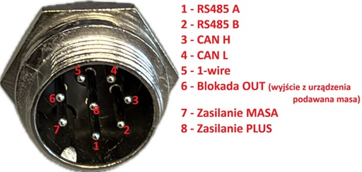
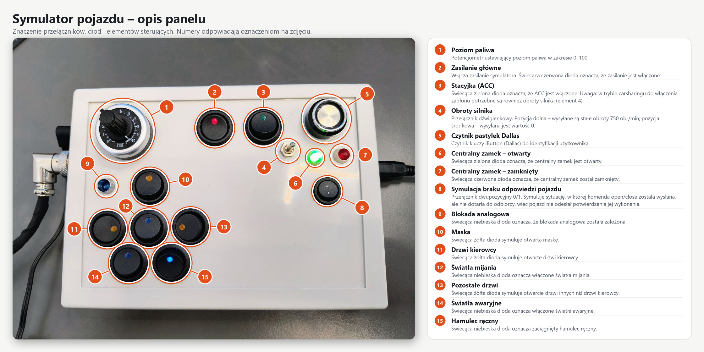

# V-BOX Firmware Project

Automotive controller firmware developed for the **STM32C542RCT6** microcontroller on the **NUCLEO-C542RC** board (ARM Cortex-M33 @ 144 MHz, TrustZone, FPU/DSP).

---

## Key Architectural Features
- **Strict Layered Architecture:** Complete separation of business application logic (`app/`), hardware abstraction port contracts in pure C (`app/port/`), hardware adapters (`app/port/stm32c5/`), and FreeRTOS middleware.
- **Dual-Target & Dual-Bus CAN Bootloader & OTA Subsystem (FDCAN1 & FDCAN2):**
  - **Bare-Metal CAN Bootloader (`v_box_boot` @ `0x08000000`, 32 KB):** Instant Fast-Boot (< 2 ms), ISO 15765-2 (ISO-TP) transport over both **FDCAN1** (`PB8` RX / `PB9` TX) and **FDCAN2** (`PB5` RX / `PB6` TX) @ 500 kbps, OpenBootloader command engine, and **Deferred Vector Table Commit** protecting against power-loss bricking.
  - **Automotive-Safe & Collision-Free Protocol:** Uses 29-bit Extended CAN IDs in the dedicated V-Box namespace (`0x01F2F3DF`, `0x01F2F3E0`, `0x01F2F3E8`, `0x01F2F3E9`) with a 4-byte `"VBOX"` magic authorization token, preventing any collision with standard 11-bit OBD-II (`0x7DF`/`0x7E0`/`0x7E8`) or vehicle ECU traffic when connected to a vehicle CAN bus on `CAN1`.
  - **Silent Anti-Brick & Crash-Loop Recovery (`SHARED_RAM` @ `0x2000FFC0`):** Hardware fault handlers (`HardFault`, `BusFault`, `MemManage`, `UsageFault`, `configASSERT`) log crash `PC`/`CFSR` to CRC32-protected non-volatile RAM. After 3 failed boots (or blank Flash), the MCU enters **Silent Recovery Mode** (`BOOT_MODE_RECOVERY` — zero unsolicited bus traffic) and responds on-demand with a `0xEE` diagnostic rescue beacon on `0x01F2F3E9` when queried by the updater.
  - **Zero-Touch OTA & Bootloader Self-Update (`v_box` @ `0x08008000`, 192 KB):** Background 96-bit factory UID discovery (`0x01F2F3DF` $\rightarrow$ `0x01F2F3E9` with anti-collision slotting) attached to both `CAN1` (`can_parser_attach_boot_ota`) and `CAN2`, automatic transition from Application to Bootloader preserving the active CAN bus index, and safe remote Bootloader upgrades via an isolated 32 KB **Flash Staging Slot (`0x08038000`)**.
- **Event-Driven CAN / CAN FD Bus (FDCAN1 & FDCAN2):** Classic CAN 2.0B and CAN FD (up to 64-byte payload, BRS data phase up to 8 Mbps) configured per parser profile (default Classic 500 kbps, 87.5% sample point), hardware M_CAN Message RAM filtering, zero-polling RX via binary semaphore, thread-safe TX queue, bus-off recovery, and modular parser profiles (`app/can_bus/can_parser/parsers/`). See [CAN / CAN FD Support](#can--can-fd-support).
- **UART → CAN Bridge:** Send any Classic / CAN FD / RTR / TLV frame on CAN1 or CAN2 with one line of text over the ST-LINK VCP (USART2), using the same syntax as Serial Commander buttons (e.g. `321##1#01 02 03`), and reconfigure the bus mode and bit rates at runtime (`CFG#1#FD_BRS#500k#2M`). See [UART → CAN Bridge](#uart--can-bridge).
- **Fault-Tolerant Bistable Relay Engine:** Edge-controlled latching relay with pre-charge pulse generation, closed-loop feedback verification (PB12), retry mechanism, power-cut recovery, and boot synchronization without audible clicking.
- **Non-Blocking Asynchronous Workers:** Decoupled relay (`relay_worker_task`) and OTA (`ota_worker_task`) execution via dedicated FreeRTOS queues to guarantee sub-microsecond CAN RX callbacks and prevent hardware FIFO overflow.
- **Parallel 16-bit Input Debouncer:** 10 ms periodic sampling, 40 ms debouncing window for 9 discrete inputs (SW0..SW8) on GPIOB and GPIOC.
- **12-bit Analog Voltage Sensing:** ADC1 sampling on PA0 linearly mapped to 0..100% vehicle voltage representation.
- **Thread-Safe Logging:** Exclusive UART2 console logging at 115200 baud via `safe_printf` (shared across FreeRTOS Application and bare-metal Bootloader).
- **Automated Dual-Target Memory Dashboard & Binary Merger:** Post-build scripts (`tools/print_memory.py` and `tools/merge_binaries.py`) generating unified production images (`v_box_full.hex` / `v_box_full.bin`) and reporting Flash/RAM usage for both targets.

---

## CAN / CAN FD Support

Both controllers (FDCAN1 and FDCAN2) support the same modes. The bit timing is calculated at runtime from the 144 MHz FDCAN clock (nominal sample point 87.5%, data 75%); only exactly reachable bit rates are accepted, an unreachable configuration is rejected and the previous one stays active.

| Mode | Nominal bit rate | Data bit rate | Payload |
| :--- | :--- | :--- | :--- |
| **Classic CAN 2.0B** | 125k, 250k, 500k, 1M | – | 0–8 B, data and remote (RTR) frames |
| **CAN FD (no BRS)** | 500k, 1M | = nominal | 0–64 B |
| **CAN FD + BRS** | 500k | 1M, 2M, 4M, 8M | 0–64 B |
| **CAN FD + BRS** | 1M | 2M, 4M, 8M | 0–64 B |

* **Mixed traffic:** Classic frames are always allowed on an FD bus (OTA / ISO-TP keep working); FD frames are refused on a Classic bus.
* **Per-frame BRS:** an FD frame can disable bit rate switching on an FD + BRS bus (`CAN_MSG_FLAG_BRS_SET` in `CAN_msg_t.flags`).
* **Transmitter Delay Compensation** is enabled automatically for BRS with a data prescaler ≤ 2 (high data rates).
* **Not reachable at 144 MHz:** e.g. 5 Mbps data phase, 83.3 kbps nominal.
* **Configuration:** per parser profile (`bus_config`, applied by `can_parser_select()`), or at runtime over UART (`CFG#…`, see below).
* **Hardware verification:** all 13 configurations above plus 3 negative tests pass with 0 protocol errors (echo of every DLC length, node TX burst, mixed Classic/FD traffic): [can_fd_test_report_can2.md](docs/can_bus/can_fd_test_report_can2.md). Test procedure: [can_fd_test_guide.md](docs/can_bus/can_fd_test_guide.md).

### UART → CAN Bridge

Open the ST-LINK VCP (e.g. `COM22`, 115200 8N1, line ending CRLF) in a terminal or in Serial Commander (transport *Serial (UART)*) and send one command per line:

```text
CFG#1#FD_BRS#500k#2M                       # CAN1: CAN FD + BRS, 500 kbps / 2 Mbps
321##1#11 22 33 44 55 66 77 88 99 AA BB    # CAN FD frame with BRS on CAN1
CAN2:187#01 00 00 00 40 7D 00 00           # Classic frame on CAN2
TLV#321#0xA5#Hello                         # ot_app_msg_tlv packed into a 64-byte FD frame
CFG?                                       # bus configuration, TEC/REC and error counters
```

The node answers with the decoded frame (`[CAN_UART] Ramka: 321 [11] [FD+BRS] 11 22 …`) or an error message identical to Serial Commander. The bridge is enabled by the CMake option `CAN_UART_BRIDGE` (default `ON`).

👉 **Full description** (syntax, commands, responses, limitations, architecture): [docs/can_bus/can_uart_bridge.md](docs/can_bus/can_uart_bridge.md)

**Input simulation:** the same UART can take over all inputs of the telemetry frame `0x01F2F3F4` (`ZRODLO#UART`, `DRZWI_KIER#1`, `OBROTY#750`, `PALIWO#42`, …; after reset the physical IO is always active): [docs/io/io_uart_simulation.md](docs/io/io_uart_simulation.md)

---

## Quick Start & Build Guide

The project supports two symmetrical, interchangeable build environments. Both produce the complete Dual-Target artifacts in `build/debug_GCC_NUCLEO-C542RC/`:
* `v_box_boot.elf` / `.bin` / `.hex` – Standalone CAN Bootloader (`0x08000000`, 32 KB partition)
* `v_box.elf` / `.bin` / `.hex` – Main FreeRTOS Application (`0x08008000`, 192 KB partition)
* `v_box_full.hex` / `v_box_full.bin` – Merged production image (`Bootloader + MainApp`) ready for one-step SWD programming

### 1. Building on Windows (Native)

#### Required VS Code Extensions:
To configure, compile, and debug this project in Visual Studio Code on Windows, install the following extensions:
* **[STM32 VS Code Extension](https://marketplace.visualstudio.com/items?itemName=stmicroelectronics.stm32-vscode-extension)** (`stmicroelectronics.stm32-vscode-extension`):  
  Official ST extension suite. Manages toolchain integration, ST-Link GDB server, target registers, and FreeRTOS task views.
* **[CMake Tools](https://marketplace.visualstudio.com/items?itemName=ms-vscode.cmake-tools)** (`ms-vscode.cmake-tools`):  
  Required to parse `CMakePresets.json`, configure the build tree, and execute CMake tasks (`[Windows] Configure`, `[Windows] Build`).
* **[clangd](https://marketplace.visualstudio.com/items?itemName=llvm-vs-code-extensions.vscode-clangd)** (`llvm-vs-code-extensions.vscode-clangd`):  
  Provides fast, accurate C/C++ code navigation and completion using `compile_commands.json` (the default `C_Cpp.intelliSenseEngine` is disabled in favor of clangd).

#### Recommended Productivity Extensions:
* **[C/C++ Include Guard](https://marketplace.visualstudio.com/items?itemName=akiramiyakoda.cppincludeguard)** (`akiramiyakoda.cppincludeguard`): Automatically generates and updates header include guards according to project conventions.
* **[koroFileHeader](https://marketplace.visualstudio.com/items?itemName=obkoro1.korofileheader)** (`obkoro1.korofileheader`): Auto-generates standardized Doxygen file header blocks (`@file`, `@brief`, `@author`, `@date`).
* **[Serial Monitor](https://marketplace.visualstudio.com/items?itemName=eclipse-cdt.serial-monitor)** (`eclipse-cdt.serial-monitor`): Integrated console to view UART2 `safe_printf` logs (115200 baud) without external tools like PuTTY.
* **[Memory Inspector](https://marketplace.visualstudio.com/items?itemName=eclipse-cdt.memory-inspector)** (`eclipse-cdt.memory-inspector`): Live inspection of RAM and peripheral registers during debug sessions.

*(Note: Opening the workspace in VS Code will automatically prompt you to install these via `.vscode/extensions.json`.)*

#### Build Commands:
* **VS Code Task:** Press `Ctrl+Shift+B` or run task **`[Windows] Build`**.
* **Clean Rebuild:** Run task **`[Windows] Rebuild`**.
* **Command Line (PowerShell/CMD):**
  ```powershell
  cmake --preset debug_GCC_NUCLEO-C542RC
  ninja -C build/debug_GCC_NUCLEO-C542RC
  ```

### 2. Building via Docker (Containerized)
The Docker container provides an identical, bit-for-bit reproducible build environment on any machine without installing local toolchains, Python packages, or CMake.

#### Step-by-Step Docker Setup & Build:

1. **Install Docker Engine on Windows:**
   * Install [Docker Desktop for Windows](https://www.docker.com/products/docker-desktop/) (ensure the WSL 2 backend is enabled during installation).
   * Verify Docker is running (whale icon in the Windows notification tray).

2. **Download Pre-built Docker Image Archive:**
   * Download the complete, pre-configured image archive `vbox-builder_stm32c542.tar` from corporate storage:  
     👉 **[v-box-tester (SharePoint Archive)](https://lincorspzoo-my.sharepoint.com/:f:/g/personal/j_lukaszewicz_lincor_pl/IgBjV5wdDW81QqDHNNTQZr4GARtXaX-XTG5QeiUvk5Fbme8?e=RkfN9G)**
   * Place the downloaded file `vbox-builder_stm32c542.tar` directly in the project root directory (`c:\WORK\5_v-box\`).

3. **Import the Image into Docker:**
   * Execute the import script in CMD or PowerShell:
     ```cmd
     .devcontainer\import_image.bat
     ```
     *(or run the VS Code task: `[Docker] Import Image from Archive`)*
   * In 15–30 seconds the image `vbox-builder:latest` will be loaded into your local Docker engine without needing any internet downloads.
   * *(Alternative: If you do not have the archive, running step 4 will automatically build the image from the local `Dockerfile`)*.

4. **Build the Project:**
   * **Using VS Code Tasks:**
     * Press `Ctrl+Shift+P` $\rightarrow$ `Run Task...` $\rightarrow$ select **`[Docker] Build`**
     * For full clean rebuild: select **`[Docker] Rebuild`**
     * To build and flash in one step: select **`[Docker] Build & Flash`**
   * **Using Command Line (PowerShell/CMD):**
     ```cmd
     .devcontainer\docker_build.bat
     ```
     *(To clean and rebuild from scratch: `.devcontainer\docker_build.bat rebuild`)*


### 3. Build Configurations (Default & Optional)

Firmware features are selected with CMake options. The default configuration is the production image; optional configurations are built in **separate build directories**, because CMake caches the options per directory (`CMakeCache.txt`) and a test option must never end up in the production build tree.

| CMake option | Default | Effect |
| :--- | :---: | :--- |
| `CAN_UART_BRIDGE` | `ON` | UART → CAN bridge: USART2 RX interrupt, `can_uart` task (2 KB stack), text frame parser ([details](docs/can_bus/can_uart_bridge.md)) |
| `CAN_FD_TEST` | `OFF` | CAN FD test firmware: `CP_FD_TEST` parser replaces `V_BOX` on CAN1, runtime switching of all CAN / CAN FD modes driven by `tools/can_fd_test.py`. **Never for production images.** |
| `CAN_FD_TEST_LOOP` | `OFF` | Only with `CAN_FD_TEST=ON`: starts CAN2 as the loop partner of the bus under test and allows testing CAN2 (`tools/can_fd_test.py --bus 2`). Requires a CAN FD capable transceiver on FDCAN2. |

| Configuration | Build directory | Options |
| :--- | :--- | :--- |
| **Production (default)** | `build/debug_GCC_NUCLEO-C542RC` | defaults (`CAN_UART_BRIDGE=ON`) |
| Production without the UART bridge | `build/no_uart_bridge` | `CAN_UART_BRIDGE=OFF` |
| CAN FD test, CAN1 | `build/can_fd_test` | `CAN_FD_TEST=ON` |
| CAN FD test, CAN1 + CAN2 | `build/can_fd_test_loop` | `CAN_FD_TEST=ON`, `CAN_FD_TEST_LOOP=ON` |

**Production (default):**
```powershell
cmake --preset debug_GCC_NUCLEO-C542RC
cmake --build build/debug_GCC_NUCLEO-C542RC
```

**Production without the UART bridge:**
```powershell
cmake --preset debug_GCC_NUCLEO-C542RC -B build/no_uart_bridge -DCAN_UART_BRIDGE=OFF
cmake --build build/no_uart_bridge
```

**CAN FD test firmware (CAN1 under test, CAN2 silent):**
```powershell
cmake --preset debug_GCC_NUCLEO-C542RC -B build/can_fd_test -DCAN_FD_TEST=ON
cmake --build build/can_fd_test
```

**CAN FD test firmware with CAN2 (loop partner, `--bus 2`):**
```powershell
cmake --preset debug_GCC_NUCLEO-C542RC -B build/can_fd_test_loop -DCAN_FD_TEST=ON -DCAN_FD_TEST_LOOP=ON
cmake --build build/can_fd_test_loop
```

**Flash any configuration** (replace the directory):
```powershell
STM32_Programmer_CLI -c port=SWD mode=UR -w build/can_fd_test_loop/v_box_full.hex -v -rst
```

* The VS Code tasks and `.devcontainer\docker_build.bat` build the **production** configuration (`build/debug_GCC_NUCLEO-C542RC`).
* To go back from a test image, flash `build/debug_GCC_NUCLEO-C542RC/v_box_full.hex` again.
* CAN FD test procedure and the test tool options: [docs/can_bus/can_fd_test_guide.md](docs/can_bus/can_fd_test_guide.md).

### 4. Flashing via ST-LINK V3 (SWD) & CAN Bus OTA (FDCAN2)

#### A. Initial Flashing via ST-LINK V3 (SWD):
* **Full System (Bootloader + Application):** Run VS Code task **`[Flash] Full Merged Image (Bootloader + App)`** (or **`[Windows] Build & Flash`** / **`[Docker] Build & Flash`**). Programs `v_box_full.hex` starting at `0x08000000`.
* **Bootloader Only (`0x08000000`):** Run task **`[Flash] Bootloader Only`**.
* **Application Only (`0x08008000`):** Run task **`[Flash] MainApp Only`**.

#### B. Graphical Interface for OTA Updates & Diagnostics (`tools/can_updater_gui.py`):
Launch the modern PyQt6/PyQt5 GUI studio via VS Code task **`[GUI] Launch CAN OTA Updater`** or from terminal:
```bash
python tools/can_updater_gui.py
```
* **Features:** Smart USB port classification (CANable 2.0 vs ST-Link VCP), real-time 29-bit Extended `0x01F2F3E9` / `0xEE` on-demand SOS alarm beacon monitor, interactive fleet KPI cards, asynchronous PC crash decoding (`addr2line`), Pre-Flight Cortex-M33 vector table inspector, repo-aware stale-build detector & one-click Docker/Ninja compiler, visual 5-stage / 6-stage progress pipeline, and dual terminal console (CAN log + UART2 serial monitor).
* 👉 **Full User Manual:** [docs/bootloader/can_updater_gui_manual.md](docs/bootloader/can_updater_gui_manual.md)

#### C. Command-Line Tools (`tools/can_updater.py` & `tools/test_ota_suite.py`):
Connect a **CANable 2.0** adapter (**candleLight WinUSB** or **SLCAN** @ 500 kbps) to either **FDCAN1** (`PB8` RX / `PB9` TX — onboard transceiver) or **FDCAN2** (`PB5` RX / `PB6` TX):
```bash
# 1. Install Python dependencies (includes candle-api, python-can-candle, gs_usb, pyserial, PyQt6)
pip install -r tools/requirements_ota.txt

# 2. Scan CAN bus for STM32 nodes (auto-detects candleLight USB, or pass --interface slcan --port COM17)
python tools/can_updater.py --scan

# 3. Flash Main Application over CAN (auto-switches App -> Bootloader -> App)
python tools/can_updater.py --file build/debug_GCC_NUCLEO-C542RC/v_box.bin

# 4. Safely update the Bootloader itself via Flash Staging Slot (0x08038000 -> 0x08000000)
python tools/can_updater.py --update-bootloader build/debug_GCC_NUCLEO-C542RC/v_box_boot.bin

# 5. Run the automated 6-stage Fault-Injection & Recovery test suite
python tools/test_ota_suite.py
```

### 5. VS Code Tasks Overview
| Task Label | Environment | Purpose |
| :--- | :---: | :--- |
| **`[GUI] Launch CAN OTA Updater`** | Host Win / Docker | Launches graphical Qt studio for CAN OTA flashing and diagnostics. |
| **`[OTA] Scan CAN Bus (CLI)`** | Host Win / Docker | Scans CAN bus for connected STM32 nodes (UID, active mode, version). |
| **`[OTA] Run Fault-Injection Test Suite`** | Host Win / Docker | Runs automated 6-stage fault-injection and recovery test suite. |
| **`[Windows] Build`** *(Default `Ctrl+Shift+B`)* | Windows | Incremental build of `v_box_boot`, `v_box`, and merged `v_box_full.hex`. |
| **`[Windows] Rebuild`** | Windows | Full clean and rebuild on host. |
| **`[Windows] Build & Flash`** | Windows | Builds on host and flashes the full merged image via ST-Link. |
| **`[Docker] Build`** | Docker | Headless container build. Copies all `.elf`/`.bin`/`.hex` to output path. |
| **`[Docker] Rebuild`** | Docker | Cleans container cache and rebuilds from scratch. |
| **`[Docker] Build & Flash`** | Docker | Builds in Docker and flashes full merged image via host ST-Link. |
| **`[Flash] Full Merged Image (Bootloader + App)`** | Host Win | Flashes `v_box_full.hex` (`0x08000000` + `0x08008000`) via SWD. |
| **`[Flash] Bootloader Only`** | Host Win | Flashes `v_box_boot.elf` (`0x08000000`) via SWD. |
| **`[Flash] MainApp Only`** | Host Win | Flashes `v_box.elf` (`0x08008000`) via SWD without erasing Bootloader. |
| **`Clean All`** | Host Win | Removes the entire `build/` directory (both Windows and Docker). |
| **`[USB] Attach ST-Link to Docker`** | Host Win | Passes ST-Link V3 to WSL/Docker via `usbipd` (with `--force`). |
| **`[USB] Detach ST-Link from Docker`** | Host Win | Unbinds ST-Link from WSL and returns it to Windows Device Manager. |
| **`[Docker] Export Image to Archive`** | Docker | Exports `vbox-builder` to `vbox-builder_stm32c542.tar` for long-term storage. |
| **`[Docker] Import Image from Archive`** | Docker | Imports image from `.tar` archive on a new PC without internet. |


---

## Hardware Interface & Front Panel Description

### 1. V-BOX Communication Connector Pinout

V-BOX uses a dedicated 8-pin circular industrial connector for automotive bus communication, diagnostic signals, output control, and main power delivery:



| Pin # | Signal Name | Type | Description |
| :---: | :--- | :---: | :--- |
| **1** | **RS485 A** | Bi-dir (Diff +) | RS-485 non-inverting communication line A |
| **2** | **RS485 B** | Bi-dir (Diff -) | RS-485 inverting communication line B |
| **3** | **CAN H** | Bi-dir (Diff +) | High-speed CAN High bus line (`FDCAN1` / `PB9`) |
| **4** | **CAN L** | Bi-dir (Diff -) | High-speed CAN Low bus line (`FDCAN1` / `PB8`) |
| **5** | **1-wire** | Bi-dir | 1-Wire Dallas / iButton communication interface |
| **6** | **Blokada OUT** | Open-Drain Output | Immobilizer / analog cut-off relay output (switched to ground / masa) |
| **7** | **Zasilanie MASA** | Power | System Ground (GND / 0 V) |
| **8** | **Zasilanie PLUS** | Power | Main Vehicle Supply Power (+12 V / +24 V DC) |

---

### 2. Vehicle Simulator Front Panel Description

The front panel controls and indicators simulate essential vehicle sensors, digital switches, ignition stages, analog levels, and lock status:



| # | Element Name | Type / Color | Firmware Mapping | Function & Operational Description |
| :-: | :--- | :---: | :---: | :--- |
| **1** | **Poziom paliwa** | Potentiometer | `PA0` (ADC1 Channel 0) | Sets the simulated fuel level in range 0–100% (transmitted in telemetry frame `0x01F2F3F4`). |
| **2** | **Zasilanie główne** | Switch + Red LED | Main Power Switch | Main power toggle for the simulator. Red illuminated LED indicates simulator power ON. |
| **3** | **Stacyjka (ACC)** | Switch + Green LED | `PB4` (SW0 / ACC) | Ignition switch (ACC). Green LED indicates ACC active. *(In carsharing mode, engine RPM #4 is also required for ignition)*. |
| **4** | **Obroty silnika** | Toggle Switch | `PB2` (SW8 / Engine RPM) | Engine RPM switch: Down = fixed 750 RPM transmitted; Center = 0 RPM (engine stopped). |
| **5** | **Czytnik pastylek Dallas**| Probe Ring | 1-Wire Reader | Dallas iButton touch reader ring for driver/user RFID identification pastille. |
| **6** | **Centralny zamek – otwarty** | Green LED | Central Lock Open | Illuminated green LED indicates that the vehicle central lock is in UNLOCKED state. |
| **7** | **Centralny zamek – zamknięty** | Red LED | `PB12` (SW4 / Lock Status) | Illuminated red LED indicates that the vehicle central lock is in LOCKED state. |
| **8** | **Symulacja braku odpowiedzi** | Toggle Switch (0/1) | Fault Simulation | Simulates no vehicle response: Lock/Unlock command is issued but not acknowledged by vehicle receiver. |
| **9** | **Blokada analogowa** | Blue LED | `PA8` (Relay State) | Illuminated blue LED indicates that the analog immobilizer / cut-off lock is ACTIVE. |
| **10**| **Maska** | Switch + Yellow LED | `PB13` (SW5 / Hood) | Engine hood status switch. Illuminated yellow LED simulates an open engine hood. |
| **11**| **Drzwi kierowcy** | Switch + Yellow LED | `PC8` (SW1 / Driver Door) | Driver door switch. Illuminated yellow LED simulates open driver door. |
| **12**| **Światła mijania** | Switch + Blue LED | `PB7` (SW3 / Headlights) | Headlamps switch. Illuminated blue LED indicates low-beam headlights ON. |
| **13**| **Pozostałe drzwi** | Switch + Yellow LED | `PC7` (SW2 / Other Doors) | Passenger & rear doors switch. Illuminated yellow LED simulates open passenger doors. |
| **14**| **Światła awaryjne** | Switch + Blue LED | `PB14` (SW6 / Hazards) | Hazard warning lights switch. Illuminated blue LED indicates hazard flasher active. |
| **15**| **Hamulec ręczny** | Switch + Blue LED | `PB15` (SW7 / Handbrake) | Parking brake switch. Illuminated blue LED indicates handbrake engaged. |

---

## Detailed Documentation Directory (`docs/`)

Comprehensive technical and developer documentation is organized in the `docs/` folder:

* 📖 **[docs/bootloader/can_updater_gui_manual.md](docs/bootloader/can_updater_gui_manual.md)**  
  **V-BOX CAN OTA Updater & Diagnostic Studio – User Manual:** Complete guide to the graphical PyQt6/PyQt5 interface, detailed breakdown of all 6 UI zones, smart USB port classification (CANable 2.0 vs ST-Link VCP), interactive KPI fleet filters, SOS recovery diagnostics & asynchronous PC address decoding, Pre-Flight Binary Guard, 5-step/6-step execution pipelines, and step-by-step operating scenarios.

* 📖 **[docs/bootloader/can_bootloader_and_ota_guide.md](docs/bootloader/can_bootloader_and_ota_guide.md)**  
  **CAN Bootloader & OTA Complete Guide & Operating Manual:** Detailed methodology, Flash/RAM memory partitioning, ISO-TP & OpenBootloader protocol specification, Deferred Vector Commit, Bootloader vs. MainApp program flow diagrams, hardware wiring for **CANable 2.0** (`FDCAN2` on `PB5`/`PB6`), CLI manual for `tools/can_updater.py` and `tools/test_ota_suite.py`, and real UART2/PC logs.

* 📖 **[docs/bootloader/can_updater_gui_implementation_plan.md](docs/bootloader/can_updater_gui_implementation_plan.md)**  
  **PyQt CAN OTA Updater GUI Implementation Plan:** Architectural specification, UI/UX layout, interactive fleet KPI cards, passive `0xEE` SOS recovery beacon alerting, smart repository/build detection, pre-flight Cortex-M33 vector table inspector, and multi-threaded `QThread` blueprint.

* 📖 **[docs/bootloader/bootloader_implementation_plan.md](docs/bootloader/bootloader_implementation_plan.md)**  
  **Bootloader Architectural Implementation Plan:** Phased engineering roadmap (Phases 1–6), design rationale, shared RAM IPC contract, and recovery beacon design.

* 📖 **[docs/build_and_development_guide.md](docs/build_and_development_guide.md)**  
  **Complete Build, Docker, Debugging, and Tooling Manual:** Step-by-step instructions for Windows and Docker builds, ST-Link V3 GDB debug profiles (`Debug Full System`, `Debug Application`, `Debug Bootloader`, `Hotplug`), Docker image archiving, memory footprint reporter, and QA tools.

* 📖 **[docs/project_documentation.md](docs/project_documentation.md)**  
  **Hardware & Software Technical Specification:** Detailed hardware peripherals (FDCAN1, FDCAN2, ADC1, USART2, GPIO, NVIC), full 64-pin Nucleo pinout table, ASCII board diagram, CAN frame definitions (`0x01F2F3F0`, `0x01F2F3F4`), bistable relay state machine, FreeRTOS task table, IPC concurrency diagram, and NVIC priority rules.

* 📖 **[docs/can_bus/can_parser_guide.md](docs/can_bus/can_parser_guide.md)**  
  **CAN Parser Profile Guide & Generator:** Architecture of the modular CAN dispatcher, zero-extern getter pattern, and instructions for the automated Python generator (`tools/create_parser.py <name>`).

* 📖 **[docs/can_bus/can_porting_guide.md](docs/can_bus/can_porting_guide.md)**  
  **Hardware Abstraction Layer (HAL) Porting Guide:** Instructions for porting the CAN subsystem and hardware adapters to other microcontroller families (e.g. STM32H5, STM32G4).

* 📖 **[docs/can_bus/can_uart_bridge.md](docs/can_bus/can_uart_bridge.md)**  
  **UART → CAN Bridge:** Sending Classic / CAN FD / RTR / TLV frames on CAN1 or CAN2 over the ST-LINK VCP in Serial Commander syntax, runtime bus configuration (`CFG`), responses and errors, limitations, and the `uart_port.h` contract.

* 📖 **[docs/io/io_uart_simulation.md](docs/io/io_uart_simulation.md)**  
  **UART Input Simulation:** Input source switch (physical IO / UART), commands for every input of the telemetry frame, engine RPM scaling (RPM / 3), responses, and the SW4 relay feedback restriction.

* 📖 **[docs/can_bus/can_fd_test_guide.md](docs/can_bus/can_fd_test_guide.md)**  
  **CAN FD Bus Test Guide:** Test firmware (`CAN_FD_TEST`), the automated test matrix of all CAN / CAN FD modes on CAN1 or CAN2 (`tools/can_fd_test.py --bus`), and interpretation of the reports.

* 📖 **[docs/changelog.md](docs/changelog.md)**  
  **Project Changelog:** Complete, date-indexed record of all architectural updates, added modules, modified APIs, and bug fixes following the *Keep a Changelog* standard.
