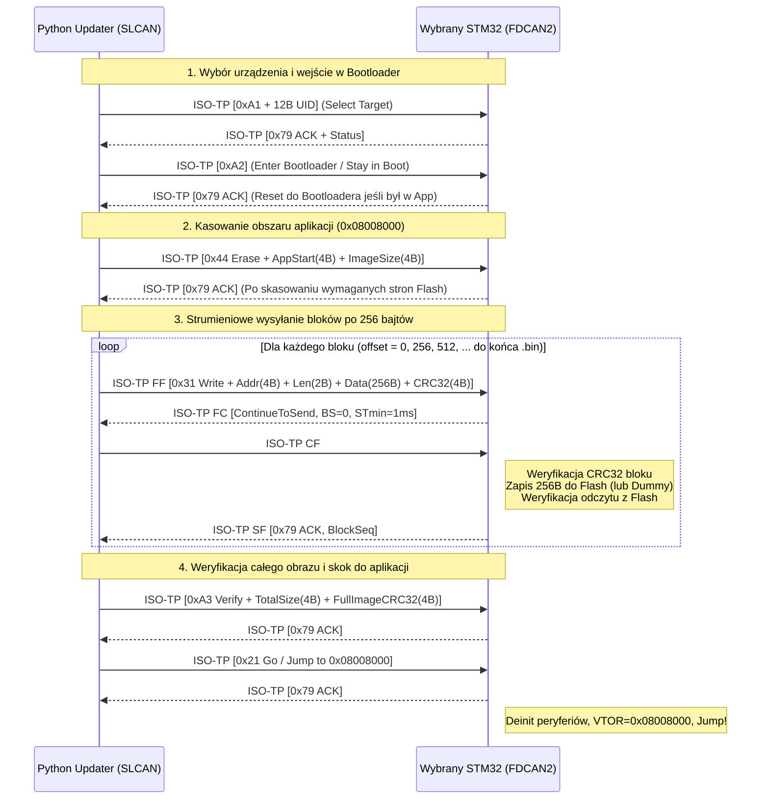
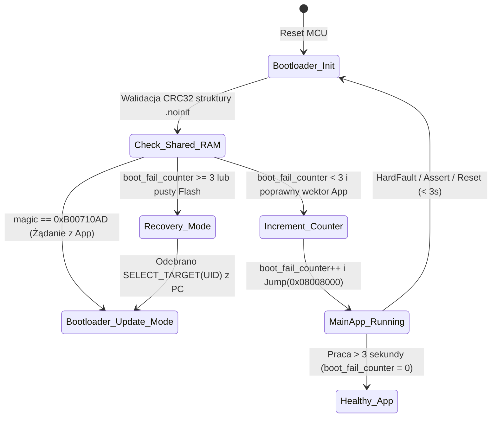

# Plan Wdrożenia Bootloadera CAN (FDCAN2 + ISO 15765-2 + OpenBootloader)

**Mikrokontroler docelowy:** STM32C542RCT6 (ARM Cortex-M33 @ 144 MHz, 256 KB Flash, 64 KB SRAM)  
**Płytka rozwojowa:** NUCLEO-C542RC  
**Magistrala aktualizacyjna:** `FDCAN2` (`PB5` = RX, `PB6` = TX) w trybie **Classic CAN 2.0 (500 kbps)**  
**Interfejs PC:** Adapter USB-CAN typu **CANable** z oprogramowaniem **SLCAN** (`python-can` + `can-isotp`)  
**Warstwa transportowa:** **ISO 15765-2 (ISO-TP)** (obsługa pakietów wieloramkowych do 4095 B z kontrolą przepływu Flow Control)  
**Architektura Bootloadera:** **STM32 OpenBootloader** (rdzeń komend + driver pamięci Flash STM32C5 + customowy adapter kanału ISO-TP/FDCAN2)

---

## Spis Treści
1. [Koncepcja Architektoniczna i Odpowiedzi na Kluczowe Zagadnienia](#1-koncepcja-architektoniczna-i-odpowiedzi-na-kluczowe-zagadnienia)
2. [Mapa Pamięci Flash i RAM (Podział Bootloader / Aplikacja)](#2-mapa-pamięci-flash-i-ram-podział-bootloader--aplikacja)
3. [Specyfikacja Protokołu Komunikacyjnego (ISO-TP + OpenBootloader + UID)](#3-specyfikacja-protokołu-komunikacyjnego-iso-tp--openbootloader--uid)
4. [STM32CubeMX2 CLI (`cube`) – Instalacja i Generowanie Kodu](#4-stm32cubemx2-cli-cube--instalacja-i-generowanie-kodu)
5. [Szczegółowa Lista Zadań Implementacyjnych (Taski w Kolejności Wdrożenia)](#5-szczegółowa-lista-zadań-implementacyjnych-taski-w-kolejności-wdrożenia)
   - [Faza 1: Implementacja i uruchomienie peryferium FDCAN2](#faza-1-implementacja-i-uruchomienie-peryferium-fdcan2)
   - [Faza 2: Warstwa transportowa ISO-TP (ISO 15765-2) i Dummy Update w Aplikacji](#faza-2-warstwa-transportowa-iso-tp-iso-15765-2-i-dummy-update-w-aplikacji)
   - [Faza 3: Aplikacja PC w Pythonie (SLCAN / CANable) do testów i aktualizacji](#faza-3-aplikacja-pc-w-pythonie-slcan--canable-do-testów-i-aktualizacji)
   - [Faza 4: Architektura Dual-Target (CMake + Linker) oraz OpenBootloader](#faza-4-architektura-dual-target-cmake--linker-oraz-openbootloader)
   - [Faza 5: Prawdziwy Firmware Update z zapisem do Flash i weryfikacją CRC32](#faza-5-prawdziwy-firmware-update-z-zapisem-do-flash-i-weryfikacją-crc32)
   - [Faza 6 (Opcjonalna): Aktualizacja samego Bootloadera po magistrali CAN](#faza-6-opcjonalna-aktualizacja-samego-bootloadera-po-magistrali-can)

---

## 1. Koncepcja Architektoniczna i Odpowiedzi na Kluczowe Zagadnienia

### 1.1. Dlaczego łączymy ISO 15765-2 (ISO-TP) z OpenBootloaderem?
Standardowy protokół FDCAN wbudowany w ST OpenBootloader (opisany w nocie *AN5405*) zakłada użycie 64-bajtowych ramek **CAN FD z BRS** i nie posiada adresowania węzłów (wszystkie układy STM32 na magistrali słuchają tych samych ID i odpowiadają jednocześnie).  
Z kolei adapter **CANable z firmwarem SLCAN** operuje na klasycznych ramkach **CAN 2.0 o długości maksymalnie 8 bajtów**.

Zastosowanie **ISO 15765-2 (ISO-TP)** jako warstwy transportowej pod komendy **OpenBootloadera** rozwiązuje wszystkie te ograniczenia:
1. **Praca po zwykłym SLCAN (8 bajtów):** ISO-TP automatycznie dzieli duże bloki firmware'u (np. paczki po `256 B` lub `512 B` wraz z nagłówkiem i CRC32) na 8-bajtowe ramki CAN (`First Frame` + seria `Consecutive Frames`).
2. **Sprzętowo-programowa kontrola przepływu (`Flow Control`):** Urządzenie STM32 po odebraniu `First Frame` wysyła ramkę `Flow Control (CTS, BlockSize, STmin)`, narzucając komputerowi PC tempo nadawania kolejnych ramek. Eliminuje to ryzyko przepełnienia buforów w adapterze SLCAN oraz w FIFO mikrokontrolera.
3. **Potwierdzenie `ACK (0x79)` / `NACK (0x1F)` co każdy blok:** Po odebraniu pełnego bloku ISO-TP, zweryfikowaniu jego `CRC32` i zapisaniu do pamięci Flash, STM32 odsyła jednoznaczne potwierdzenie `ACK`. Narzędzie w Pythonie wyświetla pasek postępu i przechodzi do kolejnego bloku dopiero po otrzymaniu `ACK`.

### 1.2. Czy budowanie w jednym repozytorium 2 targetów CMake (`Bootloader`, `MainApp`, `Both Merged`) to dobry pomysł?
**Tak – to najlepsze możliwe podejście inżynierskie (standard przemysłowy w systemach wbudowanych).**
* **Współdzielenie kodu (Zero duplikacji):** Zarówno Bootloader, jak i Aplikacja Główna korzystają z tych samych plików sterownika `stm32c5_can_adapter.c`, tej samej warstwy `isotp.c` oraz tych samych definicji protokołu i sum kontrolnych `CRC32`.
* **Trzy tryby budowania (w VS Code Tasks i CMake):**
  1. **`Build Bootloader Only` (`v_box_boot`):** Kompiluje wyłącznie lekki Bootloader (bez FreeRTOSa) pod adres `0x08000000`.
  2. **`Build MainApp Only` (`v_box`):** Kompiluje wyłącznie Aplikację Główną (z FreeRTOSem) pod adres `0x08008000` oraz generuje plik `v_box.bin` gotowy do wysłania przez skrypt w Pythonie po CAN.
  3. **`Build All & Merge` (`v_box_full_production.hex` / `.bin`):** Kompiluje oba cele i w kroku `POST_BUILD` za pomocą narzędzia **`srec_cat`** (dostępnego w naszym kontenerze Docker) lub skryptu Python skleja wsad Bootloadera (`0x08000000`) i Aplikacji (`0x08008000`) w jeden kompletny obraz produkcyjny do wgrania przez ST-Link na czystą płytkę.

### 1.3. Czy sam Bootloader może być również aktualizowany po magistrali CAN?
**Tak, jest to możliwe i wykonalne bezpiecznie!**  
Warto jednak pamiętać o fundamentalnej regule architektury ARM Cortex-M:
> Kod wykonujący się z sektora Bootloadera (`0x08000000 – 0x08007FFF`) nie może skasować samego siebie w trakcie działania, a utrata zasilania po skasowaniu adresu `0x08000000` przed zapisaniem nowego wektora resetu unieruchomi mikrokontroler (brak `Reset_Handler` przy starcie).

Dlatego aktualizację samego Bootloadera po CAN realizuje się z poziomu **działającej Aplikacji Głównej (`MainApp` pod `0x08008000`)**:
1. Gdy układ pracuje w `MainApp` (`SCB->VTOR = 0x08008000`), obszar Flash `0x08000000 – 0x08007FFF` nie jest w danej chwili wykonywany.
2. `MainApp` odbiera po CANFD2 (przez ten sam protokół ISO-TP!) nowy obraz Bootloadera (np. 16–32 KB) do bufora w RAM (mamy aż 64 KB SRAM!) lub bufora tymczasowego we Flashu.
3. Dopiero gdy cały nowy obraz Bootloadera zostanie odebrany i jego suma kontrolna **CRC32 zostanie w 100% zweryfikowana**, `MainApp` w krótkiej sekcji krytycznej kasuje sektor `0x08000000` i natychmiast zapisuje tam nowy Bootloader z pamięci RAM (zajmuje to ok. 150–300 ms).
4. Zostało to ujęte jako dedykowana **Faza 6** planu.

---

## 2. Mapa Pamięci Flash i RAM (Podział Bootloader / Aplikacja)

Mikrokontroler **STM32C542RCT6** posiada **256 KB pamięci Flash** (`0x08000000` – `0x0803FFFF`) oraz **64 KB pamięci SRAM** (`0x20000000` – `0x2000FFFF`).

```text
+-----------------------------------------------------------------------+ 0x08040000 (Koniec Flash 256 KB)
|                                                                       |
|                        PRZESTRZEŃ APLIKACJI GŁÓWNEJ                   |
|                           (v_box / MainApp)                           |
|                                                                       |
|  - Rozmiar: 224 KB (0x38000)                                          |
|  - Tablica wektorów przerwań: 0x08008000 (SCB->VTOR = 0x08008000)     |
|  - Kod FreeRTOS, CAN1, CAN2, I/O Manager, logika biznesowa            |
|                                                                       |
+-----------------------------------------------------------------------+ 0x08008000 (Start Aplikacji)
|                                                                       |
|                        PRZESTRZEŃ BOOTLOADERA                         |
|                       (v_box_boot / OpenBootloader)                   |
|                                                                       |
|  - Rozmiar: 32 KB (0x08000)                                           |
|  - Tablica wektorów przerwań: 0x08000000 (Domyślny adres po resecie)  |
|  - Bare-metal (bez RTOS): FDCAN2 + ISO-TP + OpenBootloader Flash      |
|                                                                       |
+-----------------------------------------------------------------------+ 0x08000000 (Start Flash)
```

### Współdzielony obszar RAM (`.noinit` Mailbox) do komunikacji App $\leftrightarrow$ Bootloader
Ostatnie **64 bajty pamięci SRAM2** (`0x2000FFC0` – `0x2000FFFF`) wydzielamy w obu skryptach linkera jako sekcję `NOLOAD` (`.noinit`), której zawartość **nie jest zerowana** podczas miękkiego resetu (`NVIC_SystemReset()`):
### Współdzielony obszar RAM (`.noinit` Mailbox) do komunikacji App $\leftrightarrow$ Bootloader i detekcji HardFault
Ostatnie **64 bajty pamięci SRAM2** (`0x2000FFC0` – `0x2000FFFF`) wydzielamy w obu skryptach linkera jako sekcję `NOLOAD` (`.noinit`), której zawartość **nie jest zerowana** podczas miękkiego resetu (`NVIC_SystemReset()`), resetu po `HardFault` ani resetu od Watchdoga (`IWDG`):

```c
typedef enum {
    BOOT_FAULT_NONE           = 0x00U, /**< Normal startup / no fault */
    BOOT_FAULT_HARDFAULT      = 0x01U, /**< Cortex-M33 HardFault / BusFault / UsageFault / MemManage */
    BOOT_FAULT_RTOS_ASSERT    = 0x02U, /**< FreeRTOS configASSERT or Stack Overflow */
    BOOT_FAULT_WATCHDOG_LOOP  = 0x03U, /**< Unconfirmed startup / Watchdog reset loop */
    BOOT_FAULT_CRC_MISMATCH   = 0x04U  /**< Application Flash CRC32 verification failed */
} boot_fault_reason_t;

typedef struct {
    uint32_t magic;              /**< 0xB00710AD = Stay in Bootloader, 0xCAFEBABE = Valid App Jump */
    uint32_t magic;              /**< 0xB00710AD = Stay in Boot, 0xDEADFA11 = Fault/Crash Loop */
    uint32_t session_selected;   /**< 1 = Device already selected by UID before reset */
    uint32_t uid_word0;          /**< Cached UID[0] verification */
    uint32_t reserved[12];       /**< Reserved for diagnostics / error counters */
    uint32_t crc32;              /**< CRC32 of the shared structure */
    uint32_t boot_fail_counter;  /**< Incremented by Bootloader before jump; cleared by App after 3s */
    uint32_t fault_reason;       /**< Reason of the last crash (boot_fault_reason_t) */
    uint32_t fault_pc;           /**< Stacked PC address where HardFault/Assert occurred */
    uint32_t fault_cfsr;         /**< Cortex-M33 SCB->CFSR fault status register snapshot */
    uint32_t reserved[8];        /**< Reserved for future diagnostics */
    uint32_t crc32;              /**< CRC32 of the shared structure (validates RAM integrity) */
} boot_shared_ram_t;
```
Dzięki temu, gdy Aplikacja Główna otrzyma po CAN rozkaz `ENTER_BOOTLOADER` dla swojego `UID`, zapisuje `magic = 0xB00710AD` oraz `session_selected = 1` i wywołuje `NVIC_SystemReset()`. Bootloader po starcie widzi tę flagę, nie skacze do aplikacji, lecz od razu pozostaje aktywny na magistrali CAN2 i odsyła `ACK (0x79)` do programu w Pythonie!
Dzięki tej strukturze realizujemy dwie kluczowe funkcje:
1. **Bezszwowe wejście w tryb Update z działającej aplikacji:** Gdy `MainApp` otrzyma po CAN rozkaz `ENTER_BOOTLOADER` dla swojego `UID`, zapisuje `magic = 0xB00710AD` oraz `session_selected = 1` i wywołuje `NVIC_SystemReset()`. Bootloader po starcie widzi tę flagę, nie skacze do aplikacji, lecz od razu pozostaje aktywny na magistrali CAN2 i odsyła `ACK (0x79)` do programu w Pythonie.
2. **Ochrona przed pętlą restartów po `HardFault` (Anti-Brick / Crash-Loop Protection):** Jeśli wgrana aplikacja ma błąd krytyczny i wywołuje `HardFault` + reset procesora, Bootloader wykrywa powtarzające się awarie, **przestaje skakać do uszkodzonego `MainApp`**, przechodzi w tryb `RECOVERY_MODE`, cyklicznie nadaje na CAN2 ramkę alarmową z adresem błędu `fault_pc` i czeka na nowy firmware!

---

## 3. Specyfikacja Protokołu Komunikacyjnego (ISO-TP + OpenBootloader + UID)

### 3.1. Identyfikatory CAN na magistrali FDCAN2 (Classic CAN 2.0, 500 kbps)
Aby nie kolidować z ruchem roboczym i obsłużyć zarówno rozgłaszanie (Broadcast), jak i komunikację punkt-punkt (ISO-TP), definiujemy następujące 11-bitowe identyfikatory CAN:

| Nazwa Symboliczna | CAN ID (11-bit) | Kierunek | Przeznaczenie |
| :--- | :---: | :---: | :--- |
| **`CAN_ID_OTA_BROADCAST`** | `0x7DF` | PC $\rightarrow$ Wszystkie STM32 | Komenda **Discovery** (skanowanie wszystkich urządzeń na magistrali) oraz komenda **Select Target by UID**. |
| **`CAN_ID_OTA_DISCOVERY_RESP`** | `0x7E9` | STM32 $\rightarrow$ PC | Odpowiedź pojedynczego urządzenia na Discovery (wysyłana z deterministycznym opóźnieniem antykolizyjnym wyliczonym z UID). |
| **`CAN_ID_ISOTP_REQ`** | `0x7E0` | PC $\rightarrow$ Wybrany STM32 | Kanał żądań **ISO-TP (RX dla STM32)** – przesyła komendy OpenBootloadera oraz bloki danych `.bin` (SF, FF, CF). |
| **`CAN_ID_ISOTP_RESP`** | `0x7E8` | Wybrany STM32 $\rightarrow$ PC | Kanał odpowiedzi **ISO-TP (TX dla STM32)** – przesyła ramki `Flow Control (FC)` oraz potwierdzenia `ACK (0x79)` / `NACK (0x1F)`. |

---

### 3.2. Niezawodne rozpoznawanie i wybór urządzenia wśród wielu STM32 (96-bit MCU UID)

Każdy mikrokontroler STM32C542 posiada fabrycznie wypalony, niezmienny **96-bitowy (12-bajtowy) Unique Device ID** pod adresem **`UID_BASE = 0x08FFF800`**:
* `UID_W0 = *(volatile uint32_t *)(0x08FFF800UL)` (współrzędne X/Y na waflu krzemowym)
* `UID_W1 = *(volatile uint32_t *)(0x08FFF804UL)` (numer wafla i część numeru serii)
* `UID_W2 = *(volatile uint32_t *)(0x08FFF808UL)` (pozostała część numeru serii)

#### Krok 1: Skanowanie magistrali (`CMD_DISCOVER_NODES = 0xA0`)
1. Program w Pythonie wysyła pojedynczą ramkę na `0x7DF`: `[0x02, 0xA0, 0x00, ...]`.
2. Każdy STM32 podpięty do magistrali CAN2 wylicza swój **32-bitowy skrót `UID_CRC32`** ze swoich 12 bajtów `UID`.
3. Aby uniknąć sytuacji, w której kilka układów STM32 odpowie w tej samej mikrosekundzie (lub wysyła wieloramkowe ISO-TP jednocześnie), każdy układ:
   * wylicza slot czasowy: `delay_ms = (UID_CRC32 & 0x1F) * 3 ms` (od 0 do 93 ms),
   * po upływie `delay_ms` wysyła zwięzłe ogłoszenie (2 klasyczne ramki CAN na `0x7E9` oznaczone sub-indeksem `0x01` i `0x02`):
     * **Ramka 1 (`0x7E9`):** `[0x01, UID[0..6] (7 bajtów)]`
     * **Ramka 2 (`0x7E9`):** `[0x02, UID[7..11] (5 bajtów), Mode (0=Boot, 1=App), FW_Ver_Packed]`
4. Skrypt w Pythonie zbiera odpowiedzi przez `150 ms` i wyświetla listę wszystkich wykrytych urządzeń STM32 wraz z ich pełnym 96-bitowym `UID` (np. `0038002A-3132510F-39383531`), aktualnym trybem pracy (`APP` / `BOOT`) i wersją oprogramowania.

#### Krok 2: Wybór konkretnego urządzenia (`CMD_SELECT_TARGET = 0xA1`)
1. Skrypt w Pythonie wysyła przez ISO-TP (`0x7E0`) pakiet `CMD_SELECT_TARGET` zawierający pełne **12 bajtów `UID`** wybranego mikrokontrolera:
   `[0xA1, UID_Byte0, UID_Byte1, ..., UID_Byte11]` (13 bajtów $\rightarrow$ First Frame + 1 Consecutive Frame).
2. Wszystkie układy STM32 odbierają ten pakiet:
   * Układ, którego `memcmp(my_uid, payload_uid, 12) == 0`:
     * ustawia stan `s_ota_target_selected = true`,
     * odsyła na `0x7E8` potwierdzenie: `[0x79 (ACK), Mode, FW_Major, FW_Minor, FW_Patch]`.
   * Wszystkie pozostałe układy STM32 (`memcmp != 0`):
     * ustawiają `s_ota_target_selected = false`,
     * milczą (nie wysyłają nawet `Flow Control` na `0x7E8`, dopóki nie nadejdzie kolejny `CMD_SELECT_TARGET` lub `CMD_DISCOVER_NODES`).

---

### 3.3. Jak przesyłamy paczkę FW Update po CAN (Struktura pakietów ISO-TP)

Gdy urządzenie jest już wybrane (`SELECTED`), przesył pliku binarnego `v_box.bin` odbywa się w **4 krokach**:



#### Struktura pakietu `CMD_WRITE_MEMORY (0x31)` wewnątrz ISO-TP:
Każdy blok danych (domyślnie `256 bajtów` ładunku binarnego, co idealnie pokrywa się z wielokrotnością słowa programowania Flash STM32C5 = 16 bajtów / Quad-Word) ma rozmiar **267 bajtów**:

| Offset | Rozmiar | Pole | Opis |
| :---: | :---: | :--- | :--- |
| `0` | 1 B | `cmd` | `0x31` (`OPENBL_WRITE_MEMORY_CMD`) |
| `1..4` | 4 B | `address` | Adres docelowy we Flash (Little-Endian, np. `0x08008000 + offset`) |
| `5..6` | 2 B | `length` | Długość danych w bloku (`1..512`, standardowo `256`) |
| `7..7+N-1` | `N` B | `data[N]` | Surowe bajty z pliku `.bin` (uzupełnione `0xFF` do wielokrotności 16 B) |
| `7+N..10+N` | 4 B | `crc32` | Suma kontrolna `CRC32 (IEEE 802.3)` wyliczona z pól `address + length + data[N]` |

* **Kody odpowiedzi STM32:**
  * `0x79` (`ACK`): Blok poprawny, CRC32 zgodne, zapis do Flash zakończony sukcesem.
  * `0x1F` (`NACK`) + `err_code`:
    * `0x01`: Błąd sumy kontrolnej `CRC32` (Python automatycznie ponawia wysłanie tego samego bloku do 3 razy!).
    * `0x02`: Adres poza dozwolonym zakresem aplikacji (`< 0x08008000` lub `>= 0x08040000`).
    * `0x03`: Błąd sprzętowy programowania/weryfikacji Flash (`HAL_FLASH_ProgramByAddr`).
    * `0x04`: Timeout / przerwanie sekwencji ramek ISO-TP (`Consecutive Frame` sequence error).

---

### 3.4. Mechanizm Anti-Brick: Wykrywanie `HardFault` / Pętli Resetów i Powiadamianie na CAN (Recovery Mode)

Co się stanie, jeśli wgrana aplikacja `MainApp` posiada błąd programistyczny (np. dereferencja `NULL`, przepełnienie stosu, dzielenie przez zero, błędny priorytet przerwania FreeRTOS `configASSERT`) i wywołuje **`HardFault`** oraz reset procesora?

#### 1. Przechwycenie wyjątku `HardFault` w `MainApp` (zamiast zawieszenia w `while(1)`)
Domyślny plik startowy [`startup_stm32c542xx.c`](file:///c:/WORK/5_v-box/stm32c5xx_dfp/Source/startup_stm32c542xx.c#L276-L279) definiuje słabą funkcję `__WEAK void HardFault_Handler(void) { while(1); }`. W naszym module `app/ota_update/fault_recovery.c` nadpisujemy `HardFault_Handler()` (oraz `MemManage_Handler`, `BusFault_Handler`, `UsageFault_Handler` i `configASSERT`):
1. Handler odczytuje ze stosu wyjątku adres instrukcji, która wywołała błąd (`stacked_pc`) oraz rejestr statusu błędu rdzenia Cortex-M33 (`SCB->CFSR`).
2. Zapisuje do sekcji `.noinit` (`boot_shared_ram_t` pod `0x2000FFC0`):
   * `fault_reason = BOOT_FAULT_HARDFAULT` (`0x01`) lub `BOOT_FAULT_RTOS_ASSERT` (`0x02`),
   * `fault_pc = stacked_pc`,
   * `fault_cfsr = SCB->CFSR`,
   * przelicza `crc32` struktury `boot_shared_ram_t`.
3. Natychmiast wykonuje programowy reset mikrokontrolera: `NVIC_SystemReset()`.

#### 2. Licznik Nieudanych Startów (`boot_fail_counter` – ochrona przed Boot-Loopem)
Nawet jeśli reset nastąpił z pominięciem `HardFault_Handler` (np. przez sprzętowy Watchdog `IWDG` lub nagły skok w nieznany obszar pamięci), Bootloader wykryje to dzięki mechanizmowi **Boot Counter**:
1. **Przed każdym skokiem do `MainApp` (`0x08008000`):** Bootloader zwiększa w `SHARED_RAM` licznik `shared.boot_fail_counter++` i przelicza `shared.crc32`.
2. **Potwierdzenie stabilnego startu przez `MainApp`:** Gdy `MainApp` uruchomi scheduler FreeRTOS i przepracuje stabilnie przez **3000 ms (3 sekundy)**, zadanie `ota_worker_task` zeruje licznik: `shared.boot_fail_counter = 0` i aktualizuje `shared.crc32`.
3. **Wykrycie pętli awarii (`boot_fail_counter >= 3`):**
   * Jeśli `MainApp` wpada w `HardFault` i resetuje procesor przed upływem 3 sekund, po **3 kolejnych nieudanych próbach** (co przy natychmiastowym `HardFault` trwa łącznie `< 50 ms`!), Bootloader po resecie widzi `boot_fail_counter >= 3`.
   * **Bootloader blokuje dalsze skoki do uszkodzonej aplikacji**, przechodzi w stan **`BOOT_MODE_RECOVERY`** i **zostaje na stałe w trybie oczekiwania na nowy firmware po CAN2!**



#### 3. Powiadamianie na magistrali CAN o awarii (`CAN Crash / Recovery Beacon`)
Gdy Bootloader zatrzyma się w trybie **`BOOT_MODE_RECOVERY`** (z powodu 3x `HardFault` lub uszkodzonego obrazu aplikacji):
1. **Autonomiczny cykliczny komunikat alarmowy (co 1 sekundę na `CAN_ID_OTA_DISCOVERY_RESP = 0x7E9`):**
   Bootloader samoczynnie nadaje na magistralę `FDCAN2` 8-bajtową ramkę diagnostyczną `CRASH_RECOVERY_BEACON`:
   * `Byte 0`: `0xEE` (identyfikator alarmu `OTA_EVENT_CRASH_RECOVERY`)
   * `Byte 1`: `fault_reason` (`0x01 = HardFault`, `0x02 = FreeRTOS Assert/Stack`, `0x03 = BootLoop/WWDG`, `0x04 = Flash Empty/CRC Error`)
   * `Byte 2`: `boot_fail_counter` (liczba zliczeń błędu, np. `3`)
   * `Byte 3`: `UID_Hash8` (8-bitowy skrót CRC8 z 96-bitowego UID układu)
   * `Byte 4..7`: `fault_pc` (32-bitowy adres instrukcji `PC` w `MainApp`, pod którym wystąpił `HardFault` – w formacie Little-Endian!)
2. **Raportowanie w `python tools/can_updater.py --scan`:**
   Podczas skanowania magistrali (`CMD_DISCOVER_NODES = 0xA0`), układ w trybie awaryjnym zwraca specjalny status `Mode = 0x02 (RECOVERY_HARDFAULT)`, dzięki czemu skrypt PC wyświetla wyraźne ostrzeżenie diagnostyczne:
   ```text
   Found 2 device(s):
     [1] UID: 0038002A-3132510F-39383531 | Mode: RECOVERY (HardFault x3 @ PC=0x080094A2) | Waiting for FW!
     [2] UID: 0041001B-3132510F-39383539 | Mode: APP                                     | FW: v1.0.0
   ```
3. **Sygnalizacja wizualna LED:** Dioda `LD1` na płytce mruga szybkim wzorcem alarmowym, sygnalizując operatorowi, że układ bezpiecznie czeka w Bootloaderze na wgranie poprawionej wersji.

---

## 4. STM32CubeMX2 CLI (`cube`) – Instalacja i Generowanie Kodu

Projekt `v_box` został utworzony w nowej architekturze **STM32CubeMX2 / CMSIS-Toolbox (`csolution`)**, o czym świadczą wpisy w `cmake/components.cmake` (`STM32CubeMX2 Codegen`, `STM32CubeMX2 Config`) oraz `.vscode/settings.json` (`"cmake.cmakePath": "cube-cmake"`, `"stm32cube-ide-clangd.path": "cube"`).

### 4.1. Co należy mieć zainstalowane, aby działało narzędzie `cube` CLI?
1. **Pakiet STM32CubeCLT** (Command Line Toolset) zainstalowany w systemie Windows.
2. **Rozszerzenie VS Code:** `stmicroelectronics.stm32-vscode-extension` wraz z modułem `bundles-manager`.
3. **Ścieżka do `cube.exe`:** Rozszerzenie ST instaluje narzędzie `cube.exe` (oraz `cube-cmake.exe`) w katalogu użytkownika:
   * `%LOCALAPPDATA%\STMicroelectronics\stm32cube-cli\bin\cube.exe` lub w bundlach STM32Cube.
   * Aby narzędzie `cube` działało z każdego terminala (oraz dla agenta AI), wystarczy dodać powyższy katalog `bin` do systemowej zmiennej środowiskowej `PATH` użytkownika w Windows.
4. **Sprawdzenie działania w terminalu PowerShell:**
   ```powershell
   cube --version
   cube --help
   ```

### 4.2. Jak wykorzystamy OpenBootloader na STM32C542?
W rodzinie **STM32C5xx** zastosowano zupełnie nową generację sterowników **HAL v2.1.0** (`hal_fdcan_handle_t`, `hal_flash_handle_t` zamiast starych `FDCAN_HandleTypeDef`).  
Aby zachować 100% zgodności z `stm32c5xx_drivers` oraz naszym transportem `ISO-TP`, moduł Bootloadera zrealizujemy zgodnie z architekturą **ST OpenBootloader** podzieloną na 3 czyste pliki w `app/bootloader/`:
1. **`openbl_core.c / .h`** – maszyna stanów i dyspozytor komend (`Get`, `GetVersion`, `GetID`, `EraseMemory`, `WriteMemory`, `Go` + rozszerzenia `Discover`, `SelectTarget`, `Verify`).
2. **`openbl_flash_c5.c / .h`** – warstwa dostępu do pamięci Flash dla układu STM32C542 wykorzystująca oficjalne API `HAL_FLASH_Init`, `HAL_FLASH_EraseByAddr` oraz `HAL_FLASH_ProgramByAddr` (`HAL_FLASH_PROGRAM_QUADWORD`) z pliku `stm32c5xx_hal_flash.c`.
3. **`openbl_isotp_ch.c / .h`** – kanał komunikacyjny łączący pakiet z `app/can_bus/isotp/` z jądrem `openbl_core`.

---

## 5. Szczegółowa Lista Zadań Implementacyjnych (Taski w Kolejności Wdrożenia)

Poniżej znajduje się kompletny podział wdrożenia na **5 głównych faz** (oraz opcjonalną Fazę 6). Każdy task jest atomowy, kompilowalny i kończy się łatwym do zweryfikowania kryterium akceptacji.

---

### Faza 1: Implementacja i uruchomienie peryferium FDCAN2

> **Cel Fazy 1:** Uruchomienie drugiej magistrali CAN (`FDCAN2` na pinach `PB5` RX i `PB6` TX) z prędkością **500 kbps (Classic CAN 2.0)** i potwierdzenie dwukierunkowej komunikacji z adapterem CANable (SLCAN).

#### [Task 1.1] [ZREALIZOWANO] Konfiguracja niskopoziomowa `FDCAN2` w warstwie `generated/hal/`
* **Status:** Zrealizowane i przetestowane kompilacyjnie.
* **Pliki do utworzenia / modyfikacji:**
  * `generated/hal/mx_fdcan2.h` oraz `generated/hal/mx_fdcan2.c` (wzorowane 1:1 na `mx_fdcan1.c` / `.h`).
  * `generated/hal/mx_hal_def.h` – dodanie `#include "mx_fdcan2.h"`.
  * `generated/hal/mx_system.c` – dodanie wywołania `if (mx_fdcan2_init() == NULL) return SYSTEM_PERIPHERAL_ERROR;`.
  * `generated/hal/STM32_HAL_Driver_codegen.cmake` – dopisanie `mx_fdcan2.c` do źródeł biblioteki HAL codegen.
* **Szczegóły implementacyjne (`mx_fdcan2.c`):**
  * Inicjalizacja instancji `HAL_FDCAN2`: `HAL_FDCAN_Init(&hFDCAN2, HAL_FDCAN2)`.
  * Taktowanie z PCLK1 (144 MHz): `Prescaler = 1`, `TimeSeg1 = 251`, `TimeSeg2 = 36`, `SJW = 36` (500 kbps, punkt próbkowania 87.5%).
  * Konfiguracja GPIO (Port B):
    * `PB5_PIN` (`FDCAN2_RX`, CN10 pin 6 / D4) oraz `PB6_PIN` (`FDCAN2_TX`, CN10 pin 3 / D10),
    * Tryb: `HAL_GPIO_MODE_ALTERNATE`, `HAL_GPIO_OUTPUT_PUSHPULL`, `HAL_GPIO_PULL_NO`, `HAL_GPIO_SPEED_FREQ_VERY_HIGH`, `HAL_GPIO_AF_9`.
  * Konfiguracja przerwań (zgodnie z Regułą 8 dla FreeRTOS):
    * `HAL_CORTEX_NVIC_SetPriority(FDCAN2_IT0_IRQn, HAL_CORTEX_NVIC_PREEMP_PRIORITY_5, HAL_CORTEX_NVIC_SUB_PRIORITY_0);`
    * `HAL_CORTEX_NVIC_EnableIRQ(FDCAN2_IT0_IRQn);`
    * Implementacja procedury `void FDCAN2_IT0_IRQHandler(void)` wywołującej `HAL_FDCAN_Line0_IRQHandler(&hFDCAN2);`.
  * *Uwaga sprzętowa:* Sterownik `stm32c5xx_hal_fdcan.c` automatycznie przydziela dla `FDCAN2` osobny blok w pamięci `SRAMCAN_BASE + FDCAN_RAM_SIZE`, dzięki czemu filtry i kolejki FIFO `FDCAN1` oraz `FDCAN2` są od siebie całkowicie odseparowane.

#### [Task 1.2] [ZREALIZOWANO] Rozszerzenie adaptera portowego `stm32c5_can_adapter` o obsługę `CAN2`
* **Status:** Zrealizowane i przetestowane kompilacyjnie.
* **Pliki do modyfikacji:**
  * `app/port/stm32c5/stm32c5_can_adapter.h`
  * `app/port/stm32c5/stm32c5_can_adapter.c`
* **Szczegóły implementacyjne:**
  * Zgodnie z Regułą 6 (Wzorzec gettera, zakaz `extern`), w `stm32c5_can_adapter.h` wystawiamy funkcję:
    ```c
    const can_interface_t *stm32c5_can2_interfaceGet(void);
    ```
  * W `stm32c5_can_adapter.c` refaktoryzujemy funkcje pomocnicze tak, aby przyjmowały wskaźnik `hal_fdcan_handle_t *hfdcan` oraz strukturę kontekstu instancji (lub tworzymy cienkie wrappery `stm32c5_can2_init`, `stm32c5_can2_transmit`, `stm32c5_can2_receive`, `stm32c5_can2_attach_rx_callback`, `stm32c5_can2_set_filter`).
  * Rozszerzamy wspólny callback przerwania `HAL_FDCAN_RxFifo0Callback`:
    ```c
    void HAL_FDCAN_RxFifo0Callback(hal_fdcan_handle_t *hfdcan, uint32_t rx_fifo0_interrupts)
    {
        if ((rx_fifo0_interrupts & (FDCAN_IR_RF0N | FDCAN_IR_RF0F)) == 0U)
        {
            return;
        }
        if (hfdcan == mx_fdcan1_gethandle() && s_can1_rx_cb != NULL)
        {
            s_can1_rx_cb(s_can1_rx_context);
        }
        else if (hfdcan == mx_fdcan2_gethandle() && s_can2_rx_cb != NULL)
        {
            s_can2_rx_cb(s_can2_rx_context);
        }
    }
    ```

#### [Task 1.3] [ZREALIZOWANO] Inicjalizacja `can2_inst` w `main.c` i profil parsera `cp_boot_ota`
* **Status:** Zrealizowane i przetestowane kompilacyjnie.
* **Pliki do utworzenia / modyfikacji:**
  * Wygenerowanie szkieletu parsera: `python tools/create_parser.py boot_ota` (utworzy `cp_boot_ota.h` i `cp_boot_ota.c` oraz zarejestruje `CAN_PARSER_ID_BOOT_OTA` w `can_parser.h`/`.c` i `CMakeLists.txt`).
  * `main.c` – alokacja `can_instance_t can2_inst;`, konfiguracja `CAN_MSG_FRAME_FORMAT_CAN` + `CAN_BAUDRATE_500K`, wywołanie `can_manager_init(&can2_inst, stm32c5_can2_interfaceGet(), "CAN2")` oraz `can_parser_select(&can2_inst, CAN_PARSER_ID_BOOT_OTA)`.
  * `FreeRTOSConfig.h` – weryfikacja `configTOTAL_HEAP_SIZE` (dodatkowe 2 taski `CAN2_TX` i `CAN2_RX` oraz kolejka i semafor zajmą ok. 2.5 KB sterty FreeRTOS; zwiększono pulę sterty do 24 KB).
* **Kryterium akceptacji Fazy 1:** Po wysłaniu testowej ramki `0x7DF` lub `0x7E0` z komputera PC przez CANable, `FDCAN2` odbiera ramkę i wypisuje log przez `safe_printf` na UART2.

---

### Faza 2: Warstwa transportowa ISO-TP (ISO 15765-2) i Dummy Update w Aplikacji

> **Cel Fazy 2:** Stworzenie warstwy transportowej **ISO 15765-2 (ISO-TP)** oraz maszyny stanów **Dummy Update** w aplikacji głównej, pozwalającej przetestować pełny przesył pliku `.bin` po CAN2 (wraz z Discovery po UID, Flow Control i weryfikacją CRC32) bez dotykania pamięci Flash.

#### [Task 2.1] [ZREALIZOWANO] Implementacja modułu protokołu transportowego `app/can_bus/isotp/`
* **Status:** Zrealizowane i przetestowane kompilacyjnie.
* **Pliki do utworzenia:**
  * `app/can_bus/isotp/isotp.h`
  * `app/can_bus/isotp/isotp.c`
* **Szczegóły implementacyjne:**
  * Czysty, przenośny kod C (może być wywoływany zarówno w zadaniu FreeRTOS w Aplikacji, jak i w pętli bare-metal w Bootloaderze!).
  * Wstrzykiwanie funkcji wysyłającej pojedynczą ramkę CAN 8B (`isotp_can_tx_fn`).
  * Obsługa odbioru wieloramkowego (RX):
    * Rozpoznawanie `Single Frame (0x0L)` $\rightarrow$ natychmiastowe wywołanie callbacku `rx_cb(payload, len)`.
    * Rozpoznawanie `First Frame (0x1LLL)` $\rightarrow$ zapisanie oczekiwanej długości (do `ISOTP_MAX_BUF_SIZE = 540` bajtów), skopiowanie pierwszych 6 bajtów i natychmiastowe odesłanie ramki **`Flow Control (0x30, BS=0, STmin=1ms)`** na ID `0x7E8`.
    * Rozpoznawanie `Consecutive Frame (0x2N)` $\rightarrow$ weryfikacja ciągłości numeru sekwencyjnego `SN = (prev_sn + 1) & 0x0F`, kopiowanie kolejnych 7 bajtów, aż do skompletowania całego pakietu i wywołania `rx_cb()`.
  * Obsługa nadawania (TX):
    * Dla odpowiedzi $\le 7$ bajtów (np. `[0x79, BlockSeq]`) wysyła pojedynczą ramkę `Single Frame`.
    * Dla dłuższych odpowiedzi dzieli dane na `FF` + `CF` po otrzymaniu `FC`.

#### [Task 2.2] [ZREALIZOWANO] Implementacja modułu `app/ota_update/` (UID Discovery + Dummy Update Worker)
* **Status:** Zrealizowane i przetestowane kompilacyjnie.
* **Pliki do utworzenia:**
  * `app/ota_update/ota_protocol.h` (wspólne stałe protokołu: kody komend `0xA0`, `0xA1`, `0xA2`, `0x44`, `0x31`, `0xA3`, `0x21`, `ACK=0x79`, `NACK=0x1F`, struktury ramek).
  * `app/ota_update/crc32.h` i `app/ota_update/crc32.c` (szybka implementacja `CRC32 IEEE 802.3` – identyczna ze standardowym `zlib.crc32` w Pythonie).
  * `app/ota_update/ota_manager.h` i `app/ota_update/ota_manager.c`.
* **Szczegóły implementacyjne (zgodnie z Regułą 14 – Zakaz blokowania `can_rx_task`):**
  * Callbacki w `cp_boot_ota.c` (dla ID `0x7DF` oraz `0x7E0`) wykonują się w `< 1 µs` – wrzucają odebraną ramkę CAN `CAN_msg_t` do kolejki FreeRTOS `s_ota_rx_queue` za pomocą `xQueueSend(..., 0)`.
  * Dedykowane zadanie `ota_worker_task` (priorytet `TASK_PRIO_OTA_WORKER`, stos 512 słów) odbiera ramki z kolejki i zasila maszynę stanów `isotp_on_can_frame()` oraz obsługuje komendy:
    1. **`CMD_DISCOVER_NODES (0xA0)`:** Odczytuje 96-bitowy `UID` z `0x08FFF800`, wylicza `delay = (crc32(uid, 12) & 0x1F) * 3`, wykonuje `vTaskDelay(pdMS_TO_TICKS(delay))` (w wątku workera, nigdy w `can_rx_task`!) i wysyła 2 ramki identyfikacyjne na `0x7E9`.
    2. **`CMD_SELECT_TARGET (0xA1)`:** Porównuje 12 bajtów `UID` z własnym `UID_BASE`. Jeśli zgodne – aktywuje sesję i odsyła `0x79 (ACK)`.
    3. **`CMD_ERASE_APP (0x44)` (Tryb Dummy):** Weryfikuje zakres adresów, resetuje licznik odebranych bajtów i bufor akumulacyjny CRC32, loguje `[OTA DUMMY] Erase simulated for size=...` i odsyła `0x79 (ACK)`.
    4. **`CMD_WRITE_MEMORY (0x31)` (Tryb Dummy):**
       * Sprawdza, czy urządzenie jest w stanie `SELECTED`.
       * Weryfikuje `CRC32` odebranego 256-bajtowego bloku.
       * Sprawdza ciągłość adresów (`0x08008000 + offset`).
       * Aktualizuje globalne `CRC32` strumienia i odsyła `[0x79 (ACK), block_seq]`.
    5. **`CMD_VERIFY_FIRMWARE (0xA3)` (Tryb Dummy):** Porównuje wyliczone `CRC32` całego odebranego strumienia z `CRC32` przysłanym przez PC. Jeśli się zgadza – wypisuje na UART podsumowanie sukcesu i odsyła `0x79 (ACK)`.
* **Rejestracja w `CMakeLists.txt`:** Dodano `isotp.c`, `crc32.c`, `ota_manager.c` oraz ścieżki `app/can_bus/isotp` i `app/ota_update`.

---

### Faza 3: Aplikacja PC w Pythonie (SLCAN / CANable) do testów i aktualizacji

> **Cel Fazy 3:** Napisanie wygodnego narzędzia CLI w Pythonie wykorzystującego adapter **CANable (SLCAN)** do skanowania urządzeń po `UID`, przeprowadzenia testu **Dummy Update** oraz docelowej aktualizacji firmware'u z paskiem postępu na żywo.

#### [Task 3.1] [ZREALIZOWANO] Stworzenie narzędzia `tools/can_updater.py`
* **Status:** Zrealizowane i przetestowane.
* **Pliki do utworzenia:**
  * `tools/can_updater.py` (CLI w Pythonie z maszyną stanów ISO-TP, obsługą SLCAN/SocketCAN, skanowaniem UID i paskiem postępu).
  * `tools/requirements_ota.txt` (`python-can>=4.0.0`, `pyserial>=3.5`).
* **Funkcjonalności skryptu `tools/can_updater.py`:**
  * Obsługa interfejsu `slcan` (`can.interface.Bus(interface='slcan', channel='COMx', bitrate=500000)`) oraz `socketcan` (pod Linuxem/Dockerem).
  * Wbudowana maszyna stanów **ISO-TP TX/RX** (obsługa wysyłania `FF` $\rightarrow$ oczekiwania na `FC` z `0x7E8` $\rightarrow$ wysyłania `CF` z poszanowaniem `STmin` i `BS`), dzięki czemu skrypt działa na Windowsie i Linuksie bez konieczności instalowania sterowników jądra ISO-TP!
  * **Tryby wywołania z linii komend:**
    1. **Skanowanie wszystkich STM32 na magistrali:**
       ```bash
       python tools/can_updater.py --port COM5 --scan
       ```
       *Wyjście:*
       ```text
       Scanning CAN bus (500 kbps) for STM32 devices...
       Found 1 device(s):
         [1] UID: 0038002A-3132510F-39383531 | Mode: APPLICATION  | FW: v1.0
       ```
    2. **Test przesyłu (Dummy Update – wygenerowanym buforem 32 KB lub zadanym rozmiarem):**
       ```bash
       python tools/can_updater.py --port COM5 --uid 0038002A-3132510F-39383531 --dummy --size 32768
       ```
    3. **Prawdziwa aktualizacja z plikiem binarnym jako argument:**
       ```bash
       python tools/can_updater.py --port COM5 --uid 0038002A-3132510F-39383531 --file build/debug_GCC_NUCLEO-C542RC/v_box.bin
       ```
  * **Interfejs wizualny w konsoli (Live Progress):**
    * Wyświetlanie każdego etapu: `Target Select (ACK)` $\rightarrow$ `Erase (ACK)` $\rightarrow$ `Flashing Blocks [%%%%%]` $\rightarrow$ `Full CRC32 Verify (ACK)` $\rightarrow$ `Jump to App (ACK)`.
    * Automatyczna retransmisja bloku (do 3 prób), jeśli STM32 odeśle `NACK` lub wystąpi timeout potwierdzenia `ACK`.

#### [Task 3.2] Weryfikacja Dummy Update na żywym sprzęcie
* **Kryterium akceptacji Fazy 3:** Przesłanie 32 KB danych testowych z programu `tools/can_updater.py` przez CANable (SLCAN) do płytki NUCLEO-C542RC na `FDCAN2` ze 100% potwierdzeniami `ACK` i zgodnością pełnego `CRC32`.

---

### Faza 4: Architektura Dual-Target (CMake + Linker) oraz OpenBootloader

> **Cel Fazy 4:** Podział pamięci Flash na Bootloader (`0x08000000`, 32 KB) oraz Aplikację (`0x08008000`, 224 KB), konfiguracja 3 trybów budowania w CMake (`Bootloader`, `MainApp`, `Merged`) i implementacja właściwego Bootloadera.

#### [Task 4.1] [ZREALIZOWANO] Aktywacja sterownika HAL FLASH dla STM32C542
* **Status:** Zrealizowane i przetestowane kompilacyjnie.
* **Pliki zmodyfikowane:**
  * `generated/hal/stm32c5xx_hal_conf.h`:
    ```c
    #define USE_HAL_FLASH_PROGRAM_BY_ADDR           1U
    #define USE_HAL_FLASH_ERASE_BY_ADDR             1U
    #define USE_HAL_FLASH_ERASE_PAGE                1U
    #define USE_HAL_FLASH_GET_LAST_ERRORS           1U
    ```
  * `CMakeLists.txt`: Dodano plik `stm32c5xx_drivers/hal/stm32c5xx_hal_flash.c` do kompilacji obu targetów.

#### [Task 4.2] [ZREALIZOWANO] Utworzenie dedykowanych skryptów linkera (`.ld`) oraz relokacja `VTOR`
* **Status:** Zrealizowane.
* **Pliki utworzone / zmodyfikowane:**
  * `linker/stm32c542xc_boot_flash.ld` (dla Bootloadera):
    * `ROM (rx) : org = 0x08000000, len = 0x08000` (32 KB)
    * `RAM (xrw) : org = 0x20000000, len = 0x0FFC0`
    * `SHARED_RAM (rw) : org = 0x2000FFC0, len = 0x40` (sekcja `.noinit.boot_shared`)
  * `linker/stm32c542xc_app_flash.ld` (dla Aplikacji Głównej):
    * `ROM (rx) : org = 0x08008000, len = 0x38000` (224 KB)
    * `RAM (xrw) : org = 0x20000000, len = 0x0FFC0`
    * `SHARED_RAM (rw) : org = 0x2000FFC0, len = 0x40` (sekcja `.noinit.boot_shared`)
  * Relokacja tablicy wektorów przerwań `SCB->VTOR`:
    * W `stm32c5xx_dfp/Source/Templates/system_stm32c5xx.c` funkcja `SystemInit()` wykonuje `SCB_SetVTOR((uint32_t)(&__VECTOR_TABLE[0]));`. Ponieważ `__VECTOR_TABLE` jest umieszczona w sekcji `.vectors` na początku regionu `ROM`, dla Bootloadera `VTOR` automatycznie ustawia się na `0x08000000`, a dla Aplikacji Głównej na `0x08008000`.

#### [Task 4.3] [ZREALIZOWANO] Konfiguracja `CMakeLists.txt` pod 2 targety (`v_box_boot` oraz `v_box`) i łączenie wsadów
* **Status:** Zrealizowane i przetestowane.
* **Pliki zmodyfikowane / utworzone:**
  * `CMakeLists.txt` (konfiguracja targetów `v_box` oraz `v_box_boot` z optymalizacją `-Os` dla bootloadera).
  * `stm32c5xx_dfp/CMakeLists.txt` (wsparcie właściwości docelowej `CUSTOM_LINKER_SCRIPT`).
  * `tools/print_memory.py` (obsługa raportowania rozmiaru dla `v_box_boot.elf` [limit 32 KB] oraz `v_box.elf` [limit 224 KB]).
  * `tools/merge_binaries.py` (skrypt pomocniczy łączący `v_box_boot.bin` @ `0x08000000` + `v_box.bin` @ `0x08008000` w jeden plik `v_box_full.bin` oraz `v_box_full.hex`).
  * `.vscode/tasks.json` – zadania programowania i budowania:
    * `[Flash] Full Merged Image (Bootloader + App)`
    * `[Flash] Bootloader Only`
    * `[Flash] MainApp Only`
  * `.devcontainer/docker_build.bat` – eksport wszystkich artefaktów (.elf, .bin, .hex) do `build/debug_GCC_NUCLEO-C542RC/`.

#### [Task 4.4] [ZREALIZOWANO] Implementacja Bootloadera (`app/bootloader/`), detekcji `HardFault` i procedury skoku `jump_to_app`
* **Status:** Zrealizowane i przetestowane.
* **Pliki utworzone / zmodyfikowane:**
  * `app/bootloader/boot_main.c` (punkt wejścia `main()` dla targetu `v_box_boot` – bare-metal bez FreeRTOSa).
  * `app/bootloader/boot_shared.h` i `boot_shared.c` (definicja i walidacja 64-bajtowej struktury IPC w `SHARED_RAM` z CRC32).
  * `app/bootloader/openbl_core.h` i `openbl_core.c` (bare-metal dyspozytor protokołu OpenBootloader + UID/Verify na CAN2).
  * `app/bootloader/openbl_flash_c5.h` i `openbl_flash_c5.c` (sterownik zapisu/kasowania Flash STM32C542).
  * `app/bootloader/boot_jump.h` i `boot_jump.c` (bezpieczny skok do Aplikacji: deinit peryferiów, czyszczenie MSPLIM/PSPLIM, relokacja VTOR, skok do Reset_Handler).
  * `app/ota_update/fault_recovery.h` i `app/ota_update/fault_recovery.c` (przechwycenie `HardFault_Handler` w `MainApp`, zrzut `fault_pc` i `SCB->CFSR` do `SHARED_RAM`, reset MCU oraz potwierdzenie zdrowego startu `fault_recovery_confirm_app_healthy()` po 3 sekundach pracy FreeRTOS).
  * `app/logging/safe_printf.c` (wsparcie działania bez FreeRTOS dla targetu Bootloadera).
* **Logika startowa Bootloadera (`boot_main.c`):**
  1. Inicjalizacja zegarów (`mx_system_init()` – 144 MHz, `FDCAN2`, `USART2` do logów, `GPIO` dioda LD1).
  2. Walidacja `CRC32` struktury `SHARED_RAM` (`0x2000FFC0`):
     * **Przypadek A (`magic == 0xB00710AD`):** Aplikacja zażądała wejścia w Bootloader po CAN $\rightarrow$ czyści `magic`, ustawia `s_ota_target_selected = (shared.session_selected == 1)`, odsyła `ACK (0x79)` na `0x7E8` i zostaje w pętli Bootloadera.
     * **Przypadek B (`boot_fail_counter >= 3` – Wykryto pętlę `HardFault` / Resetów w `MainApp`):**
       * Bootloader **nie skacze do uszkodzonej aplikacji**, lecz przechodzi w tryb `BOOT_MODE_RECOVERY`!
       * Wypisuje na UART2 raport błędu (`[BOOT RECOVERY] MainApp crashed 3 times! Last reason=HardFault, PC=0x...`).
       * Co **1000 ms (1 Hz)** nadaje na `FDCAN2` (`ID = 0x7E9`) ramkę alarmową `CRASH_RECOVERY_BEACON` (`[0xEE, fault_reason, fail_cnt, uid_hash8, fault_pc(4B)]`) i czeka w trybie update na wgranie nowego firmware'u.
      * **Przypadek C (Normalny szybki start, Fast-Boot):**
        * Sprawdza poprawność wektora aplikacji pod `0x08008000` (czy pierwsze słowo `MSP` wskazuje na poprawny adres SRAM `0x20000000..0x20010000`, a drugie słowo `Reset_Handler` wskazuje na Flash `0x08008001..0x0803FFFF`).
        * **Brak sztucznego opóźnienia:** Jeśli Aplikacja jest poprawna $\rightarrow$ inkrementuje `shared.boot_fail_counter++`, przelicza `shared.crc32` i bezzwłocznie wykonuje `boot_jump_to_application(0x08008000)` (czas rozruchu Bootloadera < 2 ms).
        * Jeśli Flash aplikacji jest pusty (`0xFFFFFFFF`) lub uszkodzony $\rightarrow$ przechodzi w tryb ratunkowy `BOOT_MODE_RECOVERY` (`BOOT_FAULT_NO_APP = 0x04`), nadaje co 1 s ramkę ratunkową `0xEE` na CAN2 i czeka na wgranie firmware'u!
* **Bezpieczna procedura `boot_jump_to_application(0x08008000)` (z czyszczeniem `MSPLIM`/`PSPLIM` dla Cortex-M33):**
  ```c
  __disable_irq();
  SysTick->CTRL = 0U;
  SysTick->LOAD = 0U;
  SysTick->VAL  = 0U;
  mx_fdcan2_deinit();
  mx_usart2_uart_deinit();
  for (uint32_t i = 0U; i < 8U; i++) {
      NVIC->ICER[i] = 0xFFFFFFFFUL;
      NVIC->ICPR[i] = 0xFFFFFFFFUL;
  }
  SCB->VTOR = APP_START_ADDRESS; /* 0x08008000 */
  __DSB();
  __ISB();
  __set_MSPLIM(0U); /* Crucial on Cortex-M33 before changing MSP! */
  __set_PSPLIM(0U);
  __set_MSP(*(volatile uint32_t *)APP_START_ADDRESS);
  __set_CONTROL(0U); /* Privileged mode, MSP stack */
  __enable_irq();
  void (*app_reset_handler)(void) = (void (*)(void))(*(volatile uint32_t *)(APP_START_ADDRESS + 4U));
  app_reset_handler();
  ```

---

### Faza 5: Prawdziwy Firmware Update z zapisem do Flash i weryfikacją CRC32

> **Cel Fazy 5:** Połączenie wszystkich elementów w kompletny proces aktualizacji: od działającej aplikacji, przez automatyczny skok do Bootloadera po `UID`, skasowanie i zapisanie nowego pliku `v_box.bin` pod `0x08008000`, po automatyczny start nowej wersji firmware'u.

#### [Task 5.1] Implementacja zapisu i kasowania Flash w `openbl_flash_c5.c`
* **Szczegóły implementacyjne dla STM32C542 (`stm32c5xx_hal_flash.c`):**
  * Odblokowanie rejestru kontrolnego Flash: `HAL_FLASH_ITF_Unlock(HAL_FLASH)`.
  * **Kasowanie (`openbl_flash_erase`):**
    * Sprawdzenie, że adres startowy $\ge$ `0x08008000` (ochrona przed przypadkowym nadpisaniem Bootloadera).
    * Wywołanie `HAL_FLASH_EraseByAddr(&s_hflash, start_addr, size_bytes, 5000U)` dla dokładnie tylu stron Flash, ile zajmuje wgrywany obraz `.bin`.
  * **Programowanie (`openbl_flash_write`):**
    * Konfiguracja trybu programowania: `HAL_FLASH_SetProgrammingMode(&s_hflash, HAL_FLASH_PROGRAM_QUADWORD)` (lub `HAL_FLASH_ProgramByAddrAdapt` dla elastycznego dopasowania wyrównania).
    * Zapis odebranego z ISO-TP bufora 256 B pod adres `0x08008000 + offset`.
    * Natychmiastowa weryfikacja zapisu (`memcmp((const void *)flash_addr, ram_buf, len) == 0`).
  * Zablokowanie Flash po zakończeniu: `HAL_FLASH_ITF_Lock(HAL_FLASH)`.

#### [Task 5.2] Obsługa przejścia `App -> Bootloader` po rozkazie CAN w Aplikacji Głównej
* **Szczegóły implementacyjne:**
  * Gdy mikrokontroler pracuje w Aplikacji Głównej (`v_box`), a narzędzie `can_updater.py` rozpocznie aktualizację (bez flagi `--dummy`):
    1. Python wysyła `CMD_SELECT_TARGET(UID)` $\rightarrow$ wybrany STM32 odpowiada `ACK (0x79, Mode=APP)`.
    2. Python widzi, że układ jest w trybie `APP`, więc wysyła `CMD_ENTER_BOOTLOADER (0xA2)`.
    3. Zadanie `ota_worker_task` w Aplikacji Głównej zapisuje do `SHARED_RAM`: `magic = 0xB00710AD`, `session_selected = 1`, odsyła `ACK (0x79)`, odczekuje `20 ms` na opróżnienie FIFO TX kontrolera FDCAN2 i wywołuje `NVIC_SystemReset()`.
    4. Układ w ciągu `< 15 ms` uruchamia się w Bootloaderze, widzi `session_selected == 1` i natychmiast przyjmuje komendę `CMD_ERASE_APP (0x44)` oraz kolejne paczki `CMD_WRITE_MEMORY (0x31)`!

#### [Task 5.3] Test End-to-End prawdziwej aktualizacji i aktualizacja dokumentacji
* **Scenariusz weryfikacji:**
  1. Wgrywamy połączony obraz (`Bootloader + App v1.0.0`) przez ST-Link.
  2. Zmieniamy w `CMakeLists.txt` wersję na `v1.1.0` (np. `set(FW_VERSION_MINOR 1)`) i budujemy target `MainApp` (`v_box.bin`).
  3. Uruchamiamy:
     ```bash
     python tools/can_updater.py --port COM5 --file build/debug_GCC_NUCLEO-C542RC/v_box.bin
     ```
  4. Obserwujemy pasek postępu `0% -> 100%` z potwierdzeniami `ACK`.
  5. Po zakończeniu i komendzie `CMD_GO`, na konsoli UART2 pojawia się baner startowy `version_printBootBanner()` z nową wersją **`v1.1.0`**, a komenda `--scan` po CAN zwraca `Mode: APP | FW: v1.1.0`!
* **Aktualizacja dokumentacji zgodnie z Regułą 15 (Docs-as-Code):**
  * Aktualizacja `docs/project_documentation.md` (sekcja FDCAN2, mapa pamięci Flash, architektura Bootloadera).
  * Aktualizacja `docs/build_and_development_guide.md` oraz `README.md` (opis nowych tasków budowania Bootloadera/App i instrukcja `tools/can_updater.py`).
  * Dopisanie wpisów w `docs/changelog.md`.

---

### Faza 6 (Opcjonalna): Aktualizacja samego Bootloadera po magistrali CAN

> **Cel Fazy 6:** Umożliwienie zdalnej aktualizacji obszaru Bootloadera (`0x08000000` – `0x08007FFF`, 32 KB) po magistrali `FDCAN2` za pomocą tego samego narzędzia `tools/can_updater.py --update-bootloader v_box_boot.bin`.

#### [Task 6.1] Implementacja `CMD_UPDATE_BOOTLOADER (0xA4)` w Aplikacji Głównej (`MainApp`)
* **Dlaczego aktualizacja Bootloadera odbywa się z poziomu `MainApp`?**
  * Gdy procesor wykonuje kod `MainApp` (z adresu `0x08008000`), tablica wektorów przerwań `SCB->VTOR` wskazuje na `0x08008000`, a obszar `0x08000000 – 0x08007FFF` jest całkowicie nieaktywny.
* **Przebieg bezpiecznej aktualizacji Bootloadera (Fail-Safe RAM Buffer):**
  1. W `MainApp` rezerwujemy lub wykorzystujemy bufor stagingowy (lub wolny obszar na końcu Flasha, np. ostatnie 32 KB `0x08038000 – 0x0803FFFF` jako *Staging Slot*).
  2. Skrypt `can_updater.py --update-bootloader v_box_boot.bin` przesyła nowy obraz Bootloadera przez ISO-TP do *Staging Slotu* (zero ryzyka podczas transferu po CAN – stary Bootloader pod `0x08000000` jest wciąż nienaruszony!).
  3. Po odebraniu wszystkich bloków `MainApp` weryfikuje:
     * czy `CRC32` całego obrazu w *Staging Slocie* zgadza się w 100%,
     * czy nagłówek tablicy wektorów nowego Bootloadera posiada poprawny wskaźnik `MSP` (`0x2000xxxx`) oraz `Reset_Handler` (`0x0800xxxx`).
  4. Dopiero po przejściu obu walidacji `MainApp` kasuje strony `0x08000000 – 0x08007FFF`, kopiuje zweryfikowany obraz ze *Staging Slotu* pod `0x08000000`, weryfikuje zapis bajt po bajcie i odsyła końcowe `ACK (0x79)`.

---

## Podsumowanie Kolejności Wdrożenia (Checklista)

- [x] **Krok 1 (Faza 1):** `mx_fdcan2.c/h` + `stm32c5_can2_interfaceGet()` + `can2_inst` w `main.c` + `cp_boot_ota.c/h`.
- [x] **Krok 2 (Faza 2):** Warstwa `app/can_bus/isotp/` + `app/ota_update/` (96-bit UID Discovery, Select Target, Dummy Update z CRC32).
- [x] **Krok 3 (Faza 3):** Skrypt `tools/can_updater.py` (SLCAN/CANable) + test przesyłu **Dummy Update** z potwierdzeniami `ACK`.
- [x] **Krok 4 (Faza 4):** Skrypty linkera (`0x08000000` Boot + `0x08008000` App) + 2 targety w `CMakeLists.txt` + moduł `app/bootloader/` (OpenBootloader + Jump to App).
- [x] **Krok 5 (Faza 5):** Włączenie prawdziwego zapisu `HAL_FLASH` w Bootloaderze + pełny test aktualizacji `.bin` z poziomu Pythona.
- [x] **Krok 6 (Faza 6 - opcjonalnie):** Zdalna aktualizacja samego Bootloadera z poziomu Aplikacji Głównej przez *Staging Slot*.

