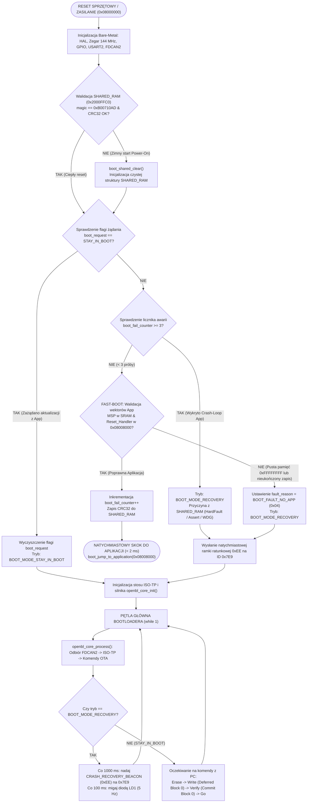
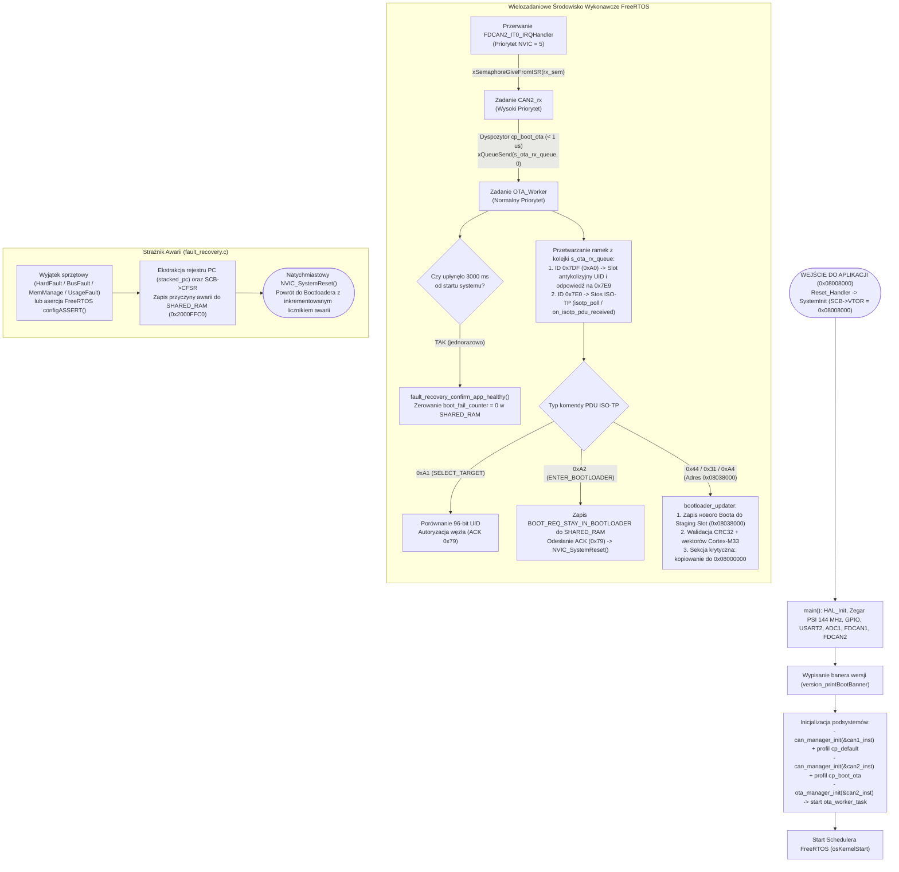
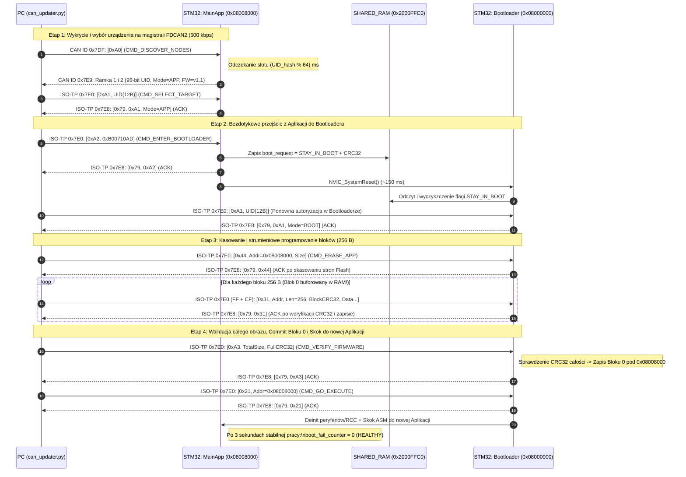

# Dokumentacja Techniczna i Instrukcja Obsługi: CAN Bootloader & OTA Update (FDCAN1 & FDCAN2)

> **Powiązane dokumenty:**
> * Instrukcja obsługi programu GUI (OTA Studio): [docs/bootloader/can_updater_gui_manual.md](file:///c:/WORK/5_v-box/docs/bootloader/can_updater_gui_manual.md)
> * Plan wdrożenia i podział na fazy: [docs/bootloader/bootloader_implementation_plan.md](file:///c:/WORK/5_v-box/docs/bootloader/bootloader_implementation_plan.md)
> * Główna dokumentacja architektury projektu: [docs/project_documentation.md](file:///c:/WORK/5_v-box/docs/project_documentation.md)
> * Aplikacja GUI / Skrypt CLI: [tools/can_updater_gui.py](file:///c:/WORK/5_v-box/tools/can_updater_gui.py) / [tools/can_updater.py](file:///c:/WORK/5_v-box/tools/can_updater.py)
> * Pakiet testów odpornościowych (Fault Injection): [tools/test_ota_suite.py](file:///c:/WORK/5_v-box/tools/test_ota_suite.py)

---

## 1. Wprowadzenie i Architektura Systemu Dual-Target

Podsystem aktualizacji oprogramowania układowego (**CAN Bootloader & OTA Update**) na mikrokontrolerze **STM32C542RCT6** (płytka **NUCLEO-C542RC**, ARM Cortex-M33 @ 144 MHz) został zaprojektowany i zrealizowany zgodnie z 6-fazowym planem architektonicznym opisanym w pliku [bootloader_implementation_plan.md](file:///c:/WORK/5_v-box/docs/bootloader/bootloader_implementation_plan.md).

System wykorzystuje architekturę **Dual-Target** (dwa niezależne programy wykonywalne kompilowane w ramach jednego drzewa CMake i scalane post-buildem w pojedynczy obraz produkcyjny):
1. **`v_box_boot` (`CAN Bootloader`)** – lekki, autonomiczny program **bare-metal** (bez systemu RTOS, kompilowany z flagą `-Os`), rezydujący w pierwszych **32 KB** pamięci Flash (`0x08000000`). Odpowiada za błyskawiczny rozruch aplikacji (**Fast-Boot < 2 ms**), weryfikację spójności wektorów startowych, obsługę cichego trybu awaryjnego (**Silent Recovery Mode**) oraz programowanie pamięci Flash aplikacji przez magistralę **FDCAN1** lub **FDCAN2**.
2. **`v_box` (`Main Application`)** – wielowątkowa aplikacja główna oparta na systemie **FreeRTOS**, rezydująca od adresu `0x08008000` (**192 KB**). Podczas normalnej pracy nasłuchuje w tle jednocześnie na magistrali **FDCAN1** (dołączony profil `can_parser_attach_boot_ota`) oraz **FDCAN2** (29-bitowe Extended ID `0x01F2F3DF` oraz `0x01F2F3E0`), weryfikuje 4-bajtowy token autoryzacyjny `"VBOX"`, odpowiada na rozgłoszenia **UID Discovery** wyłącznie na tej magistrali, z której nadeszło zapytanie, przyjmuje polecenia przejścia do Bootloadera (przekazując aktywny numer magistrali w `SHARED_RAM`) oraz realizuje bezpieczną aktualizację samego Bootloadera za pośrednictwem wyizolowanego bufora **Flash Staging Slot** (`0x08038000`).

---

### 1.1. Mapa Pamięci Flash (256 KB) oraz SRAM (64 KB)

Pamięć wewnętrzna mikrokontrolera STM32C542RCT6 (128 stron Flash po 2 KB = 256 KB oraz 64 KB SRAM) została podzielona w skryptach linkera [stm32c542xc_boot_flash.ld](file:///c:/WORK/5_v-box/linker/stm32c542xc_boot_flash.ld) oraz [stm32c542xc_app_flash.ld](file:///c:/WORK/5_v-box/linker/stm32c542xc_app_flash.ld):

```text
+-----------------------------------------------------------------------+ 0x08040000 (Koniec Flash 256 KB)
|                 BOOTLOADER STAGING SLOT (32 KB)                       |
|                   Strony 112 .. 127 (16 x 2 KB)                       |
|   Bufor tymczasowy wykorzystywany przez MainApp do bezpiecznego       |
|   odebrania i walidacji CRC32/wektorów nowego obrazu v_box_boot.bin   |
+-----------------------------------------------------------------------+ 0x08038000
|                                                                       |
|                    MAIN APPLICATION - v_box (192 KB)                  |
|                    Strony 16 .. 111 (96 x 2 KB)                       |
|   - 0x08008000: Tablica wektorów Cortex-M33 (SCB->VTOR = 0x08008000)  |
|     (Blok 0 zapisywany atomowo na samym końcu po weryfikacji CRC32!)  |
|   - Kod wykonywalny FreeRTOS, zadania CAN1/CAN2, OTA Manager, I/O     |
|   - Zajętość: ~61.2 KB (31.9%), Wolne: ~130.8 KB                      |
|                                                                       |
+-----------------------------------------------------------------------+ 0x08008000
|                   CAN BOOTLOADER - v_box_boot (32 KB)                 |
|                     Strony 0 .. 15 (16 x 2 KB)                        |
|   - 0x08000000: Tablica wektorów startowych po resecie sprzętowym     |
|   - Bare-metal FDCAN2 + ISO-TP + OpenBootloader + Fast-Boot           |
|   - Zajętość: ~20.4 KB (63.9%), Wolne: ~11.6 KB                       |
+-----------------------------------------------------------------------+ 0x08000000 (Start Flash)
```

| Region Pamięci | Zakres Adresów | Rozmiar | Skrypt Linkera / Sekcja | Przeznaczenie |
| :--- | :--- | :---: | :--- | :--- |
| **Bootloader (`ROM`)** | `0x08000000` – `0x08007FFF` | **32 KB** (16 stron) | `stm32c542xc_boot_flash.ld` | Program wykonywalny `v_box_boot.elf` (bare-metal) |
| **Main Application (`ROM`)** | `0x08008000` – `0x08037FFF` | **192 KB** (96 stron) | `stm32c542xc_app_flash.ld` | Program wykonywalny `v_box.elf` (FreeRTOS) |
| **Staging Slot (`STAGING`)** | `0x08038000` – `0x0803FFFF` | **32 KB** (16 stron) | `stm32c542xc_app_flash.ld` | Bufor pośredni do zdalnej aktualizacji Bootloadera |
| **SRAM Aplikacji / Boota** | `0x20000000` – `0x2000FFBF` | **63.9 KB** (65 472 B) | `.data`, `.bss`, `ucHeap` | Stos systemowy, zmienne globalne, sterta FreeRTOS (24 KB) |
| **`SHARED_RAM` (IPC Mailbox)** | `0x2000FFC0` – `0x2000FFFF` | **64 B** | `.noinit.boot_shared` | Nieresetowalna skrzynka IPC między Bootloaderem a Aplikacją |

---

### 1.2. Struktura Plików Modułu w Drzewie Projektu

Zgodnie ze Złotą Zasadą Projektu, cała logika protokołowa, transportowa i sterująca została umieszczona w katalogu `app/` z zachowaniem pełnej hermetyzacji:

```text
c:\WORK\5_v-box\
├── app/
│   ├── bootloader/                         # Kod specyficzny dla targetu v_box_boot (Bare-Metal)
│   │   ├── boot_main.c                     # Punkt wejścia Bootloadera, Fast-Boot, pętla Recovery
│   │   ├── boot_jump.h / .c                # Deinicjalizacja RCC/ICACHE/peryferiów i skok ASM do App
│   │   ├── boot_shared.h / .c              # Obsługa struktury IPC w SHARED_RAM (0x2000FFC0) + CRC32
│   │   ├── openbl_core.h / .c              # Maszyna stanów OpenBootloader + Deferred Vector Commit
│   │   └── openbl_flash_c5.h / .c          # Niskopoziomowy driver Flash STM32C5 (Erase / Program / Verify)
│   │
│   ├── ota_update/                         # Moduły OTA współdzielone i aplikacyjne (MainApp)
│   │   ├── ota_protocol.h                  # Definicje ID CAN (0x7DF..0x7E9), komend (0xA0..0xA4) i błędów
│   │   ├── ota_manager.h / .c              # Zadanie ota_worker_task, Discovery, przejście do Bootloadera
│   │   ├── bootloader_updater.h / .c       # Aktualizacja Bootloadera z poziomu App przez Staging Slot
│   │   ├── fault_recovery.h / .c           # Handlery HardFault/BusFault/Assert, zrzut PC/CFSR do SHARED_RAM
│   │   └── crc32.h / .c                    # Szybka tablicowa implementacja CRC32 (IEEE 802.3 / 0xEDB88320)
│   │
│   ├── can_bus/
│   │   ├── isotp/
│   │   │   └── isotp.h / .c                # Przenośna warstwa transportowa ISO 15765-2 (SF, FF, CF, FC)
│   │   └── can_parser/parsers/
│   │       └── cp_boot_ota.h / .c          # Profil parsera FDCAN2 (filtry 0x7DF i 0x7E0 -> kolejka OTA)
│   │
│   └── port/stm32c5/
│       └── stm32c5_can_adapter.h / .c      # Adapter sprzętowy obsługujący instancje FDCAN1 oraz FDCAN2
│
├── generated/hal/
│   └── mx_fdcan2.h / .c                    # Konfiguracja zegara 144 MHz, pinów PB5/PB6 i NVIC dla FDCAN2
│
├── linker/
│   ├── stm32c542xc_boot_flash.ld           # Skrypt linkera Bootloadera (32 KB @ 0x08000000)
│   └── stm32c542xc_app_flash.ld            # Skrypt linkera Aplikacji (192 KB @ 0x08008000 + 32 KB Staging)
│
└── tools/
    ├── can_updater.py                      # Narzędzie CLI (Python) do skanowania i aktualizacji po CAN
    ├── test_ota_suite.py                   # Zautomatyzowany pakiet 6 testów Fault-Injection & Recovery
    ├── merge_binaries.py                   # Skrypt scalający v_box_boot.bin + v_box.bin -> v_box_full.hex/.bin
    └── print_memory.py                     # Raporter zajętości pamięci Dual-Target
```

---

## 2. Szczegółowy Opis Metody i Sposobu Implementacji

### 2.1. Warstwa Fizyczna, Obsługa Dual-Bus (CAN1 + CAN2) i Ochrona Przed Kolizją w Aucie
Komunikacja aktualizacyjna oraz diagnostyczna OTA obsługuje jednocześnie oba kontrolery **FDCAN1** oraz **FDCAN2** (wspierając zarówno płytki docelowe wyposażone wyłącznie w transceiver `CAN1`, jak i stanowiska z dedykowanym `CAN2`):
* **Wyprowadzenia GPIO:**
  * **FDCAN1:** `PB8` (`FDCAN1_RX`, `AF9`) oraz `PB9` (`FDCAN1_TX`, `AF9`) – wbudowany transceiver na płytce (współdzielony z główną magistralą pojazdu / V-Box).
  * **FDCAN2:** `PB5` (`FDCAN2_RX`, `AF9`) oraz `PB6` (`FDCAN2_TX`, `AF9`) – opcjonalny drugi kanał CAN.
* **Parametry czasowe (Bit Timing):** Zegar rdzenia M_CAN wynosi **144 MHz** (`CLK_FD`). Przy `Prescaler = 1`, `NominalTimeSeg1 = 251`, `NominalTimeSeg2 = 36`, `SJW = 36` uzyskano precyzyjną prędkość **500 kbps** (Classic CAN 2.0B) z punktem próbkowania na poziomie **87.5%** ($252 / 288$ kwantów czasu).
* **Przestrzeń adresowa 29-bit Extended ID (`0x01F2F3xx`) i Token `"VBOX"` (Automotive-Safe):**
  Aby całkowicie wykluczyć kolizję z fabrycznymi sterownikami samochodowymi (ECM/TCM/BCM) oraz standardowymi testerami diagnostycznymi OBD-II (`0x7DF` / `0x7E0` / `0x7E8`), cały protokół OTA został przeniesiony do prywatnej przestrzeni **29-bitowych identyfikatorów Extended CAN (`0x01F2F3xx`)**:
  * `0x01F2F3DF` (`CAN_ID_OTA_BROADCAST`) – ramki rozgłoszeniowe Discovery (wymagają 4-bajtowego tokenu autoryzacyjnego `'V','B','O','X'` w bajtach `2..5`).
  * `0x01F2F3E0` (`CAN_ID_ISOTP_REQ`) – ramki żądań unicastowych ISO-TP z narzędzia PC.
  * `0x01F2F3E8` (`CAN_ID_ISOTP_RESP`) – ramki odpowiedzi ISO-TP z wybranego węzła STM32.
  * `0x01F2F3E9` (`CAN_ID_OTA_DISCOVERY_RESP`) – odpowiedzi UID Discovery oraz ramka diagnostyczna `0xEE` (nadawana wyłącznie na żądanie po autoryzowanym zapytaniu `"VBOX"`, zero spontanicznego ruchu na magistrali auta!).
* **Dynamiczny wybór aktywnej magistrali:** Zarówno `ota_manager` w aplikacji, jak i `openbl_core` w Bootloaderze automatycznie wykrywają, na którym interfejsie (`CAN1` lub `CAN2`) nadeszło zapytanie, i odsyłają odpowiedzi wyłącznie na ten sam interfejs (nie zapełniając bufora TX na nieobsadzonym porcie `CAN2`).
* **Bezpieczeństwo przerwań FreeRTOS:** W plikach [mx_fdcan1.c](file:///c:/WORK/5_v-box/generated/hal/mx_fdcan1.c) i [mx_fdcan2.c](file:///c:/WORK/5_v-box/generated/hal/mx_fdcan2.c) przerwania `FDCAN1_IT0_IRQn` oraz `FDCAN2_IT0_IRQn` otrzymują jawnie priorytet wywłaszczania **5** (`HAL_CORTEX_NVIC_PREEMP_PRIORITY_5`), równy `configLIBRARY_MAX_SYSCALL_INTERRUPT_PRIORITY`, co pozwala na bezpieczne wywoływanie `xSemaphoreGiveFromISR()` wewnątrz `HAL_FDCAN_RxFifo0Callback()`.

---

### 2.2. Warstwa Transportowa ISO 15765-2 (ISO-TP)
Ponieważ klasyczna ramka CAN 2.0 mieści maksymalnie 8 bajtów danych, a bloki obrazu firmware mają rozmiar **256 bajtów** (+ 11 bajtów nagłówka i sumy kontrolnej = **267 bajtów**), w plikach [isotp.h](file:///c:/WORK/5_v-box/app/can_bus/isotp/isotp.h) oraz [isotp.c](file:///c:/WORK/5_v-box/app/can_bus/isotp/isotp.c) zaimplementowano w czystym języku C lekki stos **ISO 15765-2**:
* **Single Frame (`SF`, PCI `0x0N`):** Dla krótkich komend i odpowiedzi (do 7 bajtów payloadu, np. `ACK`, `NACK`, `SELECT_TARGET`, `VERIFY_FIRMWARE`).
* **First Frame (`FF`, PCI `0x1L 0xLL`):** Rozpoczyna wieloramkowy transfer bloku pamięci (np. 267 B), niosąc pierwsze 6 bajtów payloadu oraz 12-bitową długość całkowitą.
* **Flow Control (`FC`, PCI `0x30 0x00 0x01`):** Po odebraniu `FF` mikrokontroler natychmiast odsyła na ID `0x7E8` ramkę `FC (Clear To Send)` z parametrami `BlockSize = 0` (brak konieczności potwierdzania podbloków) oraz `STmin = 1 ms` (minimalny odstęp między kolejnymi ramkami `CF`, zapobiegający przepełnieniu sprzętowego FIFO 0 kontrolera FDCAN2).
* **Consecutive Frame (`CF`, PCI `0x2N`):** Przenosi kolejne porcje po 7 bajtów danych z inkrementowanym modulo-16 numerem sekwencyjnym `SN` (`0x21..0x2F, 0x20..`). Przerwanie ciągłości `SN` natychmiast przerywa transakcję i zgłasza błąd.

---

### 2.3. Bezkolizyjny Mechanizm Discovery (96-bitowy UID + Anti-Collision Slotting)
W środowisku docelowym do jednej magistrali CAN może być podłączonych wiele płytek STM32C542 jednocześnie. Aby uniknąć kolizji na magistrali i konieczności kompilowania osobnych wsadów ze statycznymi adresami węzłów:
1. Skrypt PC wysyła pojedynczą ramkę broadcastową `CMD_DISCOVER_NODES (0xA0)` na ID `0x7DF`.
2. Każdy układ STM32 odczytuje swój unikalny, fabryczny **96-bitowy identyfikator (`UID_BASE = 0x08FFF800`)**.
   > [!IMPORTANT]
   > Na mikrokontrolerze STM32C542 obszar systemowy `0x08FFF800` nie zezwala na odczyty 8-bitowe (`ldrb` powoduje natychmiastowy wyjątek `HardFault` / `BusFault`). W funkcji [`ota_get_mcu_uid()`](file:///c:/WORK/5_v-box/app/ota_update/ota_manager.c#L50-L60) oraz w Bootloaderze odczyt realizowany jest wyłącznie jako **trzy wyrównane słowa 32-bitowe (`volatile const uint32_t *`)**.
3. Z 12 bajtów UID wyliczany jest skrót `uid_hash8` (`CRC32(UID) & 0xFF`), na podstawie którego wyznaczane jest deterministyczne opóźnienie slotu odpowiedzi:
   $$\text{Delay}_{\text{slot}} = (\text{uid\_hash8} \bmod 64) \times 1\text{ ms} \quad (0 \dots 63\text{ ms})$$
4. Po upływie swojego slotu węzeł nadaje na ID `0x7E9` parę ramek ogłoszeniowych zawierających pełne 96 bitów UID, bieżący tryb pracy (`0x00` = Bootloader, `0x01` = Application, `0xEE` = Recovery) oraz wersję firmware (`vMajor.Minor`).
5. Aby rozpocząć programowanie wybranego urządzenia, narzędzie PC wysyła komendę `CMD_SELECT_TARGET (0xA1)` wraz z jego 12-bajtowym UID. Tylko węzeł o zgodnym UID ustawia flagę autoryzacji sesji `s_target_selected = true` i odpowiada `OTA_RESP_ACK (0x79)`.

---

### 2.4. Zestaw Komend Protokołu (`ota_protocol.h`)

| Komenda | Kod Hex | Kierunek | Format Payloadu (ISO-TP / CAN) | Opis działania |
| :--- | :---: | :---: | :--- | :--- |
| `CMD_DISCOVER_NODES` | `0xA0` | PC $\rightarrow$ `0x01F2F3DF` | `[0x06, 0xA0, 'V', 'B', 'O', 'X', 0, 0]` | Rozgłoszeniowe zapytanie o aktywne węzły z 4-bajtowym tokenem `"VBOX"` |
| `CMD_SELECT_TARGET` | `0xA1` | PC $\rightarrow$ `0x01F2F3E0` | `[0xA1, UID[0..11]]` (13 B) | Wybór i autoryzacja konkretnego mikrokontrolera po 96-bitowym UID |
| `CMD_ENTER_BOOTLOADER` | `0xA2` | PC $\rightarrow$ `0x01F2F3E0` | `[0xA2]` (1 B) | Zapis żądania i `active_can_bus` do `SHARED_RAM`, odesłanie `ACK` i `NVIC_SystemReset()` |
| `CMD_ERASE_APP` | `0x44` | PC $\rightarrow$ `0x01F2F3E0` | `[0x44, Addr(4B), Size(4B)]` (9 B) | Kasowanie stron Flash (obszar `0x08008000` w Boot lub `0x08038000` w App) |
| `CMD_WRITE_MEMORY` | `0x31` | PC $\rightarrow$ `0x01F2F3E0` | `[0x31, Addr(4B), Len(2B), Data(N), CRC32(4B)]` | Zapis bloku 256 B z weryfikacją CRC32 bloku przed dotknięciem Flash |
| `CMD_VERIFY_FIRMWARE` | `0xA3` | PC $\rightarrow$ `0x01F2F3E0` | `[0xA3, TotalSize(4B), ExpectedCRC32(4B)]` (9 B) | Walidacja CRC32 całego obrazu + **atomowy commit bloku 0 (`0x08008000`)** |
| `CMD_UPDATE_BOOTLOADER` | `0xA4` | PC $\rightarrow$ `0x01F2F3E0` | `[0xA4, TotalSize(4B), ExpectedCRC32(4B)]` (9 B) | Walidacja obrazu w Staging Slot (`0x08038000`) i przepisanie do `0x08000000` |
| `CMD_GO_EXECUTE` | `0x21` | PC $\rightarrow$ `0x01F2F3E0` | `[0x21]` (1 B) | Skok z Bootloadera do Aplikacji lub restart MCU po aktualizacji Boota |
| `CRASH_RECOVERY_BEACON`| `0xEE` | MCU $\rightarrow$ `0x01F2F3E9`| `[0xEE, Reason, FailCnt, Hash8, PC(4B)]` (8 B) | Ramka ratunkowa nadawana **na żądanie (on-demand)** po odebraniu Discovery w `BOOT_MODE_RECOVERY` |

**Kody odpowiedzi (na 29-bitowym Extended ID `0x01F2F3E8`):**
* `OTA_RESP_ACK (0x79)`: Operacja zakończona powodzeniem `[0x79, CmdEcho, ...]`.
* `OTA_RESP_NACK (0x1F)`: Operacja odrzucona `[0x1F, ErrorCode]`, gdzie `ErrorCode` określa przyczynę:
  * `OTA_ERR_CRC (0x01)` – niezgodność sumy kontrolnej CRC32 bloku lub całego obrazu.
  * `OTA_ERR_ADDRESS (0x02)` – adres docelowy spoza dozwolonego okna partycji.
  * `OTA_ERR_ALIGNMENT (0x03)` – brak wyrównania do granicy słowa kwadrowego (16 B).
  * `OTA_ERR_FLASH_HW (0x04)` – błąd sprzętowy kasowania/zapisu lub niezgodność nagłówka wektorów Cortex-M33.
  * `OTA_ERR_SEQUENCE (0x05)` – naruszenie sekwencji (np. brak wcześniejszego `CMD_SELECT_TARGET` lub `CMD_ERASE_APP`).

---

### 2.5. Mechanizmy Bezpieczeństwa i Odporności na Awarie (Anti-Brick)

#### 1. Opóźniony zapis tablicy wektorów (Deferred Vector Table Commit)
Gdyby podczas aktualizacji Aplikacji Głównej pierwszy blok (`0x08008000` – zawierający wskaźnik stosu `MSP` i adres wejścia `Reset_Handler`) został od razu zapisany do pamięci Flash, a w połowie wgrywania nastąpiłoby odcięcie zasilania, to po ponownym włączeniu zasilania Bootloader zobaczyłby poprawny nagłówek wektorów pod `0x08008000` i wykonał skok do niekompletnego kodu, powodując natychmiastowy `Lockup` procesora.

Aby całkowicie wyeliminować to ryzyko, w [`openbl_core.c`](file:///c:/WORK/5_v-box/app/bootloader/openbl_core.c) wdrożono mechanizm **Deferred Vector Table Commit**:
* Podczas odbioru komendy `CMD_WRITE_MEMORY (0x31)` dla adresu bazowego `0x08008000` (pierwsze 256 bajtów obrazu), dane **nie są zapisywane do pamięci Flash** – trafiają do bufora `s_deferred_vector_block[256]` w pamięci RAM, a strona `0x08008000` we Flash pozostaje skasowana (`0xFFFFFFFF`).
* Wszystkie pozostałe bloki (`0x08008100`, `0x08008200`, ...) są normalnie programowane do pamięci Flash.
* Dopiero podczas komendy `CMD_VERIFY_FIRMWARE (0xA3)` Bootloader oblicza hybrydową sumę kontrolną CRC32 (pierwsze 256 B z bufora RAM + reszta obrazu bezpośrednio z pamięci Flash).
* **Tylko jeśli obliczona suma CRC32 całego obrazu w 100% zgadza się z sumą oczekiwaną**, Bootloader programuje bufor `s_deferred_vector_block` pod adres `0x08008000` i wykonuje końcową weryfikację odczytu z Flash.
* Jeżeli zasilanie zostanie odcięte w dowolnym momencie przed końcową weryfikacją CRC32, pod adresem `0x08008000` pozostaje wartość `0xFFFFFFFF`. Po powrocie zasilania Bootloader natychmiast rozpoznaje brak aplikacji (`BOOT_FAULT_NO_APP`), wchodzi w `BOOT_MODE_RECOVERY` i czeka na ponowne wgranie wsadu.

#### 2. Atomowy skok z Bootloadera do Aplikacji i reset drzewa zegarowego RCC
W mikrokontrolerach rodziny STM32C5xx sterownik HAL zegarów (`HAL_RCC_PSI_SetConfig()`) podczas inicjalizacji w `MainApp` wymaga, aby generator `PSI` (144 MHz) był wyłączony przed ponowną konfiguracją. Pozostawienie włączonego zegara 144 MHz przez Bootloader powodowało błąd `SYSTEM_CLOCK_ERROR` na starcie aplikacji.

Dlatego funkcja [`boot_jump_to_application()`](file:///c:/WORK/5_v-box/app/bootloader/boot_jump.c) wykonuje pełną procedurę przywrócenia stanu sprzętowego:
1. Wyłącza przerwania (`__disable_irq()`), zatrzymuje peryferia `FDCAN2`, `FDCAN1`, `USART2`, `TIM6` oraz pamięć podręczną `ICACHE` (`HAL_ICACHE_DeInit()`).
2. Wywołuje `HAL_DeInit()` oraz **`mx_rcc_deinit()`** (`HAL_RCC_Reset()`), przełączając rdzeń z powrotem na domyślny zegar startowy `HSIDIV3` (48 MHz).
3. Zatrzymuje licznik `SysTick` i czyści wszystkie bity oczekujących przerwań w rejestrach `NVIC->ICER[0..15]` oraz `NVIC->ICPR[0..15]`.
4. Ustawia rejestr relokacji tablicy wektorów `SCB->VTOR = 0x08008000`.
5. Zeruje rejestry ochrony stosu architektury ARMv8-M (`__set_MSPLIM(0)`, `__set_PSPLIM(0)`).
6. Wykonuje atomowy skok w asemblerze inline (`cpsie i`, `msr msp, %0`, `bx %1`), nie odwołując się do zmiennych lokalnych na stosie C po podmianie rejestru `MSP`.

#### 3. Zdalna aktualizacja samego Bootloadera przez Flash Staging Slot
Aktualizacja Bootloadera (`0x08000000`) nigdy nie odbywa się „w miejscu” podczas odbierania ramek CAN. Cały proces realizowany jest przez moduł [`bootloader_updater.c`](file:///c:/WORK/5_v-box/app/ota_update/bootloader_updater.c) w kontekście działającej **Aplikacji Głównej (`MainApp`)**:
1. Nowy obraz `v_box_boot.bin` jest przesyłany po ISO-TP do wyizolowanego sektora **Staging Slot (`0x08038000`)**. Jeśli w trakcie transmisji nastąpi utrata połączenia lub zasilania, aktywny Bootloader pod `0x08000000` pozostaje w 100% nienaruszony.
2. Po odebraniu komendy `CMD_UPDATE_BOOTLOADER (0xA4)` aplikacja weryfikuje:
   * Całościową sumę kontrolną CRC32 obrazu znajdującego się w Staging Slot (`0x08038000`).
   * **Strażnika tablicy wektorów Cortex-M33:** sprawdza, czy pierwsze słowo (`initial_msp`) wskazuje na poprawny obszar SRAM (`0x20000000` .. `0x20010000`), a drugie słowo (`reset_handler`) wskazuje na obszar sektora Bootloadera (`0x08000001` .. `0x08007FFF`) z ustawionym bitem instrukcji Thumb (`bit 0 == 1`). Próba wgrania uszkodzonego lub obcego pliku binarnego jest natychmiast blokowana kodem `OTA_ERR_FLASH_HW (0x04)`.
3. Dopiero po przejściu obu kontroli aplikacja wchodzi w sekcję krytyczną FreeRTOS (`taskENTER_CRITICAL()`), odblokowuje Flash, kasuje strony `0x08000000`..`0x08007FFF`, kopiuje zweryfikowany obraz ze Staging Slot, sprawdza zapis bajt po bajcie funkcją `memcmp()` i kasuje Staging Slot.

---

## 3. Aktualny Przepływ Programu (Program Flow): Bootloader vs. Main Application

### 3.1. Przepływ Programu w Bootloaderze (`v_box_boot` @ `0x08000000`)

Bootloader został zaprojektowany w architekturze **Instant Fast-Boot**. Podczas normalnego włączenia zasilania **nie wprowadza żadnego sztucznego opóźnienia czasowego** (nie czeka 300 ms na ramki CAN), lecz w czasie poniżej **2 ms** weryfikuje spójność systemu i natychmiast przekazuje sterowanie do Aplikacji Głównej. W tryb nasłuchu CAN przechodzi wyłącznie wtedy, gdy zażądała tego aplikacja, wystąpiła seria awarii (Crash-Loop) lub pamięć aplikacji jest pusta.



#### Szczegółowy przebieg kroków Bootloadera ([`boot_main.c`](file:///c:/WORK/5_v-box/app/bootloader/boot_main.c)):
1. **Start po resecie (`main()`):** Konfiguracja zegara systemowego PSI na 144 MHz, inicjalizacja `USART2` (logi z prefiksem `[BOOT]`) oraz `FDCAN2` (500 kbps).
2. **Kontrola `SHARED_RAM` (`0x2000FFC0`):**
   * Przy pierwszym podłączeniu zasilania (Cold Boot) zawartość SRAM jest losowa – `boot_shared_is_valid()` zwraca `false`, a struktura jest zerowana i podpisywana sumą CRC32.
   * Przy resecie programowym (`NVIC_SystemReset()`), resecie od Watchdoga lub z `HardFault_Handler` zawartość `SHARED_RAM` jest zachowana.
3. **Decyzja o trybie rozruchu:**
   * **Ścieżka 1 (`BOOT_MODE_STAY_IN_BOOT`):** Jeśli `boot_request == BOOT_REQ_STAY_IN_BOOTLOADER (0x01)`, Bootloader zeruje tę flagę i pozostaje w pętli obsługi komend programowania Flash.
   * **Ścieżka 2 (`BOOT_MODE_RECOVERY` – Crash-Loop):** Jeśli aplikacja zresetowała się 3 razy z rzędu przed upływem 3 sekund stabilnej pracy (`boot_fail_counter >= 3`), Bootloader blokuje dalsze próby uruchomienia wadliwej aplikacji, wysyła ramkę alarmową `0xEE` na ID `0x7E9` i przechodzi w stan oczekiwania na ratunek.
   * **Ścieżka 3 (`BOOT_MODE_NORMAL` – Fast-Boot):** Bootloader sprawdza słowa pod `0x08008000` (`MSP`) oraz `0x08008004` (`Reset_Handler`).
     * Jeśli są poprawne: zwiększa `boot_fail_counter++` w `SHARED_RAM` i **natychmiast wywołuje `boot_jump_to_application()`**.
     * Jeśli pamięć Flash aplikacji jest skasowana (`0xFFFFFFFF`): ustawia powód `BOOT_FAULT_NO_APP (0x04)` i przechodzi w `BOOT_MODE_RECOVERY`, rozgłaszając co 1 sekundę ramkę `0xEE`.

---

### 3.2. Przepływ Programu w Aplikacji Głównej (`v_box` @ `0x08008000`)

Po skoku z Bootloadera Aplikacja Główna uruchamia system **FreeRTOS** i obsługuje komunikację OTA całkowicie asynchronicznie w tle, nie blokując głównych zadań pomiarowych ani wykonawczych.



#### Sekwencja wymiany komunikatów podczas pełnej aktualizacji Aplikacji (`App -> Bootloader -> App`)



---

## 4. Instrukcja Obsługi Narzędzia `tools/can_updater.py` oraz Wymagany Sprzęt

### 4.1. Wymagany Sprzęt (Hardware Setup)

Do przeprowadzenia aktualizacji oprogramowania oraz uruchomienia testów wymagane są następujące elementy sprzętowe:

1. **Płytka rozwojowa:** **STM32 NUCLEO-C542RC** (z mikrokontrolerem STM32C542RCT6) podłączona przewodem USB-C do komputera PC (zapewnia zasilanie 5V, programator ST-Link V3 oraz wirtualny port szeregowy UART2 VCP do podglądu logów diagnostycznych).
2. **Konwerter USB-CAN:** **CANable 2.0** (lub kompatybilny adapter USB-CAN z wgranym oprogramowaniem **SLCAN / candleLight** obsługującym prędkość 500 kbps).
3. **Transceiver fizyczny CAN 3.3V:** Zewnętrzny moduł transceivera CAN zasilany napięciem 3.3V (np. **SN65HVD230**, **TJA1051T/3** lub **MCP2562**) podłączony do wyprowadzeń kontrolera **FDCAN2** na płytce Nucleo.
4. **Terminacja magistrali:** Rezystory terminujące **120 $\Omega$** na obu końcach linii różnicowej `CAN_H` / `CAN_L` (zworka terminacji `120R` włączona na adapterze CANable 2.0 oraz rezystor 120 $\Omega$ na module transceivera przy płytce Nucleo).

#### Tabela Połączeń Wyprowadzeń FDCAN2 (NUCLEO-C542RC $\leftrightarrow$ Transceiver CAN $\leftrightarrow$ CANable 2.0)

| Sygnał MCU | Pin STM32 | Złącze na NUCLEO-C542RC | Pin Transceivera CAN (np. SN65HVD230) | Połączenie z CANable 2.0 |
| :--- | :---: | :--- | :--- | :--- |
| **`FDCAN2_RX`** | **`PB5`** | **CN10 – Pin 6** *(Arduino **D4**)* | **`RXD` (`R` / `RO`)** – wyjście odbiornika | — |
| **`FDCAN2_TX`** | **`PB6`** | **CN10 – Pin 3** *(Arduino **D10**)* | **`TXD` (`D` / `DI`)** – wejście nadajnika | — |
| **`3V3`** | — | **CN7 – Pin 16** *(Zasilanie 3.3V)* | **`VCC` (`3.3V`)** | — |
| **`GND`** | — | **CN7 – Pin 20** lub **CN10 – Pin 9** | **`GND`** | **`GND`** (Wspólna masa sygnałowa) |
| **`CAN_H`** | — | *(Po stronie transceivera)* | **`CANH`** | **`CAN_H`** (Magistrala wysoka + 120 $\Omega$) |
| **`CAN_L`** | — | *(Po stronie transceivera)* | **`CANL`** | **`CAN_L`** (Magistrala niska + 120 $\Omega$) |

```text
+-----------------------+          +-------------------+               +----------------------+
|     KOMPUTER PC       |          |   CANable 2.0     |               | Transceiver CAN 3.3V |
|                       |  USB-C   |  (Tryb SLCAN)     |  CAN_H / CAN_L|   (np. SN65HVD230)   |
| - can_updater.py      +--------->+  Port: np. COM17  +===============+  [Terminacja 120 Ω]  |
| - Terminal UART2      |          |  [Terminacja 120Ω]|   Skrętka     |                      |
|   (Port: np. COM22)   |          +---------+---------+               +---+--------+-----+---+
+-----------+-----------+                    |                             |        |     |
            |                                | GND                         | RXD    | TXD | VCC/GND
            | USB-C (ST-Link V3 + VCP)       |                             |        |     |
            v                                |                             v        v     v
+-----------+--------------------------------+-----------------------------+--------+-----+---+
|                                   PŁYTKA NUCLEO-C542RC                                      |
|  - UART2 (PA2/PA3) -> Wbudowany ST-Link VCP (115200 bps)                                    |
|  - PB5 (FDCAN2_RX) -> Złącze CN10 pin 6 (Arduino D4)                                        |
|  - PB6 (FDCAN2_TX) -> Złącze CN10 pin 3 (Arduino D10)                                       |
|  - 3V3 / GND       -> Złącze CN7 pin 16 / pin 20                                            |
+---------------------------------------------------------------------------------------------+
```

---

### 4.2. Przygotowanie Środowiska Python oraz Pierwsze Wgranie (SWD)

1. **Instalacja pakietów Python na komputerze PC:**
   ```bash
   pip install -r tools/requirements_ota.txt
   ```
   *(Instaluje bibliotekę `python-can>=4.0.0` oraz `pyserial>=3.5` obsługującą interfejs `slcan`).*

2. **Pierwsze zaprogramowanie mikrokontrolera (Bootloader + Aplikacja) przez ST-Link:**
   Przed pierwszym użyciem magistrali CAN zaprogramuj płytkę połączonym obrazem `v_box_full.hex` (zawierającym zarówno Bootloader pod `0x08000000`, jak i Aplikację pod `0x08008000`):
   * W VS Code uruchom zadanie: **`[Flash] Full Merged Image (Bootloader + App)`** (lub **`[Windows] Build & Flash`**).

3. **Sprawdzenie numerów portów COM (Menedżer Urządzeń Windows):**
   * **Port CANable 2.0 (SLCAN):** np. `COM17`
   * **Port STMicroelectronics STLink Virtual COM Port (UART2):** np. `COM22` (ustawienia terminala: `115200 bps, 8N1`).

---

### 4.3. Instrukcja Krok po Kroku – Polecenia `tools/can_updater.py`

Skrypt [tools/can_updater.py](file:///c:/WORK/5_v-box/tools/can_updater.py) obsługuje cztery główne tryby pracy:

#### 1. Skanowanie magistrali CAN (`--scan`)
Wykrywa wszystkie podłączone mikrokontrolery STM32C542, wyświetla ich 96-bitowy identyfikator UID, aktualny tryb pracy (`APPLICATION`, `BOOTLOADER` lub `RECOVERY_MODE`) oraz wersję oprogramowania (automatycznie wykrywa adapter `candleLight` USB lub przyjmuje jawny parametr `--interface candle` / `--interface slcan --port COM17`):
```bash
# Automatyczne wykrycie adaptera candleLight (WinUSB / gs_usb):
python tools/can_updater.py --scan

# Jawny wybór interfejsu candleLight lub SLCAN:
python tools/can_updater.py --interface candle --scan
python tools/can_updater.py --interface slcan --port COM17 --scan
```

#### 2. Aktualizacja Aplikacji Głównej (`--file`)
Wgrywa nowy plik binarny aplikacji `v_box.bin` do przestrzeni `0x08008000`. Jeśli na magistrali znajduje się tylko jedno urządzenie, parametr `--uid` można pominąć (skrypt automatycznie wybierze wykryty układ, przełączy go z Aplikacji do Bootloadera, skasuje Flash, prześle bloki, zweryfikuje CRC32 i uruchomi nową aplikację):
```bash
python tools/can_updater.py --file build/debug_GCC_NUCLEO-C542RC/v_box.bin
```
*(Opcjonalnie przy wielu urządzeniach na magistrali wskaż docelowy węzeł: `--uid 46009900-19513531-31343039`).*

#### 3. Zdalna Aktualizacja Bootloadera przez Staging Slot (`--update-bootloader`)
Wgrywa nową wersję Bootloadera `v_box_boot.bin` do bufora pośredniego `0x08038000`, weryfikuje sumę CRC32 oraz tablicę wektorów Cortex-M33, a następnie atomowo aktualizuje sektor `0x08000000`:
```bash
python tools/can_updater.py --update-bootloader build/debug_GCC_NUCLEO-C542RC/v_box_boot.bin
```

#### 4. Test przepustowości i stabilności bez zapisu Flash (`--dummy`)
Przeprowadza pełny test protokołu ISO-TP i weryfikacji CRC32 w pamięci RAM bez zużywania cykli zapisu pamięci Flash:
```bash
python tools/can_updater.py --dummy --size 32768
```

---

### 4.4. Przykładowe Logi z Działania (Aplikacja PC oraz Terminal UART2)

#### Scenariusz A: Pełna aktualizacja Aplikacji Głównej (`v_box.bin`)

**Log z konsoli PC (`can_updater.py`):**
```text
$ python tools/can_updater.py --interface slcan --channel COM17 --file build/debug_GCC_NUCLEO-C542RC/v_box.bin

[INFO] Opening CAN interface 'slcan' on channel 'COM17' @ 500000 bps...
[INFO] No --uid specified. Running auto-discovery...

[INFO] Scanning CAN bus (500 kbps) for STM32 devices...

[OK] Found 1 device(s) on CAN bus:
  [1] UID: 46009900-19513531-31343039 | Mode: APPLICATION  | FW: v1.1

[INFO] Auto-selected target UID: 46009900-19513531-31343039

============================================================================
  Starting FIRMWARE FLASH (Hardware Flash)
  Target UID      : 46009900-19513531-31343039
  Flash Target    : 0x08008000
  Payload Size    : 62656 bytes (61.2 KB)
  Block Size      : 256 bytes
  Full CRC32      : 0x8592C677 (IEEE 802.3)
============================================================================

[Step 1/5] Selecting Target Device by 96-bit UID...
  [OK] Device acknowledged selection! Active mode: APPLICATION

[Step 1b] Device is currently running APPLICATION. Requesting switch to BOOTLOADER...
  [OK] Device acknowledged reboot to Bootloader! Waiting for MCU reset (~150 ms)...
  --> Re-selecting target in Bootloader...
  [OK] Connected to Bootloader! Mode: BOOTLOADER

[Step 2/5] Requesting Flash Erase (0x08008000, size=62656 B)...
  [OK] Erase confirmed by device!

[Step 3/5] Streaming 62656 bytes in blocks of 256 B...
  Flashing: [██████████████████████████████] 100.0% | 62656/62656 B |   0.4 KB/s | ETA:  0.0s
  [OK] All blocks successfully transmitted and verified!

[Step 4/5] Verifying entire firmware checksum (CRC32: 0x8592C677)...
  [OK] Full image CRC32 verified by STM32!

[Step 5/5] Sending GO / Execute command (Jump to 0x08008000)...
  [OK] Device acknowledged GO command and is booting firmware!

============================================================================
  SUCCESS! Completed in 148.20s (Average speed: 0.42 KB/s)
============================================================================
```

**Równoległy log z terminala mikrokontrolera (UART2 @ 115200 bps):**
```text
RX [15:50:55.351]: [MAIN] main task
RX [15:50:56.182]: [CAN2] rx msg ID=0x7DF len=8
RX [15:50:56.214]: [OTA_MGR] [DISCOVERY] Responded on 0x7E9 after 12 ms slot (UID: 46009900...)
RX [15:50:56.714]: [CAN2] rx msg ID=0x7E0 len=8
RX [15:50:56.717]: [CAN2] rx msg ID=0x7E0 len=8
RX [15:50:56.745]: [CAN2] rx msg ID=0x7E0 len=8
RX [15:50:56.749]: [OTA_MGR] [CMD] ENTER_BOOTLOADER requested! Saving state to SHARED_RAM and resetting...
RX [15:50:56.792]: [BOOT]
RX [15:50:56.794]: ==============================================
RX [15:50:56.796]: [BOOT] STM32C542 CAN Bootloader (v_box_boot v1.0)
RX [15:50:56.799]: [BOOT] ==============================================
RX [15:50:56.802]: [BOOT] [INIT] App requested Bootloader mode! Staying in bootloader.
RX [15:50:56.979]: [BOOT] [ERASE] Erasing Flash 0x08008000, size=62656 B...
RX [15:53:08.115]: [BOOT] [VERIFY] Success! Size=62656 B, CRC32=0x8592C677
RX [15:53:08.131]: [BOOT] [GO] Jump command received! Acknowledging and jumping to App...
RX [15:53:08.162]: ======================================================================
RX [15:53:08.177]: V-BOX TESTER - Automotive Telematics Test Bench & Signal Converter
RX [15:53:08.180]: ======================================================================
RX [15:53:08.192]: Firmware : v1.1.0 (v1.0.0-11-g0f37d21) [debug_GCC_NUCLEO-C542RC]
RX [15:53:08.195]: Commit : 0f37d21
RX [15:53:08.197]: Target MCU : STM32C542RCT6 (ARM Cortex-M33 @ 144 MHz)
RX [15:53:08.200]: Hardware : NUCLEO-C542RC (Rev 1.0)
RX [15:53:08.210]: ======================================================================
RX [15:53:08.214]: [CAN_PARSER] Active parser: ID 0 (2 filters)
RX [15:53:08.220]: [CAN_PARSER] Active parser: ID 2 (2 filters)
RX [15:53:08.222]: [OTA_MGR] Initialized. MCU UID: 46009900-19513531-31343039
RX [15:53:08.239]: [OTA_MGR] OTA Worker Task started
RX [15:53:08.242]: [MAIN] main task
RX [15:53:11.239]: [OTA_MGR] [HEALTHY] Application ran stably for 3s. Boot fail counter cleared.
```

---

#### Scenariusz B: Zdalna aktualizacja samego Bootloadera przez Staging Slot (`--update-bootloader`)

**Log z konsoli PC (`can_updater.py`):**
```text
$ python tools/can_updater.py --interface slcan --channel COM17 --update-bootloader build/debug_GCC_NUCLEO-C542RC/v_box_boot.bin

============================================================================
  Starting BOOTLOADER UPDATE via STAGING SLOT
  Target UID      : 46009900-19513531-31343039
  Staging Address : 0x08038000 -> Install to 0x08000000
  Payload Size    : 20928 bytes (20.4 KB)
  Block Size      : 256 bytes
  Full CRC32      : 0x07E70C2A (IEEE 802.3)
============================================================================

[Step 1/5] Selecting Target Device by 96-bit UID...
  [OK] Device is running APPLICATION. Ready for Staging Upload!

[Step 2/5] Requesting Staging Slot Erase (0x08038000, size=20928 B)...
  [OK] Staging Erase confirmed by device!

[Step 3/5] Streaming 20928 bytes to Staging Slot (0x08038000)...
  Staging : [██████████████████████████████] 100.0% | 20928/20928 B |   0.4 KB/s | ETA:  0.0s
  [OK] All Bootloader blocks staged at 0x08038000!

[Step 4/5] Verifying staged Bootloader & committing to 0x08000000 (CRC32: 0x07E70C2A)...
  [OK] Bootloader verified and atomically installed to 0x08000000!

[Step 5/5] Sending Reboot command...
  [OK] Device acknowledged reboot! Running new Bootloader.
```

**Równoległy log z terminala mikrokontrolera (UART2 @ 115200 bps):**
```text
RX [09:30:27.515]: [OTA_MGR] [SELECT] Target SELECTED! Ready for OTA commands.
RX [09:30:27.594]: [BOOT_UPD] Erasing Staging Slot 0x08038000 (size=20928 B)...
RX [09:30:27.737]: [BOOT_UPD] Staging Slot erased successfully.
RX [09:31:19.019]: [BOOT_UPD] Progress: 20928 bytes written to Staging Slot
RX [09:31:19.035]: [BOOT_UPD] Validating staged Bootloader (size=20928 B, expected CRC=0x07E70C2A)...
RX [09:31:19.037]: [BOOT_UPD] Staged image valid! MSP=0x2000FFC0, Reset_Handler=0x08002849, CRC=0x07E70C2A
RX [09:31:19.051]: [BOOT_UPD] Installing new Bootloader to 0x08000000 (CRITICAL SECTION)...
RX [09:31:19.226]: [BOOT_UPD] SUCCESS! Bootloader updated at 0x08000000 and staging slot cleaned.
RX [09:31:19.291]: [OTA_MGR] [GO] Rebooting MCU after Bootloader update...
RX [09:31:19.349]: [BOOT]
RX [09:31:19.349]: ==============================================
RX [09:31:19.349]: [BOOT] STM32C542 CAN Bootloader (v_box_boot v1.0)
RX [09:31:19.349]: [BOOT] ==============================================
RX [09:31:19.349]: [BOOT] [JUMP] Fast-Boot: Valid App at 0x08008000 (attempt 1/3). Jumping...
```

---

### 4.5. Pakiet Testów Odpornościowych i Wstrzykiwania Błędów (`tools/test_ota_suite.py`)

Do kompleksowej weryfikacji niezawodności systemu służy dedykowany skrypt testowy [tools/test_ota_suite.py](file:///c:/WORK/5_v-box/tools/test_ota_suite.py), który automatycznie przeprowadza **6 scenariuszy testowych** (4 testy negatywne Fault-Injection oraz 2 testy pozytywne Golden-Path):

```bash
python tools/test_ota_suite.py --port COM17
```

#### Zestawienie scenariuszy w `test_ota_suite.py`:
1. **Test 1 (`T1_APP_BAD_CRC`):** Wysłanie pełnego obrazu aplikacji ze zmanipulowaną sumą kontrolną CRC32 (`~true_crc`). Weryfikuje odrzucenie obrazu (`NACK 0x1F, ERR_CRC 0x01`), brak commitu bloku 0 oraz pozostanie układu w Bootloaderze.
2. **Test 2 (`T2_APP_POWER_LOSS`):** Rozpoczęcie zapisu pamięci Flash aplikacji, przerwanie transmisji po wgraniu 15 bloków (3840 B) i wyświetlenie instrukcji dla operatora: **`TERAZ ODŁĄCZ ZASILANIE PŁYTKI STM32 (kabel USB ST-Link) na ~2 sekundy i podłącz ponownie`**. Po powrocie zasilania test weryfikuje, że Bootloader nie skacze do niekompletnej aplikacji (dzięki Deferred Vector Commit), lecz natychmiast wchodzi w `BOOT_MODE_RECOVERY` (`0xEE`), po czym skrypt automatycznie przeprowadza **Rescue Flash**, przywracając pełną sprawność płytki.
3. **Test 3 (`T3_BOOT_BAD_VECTOR`):** Wysłanie do Staging Slot obrazu Bootloadera z celowo uszkodzonym wskaźnikiem stosu `MSP = 0xDEADBEEF` (lecz poprawną sumą CRC32!). Weryfikuje zadziałanie strażnika tablicy wektorów Cortex-M33 (`NACK 0x1F, ERR_FLASH_HW 0x04`) i nienaruszalność sektora `0x08000000`.
4. **Test 4 (`T4_BOOT_INTERRUPTED`):** Przerwanie wgrywania Bootloadera do Staging Slot po 10 blokach (2560 B) i weryfikacja, że aktywny Bootloader oraz Aplikacja działają bez zakłóceń.
5. **Test 5 (`T5_BOOT_GOLDEN`):** Pełna, wzorcowa aktualizacja Bootloadera przez Staging Slot i potwierdzenie ponownego uruchomienia w trybie `APPLICATION`.
6. **Test 6 (`T6_APP_GOLDEN`):** Pełna, wzorcowa aktualizacja Aplikacji Głównej i potwierdzenie poprawnego uruchomienia po skoku z Bootloadera.

#### Przykładowy raport końcowy z uruchomienia `test_ota_suite.py`:
```text
========================================================================================
                     FINAL TEST SUITE EXECUTION REPORT
========================================================================================
ID                   | Target       | Status   | Time     | Details
----------------------------------------------------------------------------------------
T1_APP_BAD_CRC       | Application  | [PASS]   |   151.1s | Bootloader rejected bad CRC32 (NACK 0x1F01) and stayed in BOOTLOADER mode.
T2_APP_POWER_LOSS    | Application  | [PASS]   |   167.8s | Interrupted flash survived power-cycle and recovered via Rescue Flash -> APPLICATION.
T3_BOOT_BAD_VECTOR   | Bootloader   | [PASS]   |    51.9s | MainApp rejected invalid Cortex-M33 vector table (MSP=0xDEADBEEF) before touching 0x08000000.
T4_BOOT_INTERRUPTED  | Bootloader   | [PASS]   |     6.7s | Aborted staging write at 2560 B; active Bootloader & Application remained 100% healthy.
T5_BOOT_GOLDEN       | Bootloader   | [PASS]   |    53.9s | Full Bootloader update via Staging Slot succeeded and rebooted into APPLICATION.
T6_APP_GOLDEN        | Application  | [PASS]   |   153.2s | Full Application OTA update succeeded and booted into APPLICATION mode.
----------------------------------------------------------------------------------------
  SUMMARY: 6/6 PASSED, 0 FAILED | Total Time: 584.5s
  RESULT : ALL FAULT-INJECTION & RECOVERY TESTS PASSED!
========================================================================================
```

---

### 4.6. Zaawansowana Aplikacja Okienkowa GUI (`tools/can_updater_gui.py`)

Dla zapewnienia maksymalnej wygody operatora na stanowisku produkcyjnym, serwisowym oraz laboratoryjnym wdrożono zaawansowaną aplikację graficzną w języku Python (**PyQt6** z automatycznym fallbackiem do **PyQt5**): [tools/can_updater_gui.py](file:///c:/WORK/5_v-box/tools/can_updater_gui.py).

#### Uruchomienie aplikacji:
1. **Z poziomu Visual Studio Code:**
   Naciśnij `Ctrl+Shift+P` $\rightarrow$ `Tasks: Run Task` $\rightarrow$ wybierz **`[GUI] Launch CAN OTA Updater`**.
2. **Z wiersza poleceń (CLI):**
   ```bash
   python tools/can_updater_gui.py
   # Opcjonalnie z automatycznym wskazaniem portu i prędkości:
   python tools/can_updater_gui.py --port COM17 --bitrate 500000
   ```

```text
+======================================================================================================+
|  V-BOX CAN OTA UPDATER & DIAGNOSTIC STUDIO (STM32C542 / FDCAN2)                                       |
+======================================================================================================+
| [1. PASEK POŁĄCZENIA CANABLE 2.0]                                                                    |
|  Interfejs: [slcan]  Port COM: [COM17 - Urządzenie USB (CANable 2.0 SLCAN)] [🔄]  Prędkość: [500000]  |
|  Status: (● Połączono: COM17 @ 500000 bps)   [ 🔌 Rozłącz ]   [ 🔍 Skanuj (0x7DF) ]   [Auto-Scan ☑]  |
+------------------------------------------------------------------------------------------------------+
| [2. KAFELKI STATUSU FLOTY (KLIKALNE BLOKI KPI) + BANER ALARMOWY SOS]                                 |
| +-------------------------------+ +-------------------------------+ +------------------------------+ |
| | 🖧 WYKRYTE URZĄDZENIA         | | ✅ GOTOWE DO PRACY            | | 🚨 WZYWA POMOCY (RECOVERY)   | |
| |            1                  | |       1 App / 0 Boot          | |       0 błędów magistrali    | |
| | Kliknij, aby pokazać wszystkie| | Application / Bootloader      | | [PULSUJĄCY ALARM GDY > 0]    | |
| +-------------------------------+ +-------------------------------+ +------------------------------+ |
| [!] ALARM SOS: Węzeł (Hash: 0x39) nadaje sygnał 0xEE! Powód: HARDFAULT @ app_fault_handler()         |
|     Licznik restartów: 3/3 | PC: 0x080091A4                        [ 🚑 Wybierz i Ratuj (Rescue) ]   |
+------------------------------------------------------------------------------------------------------+
| [3. TABELA WYKRYTYCH WĘZŁÓW STM32]                                                                   |
|  Status     | 96-bitowy UID                 | Hash | Tryb Pracy  | Wersja FW | Diagnostyka / Info    |
| ------------+-------------------------------+------+-------------+-----------+---------------------- |
|  🟢 Zdrowy  | 46009900-19513531-31343039    | 0x39 | APPLICATION | v1.1      | Praca stabilna (OK)   |
+-------------------------------------------------+----------------------------------------------------+
| [4A. KONFIGURACJA AKTUALIZACJI I WYBÓR WSADU]   | [4B. POTOK WYKONANIA (PIPELINE) I TELEMETRIA]      |
|                                                 |                                                    |
| Cel: [46009900-19513531-31343039]               |  (1) Cel UID -> (2) Reset Boot -> (3) Kasowanie    |
|                                                 |  -> (4) Zapis Bloków -> (5) Weryfikacja            |
| Co aktualizujemy:                               |                                                    |
|  (●) Aplikacja Główna (0x08008000)              |  Postęp całkowity:                                 |
|  ( ) Bootloader (Staging Slot)                  |  [██████████████████████░░░░░] 68.5%               |
|  ( ) Test RAM (Dummy)                           |                                                    |
|                                                 |  Prędkość: 0.43 KB/s  |  ETA: 45.2 s               |
| Plik wsadowy (.bin):                            |  Bloki: 172 / 245     |  Ponowienia: 0             |
|  [x] Użyj artefaktu z build/ (Auto-Path)        |                                                    |
|  Ścieżka: [.../build/.../v_box.bin] [📂 Przegl.]|  [ 🚀 ROZPOCZNIJ AKTUALIZACJĘ ]   [ ⏹ Przerwij ]  |
|  [🔨 Zbuduj Projekt (Docker/Ninja)]             |                                                    |
|                                                 |  Szybkie akcje diagnostyczne:                      |
| Pre-Flight Binary Guard:                        |  [ 📥 Wejdź w Bootloader ]  [ ▶️ Skocz do App ]    |
|  ✔ Poprawny obraz (APP)! Gotowy do wgrania.     |  [ 🔎 Dekoduj PC błędu ]                           |
|  Rozmiar: 62656 B | MSP: 0x200075A8             |                                                    |
|  Reset: 0x08011895 | CRC32: 0x8592C677          |                                                    |
+-------------------------------------------------+----------------------------------------------------+
| [5. KONSOLA LOGÓW I TERMINAL DIAGNOSTYCZNY]                                                          |
| [ Zakładka 1: Log Transmisji CAN / ISO-TP ]  [ Zakładka 2: Terminal Szeregowy MCU UART2 (COM22) ]     |
+======================================================================================================+
```

#### Kluczowe Funkcjonalności Modułu GUI:
1. **Inteligentna klasyfikacja portów COM (`ConnectionPanel`):**
   Automatycznie rozróżnia adapter magistrali **CANable 2.0 (SLCAN, VID=0x16D0, PID=0x117E)** od interfejsu diagnostycznego **ST-Link Virtual COM Port (VID=0x0483)**. Proponuje właściwy port w selektorze magistrali CAN oraz automatycznie przypisuje port ST-Link do podglądu logów UART2.
2. **Pasywny i aktywny monitor magistrali (`CanBusMonitorWorker` w `QThread`):**
   Wątek tła ciągle nasłuchuje na identyfikatorze `0x7E9`. W przypadku odebrania cyklicznej ramki ratunkowej `0xEE` (`CRASH_RECOVERY_BEACON`) natychmiast uruchamia pulsujący czerwony alarm wizualny SOS, automatycznie odpytuje o pełny 96-bitowy UID (`CMD_DISCOVER_NODES 0xA0`) i paruje telemetrię awarii (`HARDFAULT`, `RTOS_ASSERT`, `WATCHDOG`, `NO_APP`) z wierszem w tabeli urządzeń.
3. **Dekoder adresu awarii PC (`arm-none-eabi-addr2line` z fallbackiem Docker):**
   Po odebraniu adresu instrukcji `PC` z ramki `0xEE`, GUI automatycznie tłumaczy adres sprzętowy na nazwę funkcji w języku C, plik źródłowy oraz numer linii (np. `Reset_Handler() [startup_stm32c542xx.c:256]`), korzystając z lokalnego kompilatora lub kontenera Docker `vbox-builder`.
4. **Pre-Flight Binary Guard (Ochrona przed pomyłką wsadów):**
   Przed wysłaniem jakiejkolwiek ramki CAN aplikacja analizuje pierwsze 8 bajtów tablicy wektorów Cortex-M33 (`Initial_MSP` w zakresie SRAM `0x20000000..0x20010000` oraz adres `Reset_Handler`). W przypadku próby wgrania pliku Bootloadera `v_box_boot.bin` w trybie aktualizacji Aplikacji (lub odwrotnie), GUI natychmiast blokuje transmisję i wyświetla komunikat ostrzegawczy z propozycją automatycznego przełączenia trybu.
5. **Świadomość Repozytorium i Detekcja Nieaktualnego Buildu (`Repo-Aware`):**
   Aplikacja wykrywa uruchomienie wewnątrz repozytorium `5_v-box`, automatycznie mapuje ścieżki do wygenerowanych plików `v_box.bin` / `v_box_boot.bin` w katalogu `build/debug_GCC_NUCLEO-C542RC/` oraz porównuje czasy modyfikacji plików źródłowych w `app/`, `generated/`, `linker/`. W razie modyfikacji kodu po ostatniej kompilacji ostrzega użytkownika i pozwala uruchomić kompilację projektu w tle bezpośrednio z poziomu GUI.
6. **Wizualny Potok Postępu (Pipeline Stepper) i Telemetria Na Żywo:**
   Wyświetla postęp poszczególnych kroków protokołu (1..5 dla App, 1..6 dla Bootloadera), prędkość transmisji w KB/s, szacowany czas do ukończenia (ETA), licznik przetransferowanych bloków oraz automatycznych retransmisji, a także umożliwia bezpieczne przerwanie wgrywania przyciskiem `[⏹ Przerwij]`.
7. **Podwójny Terminal:**
   * **Zakładka 1:** Pełny log ramek CAN / ISO-TP z kolorowaniem poziomów (`INFO`, `OK`, `WARN`, `ERROR`, `RECOVERY`, `STEP`), opcją Verbose, filtrowaniem, kopiowaniem i zapisem do pliku.
   * **Zakładka 2:** Wbudowany terminal szeregowy czytający port ST-Link VCP UART2 (115200 bps), prezentujący logi z wnętrza mikrokontrolera równolegle z procesem aktualizacji.


