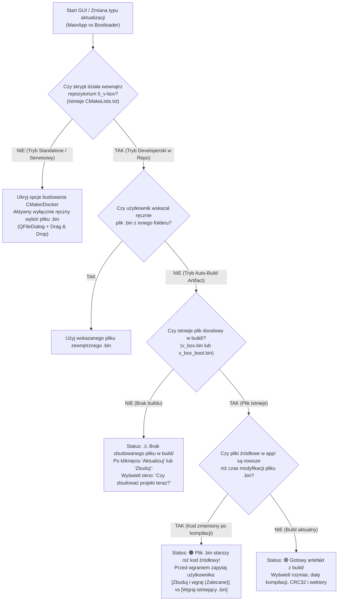
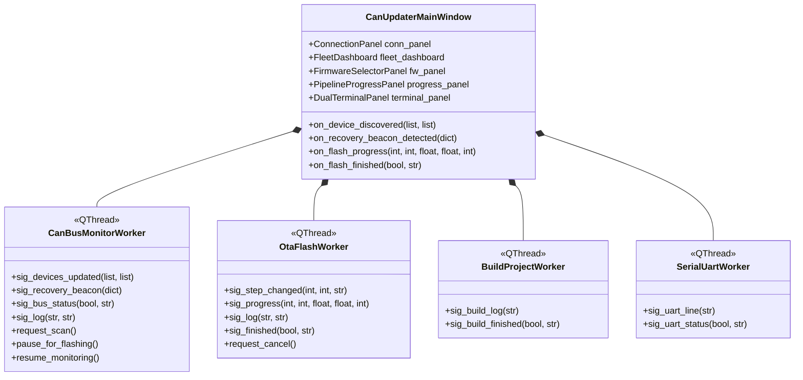

# Plan Implementacyjny: Aplikacja Okienkowa GUI do Aktualizacji i Diagnostyki CAN OTA (`V-BOX CAN Updater GUI`)

> **Kontekst i Powiązane Pliki:**
> * **Silnik protokołu CLI (Backend bazowy):** [tools/can_updater.py](file:///c:/WORK/5_v-box/tools/can_updater.py)
> * **Wzorce odporności i testów awaryjnych:** [tools/test_ota_suite.py](file:///c:/WORK/5_v-box/tools/test_ota_suite.py)
> * **Dokumentacja protokołu i sprzętu (CANable 2.0 + FDCAN2):** [docs/bootloader/can_bootloader_and_ota_guide.md](file:///c:/WORK/5_v-box/docs/bootloader/can_bootloader_and_ota_guide.md)
> * **Środowisko wykonawcze:** Python 3 + **PyQt6 / PyQt5** (preinstalowane w kontenerze Docker [`.devcontainer/Dockerfile`](file:///c:/WORK/5_v-box/.devcontainer/Dockerfile) oraz dostępne natywnie na Windows), `python-can`, `pyserial`.

---

## 1. Cel Projektu i Założenia Architektoniczne

Celem zadania jest stworzenie zaawansowanego, odpornego na błędy i przyjaznego dla operatora programu okienkowego (**PyQt GUI**) do bezdotykowej aktualizacji oprogramowania (**Main Application** oraz **Bootloader**) i monitorowania stanu mikrokontrolerów **STM32C542** przez magistralę **CAN (FDCAN2 @ 500 kbps)** przy użyciu adaptera **CANable 2.0 (SLCAN)**.

### Główne założenia projektowe:
1. **Zero duplikacji logiki protokołowej (Backend Reuse):**
   Aplikacja GUI nie przepisuje od zera stosu ISO-TP ani maszyny stanów OpenBootloader – wykorzystuje i rozszerza przetestowany moduł [`tools/can_updater.py`](file:///c:/WORK/5_v-box/tools/can_updater.py) poprzez wstrzyknięcie opcjonalnych funkcji zwrotnych (`progress_callback`, `log_callback`, `step_callback`, `cancel_check`), zachowując 100% wstecznej kompatybilności narzędzia wiersza poleceń (CLI) oraz skryptu [`tools/test_ota_suite.py`](file:///c:/WORK/5_v-box/tools/test_ota_suite.py).
2. **Pełna asynchroniczność wątkowa (`QThread` + `pyqtSignal`):**
   Żadna operacja na magistrali CAN, oczekiwanie na kasowanie pamięci Flash (trwające do 2–6 s) ani kompilacja projektu CMake/Ninja nie może wykonywać się w głównym wątku interfejsu graficznego (`GUI Event Loop`). Cała komunikacja odbywa się w dedykowanych wątkach roboczych komunikujących się z oknem głównym wyłącznie przez bezpieczne sygnały Qt.
3. **Pasywny i aktywny nasłuch alarmów ratunkowych (`SOS / Recovery Beacon 0xEE`):**
   Po otwarciu portu CANable 2.0 wątek monitorujący w tle ciągle nasłuchuje ramek o ID `0x7E9`. Jeśli jakiekolwiek urządzenie na magistrali wpadnie w pętlę restartów (`HardFault`, `RTOS_ASSERT`, `WATCHDOG`) lub ma skasowaną pamięć aplikacji (`NO_APP`), układ nadaje co 1 sekundę ramkę `0xEE`. Program GUI wykrywa to **automatycznie (nawet bez klikania „Skanuj”)** i uruchamia wyraźny, pulsujący alarm wizualny wraz z dekodowaniem przyczyny awarii i adresu instrukcji `PC`.
4. **Inteligentna świadomość repozytorium (`Repo-Aware & Auto-Build`):**
   Aplikacja automatycznie wykrywa, czy została uruchomiona wewnątrz repozytorium projektu `5_v-box` (obecność pliku `CMakeLists.txt`), czy jako samodzielne narzędzie u klienta/na stanowisku serwisowym:
   * **Wewnątrz repozytorium:** automatycznie podpowiada wygenerowane pliki `v_box.bin` i `v_box_boot.bin` z katalogu `build/debug_GCC_NUCLEO-C542RC/`, sprawdza czy pliki źródłowe `.c`/`.h` nie są nowsze niż plik `.bin` (detekcja nieaktualnego buildu) oraz oferuje przycisk/dialog **„Zbuduj projekt teraz”** bezpośrednio z poziomu GUI.
   * **Poza repozytorium (Standalone):** ukrywa opcje kompilacji i działa w czystym trybie wyboru pliku `.bin` z dysku (`QFileDialog` / Drag & Drop).
5. **Pre-Flight Binary Guard (Walidacja pliku `.bin` przed dotknięciem magistrali CAN):**
   Zanim zostanie wysłana pierwsza ramka CAN, GUI analizuje nagłówek wybranego pliku `.bin` (pierwsze 8 bajtów tablicy wektorów Cortex-M33: `Initial_MSP` oraz `Reset_Handler`), uniemożliwiając przypadkowe wgranie pliku aplikacji jako Bootloadera lub odwrotnie.

---

## 2. Projekt Interfejsu Użytkownika (UI / UX Layout)

Okno główne aplikacji (`QMainWindow`, rozdzielczość domyślna `1180 x 820 px`, nowoczesny ciemny motyw przemysłowy **Dark Engineering Theme** oparty na arkuszu QSS) składa się z **5 logicznych stref**:

```text
+======================================================================================================+
|  V-BOX CAN OTA UPDATER & DIAGNOSTIC STUDIO (STM32C542 / FDCAN2)                        [Motyw] [?]   |
+======================================================================================================+
| [1. PASEK POŁĄCZENIA CANABLE 2.0]                                                                    |
|  Interfejs: [slcan v]  Port COM: [COM17 - CANable 2.0 SLCAN v] [🔄]  Prędkość: [500 kbps v]          |
|  Status: (● POŁĄCZONO @ 500 kbps)   [ 🔌 Rozłącz ]   [ 🔍 Skanuj Magistralę (0x7DF) ]  [Auto-Scan ☑] |
+------------------------------------------------------------------------------------------------------+
| [2. KAFELKI STATUSU FLOTY (KLIKALNE BLOKI KPI) + BANER ALARMOWY SOS]                                 |
| +-------------------------------+ +-------------------------------+ +------------------------------+ |
| | 🖧 WYKRYTE URZĄDZENIA         | | ✅ GOTOWE DO PRACY            | | 🚨 WZYWA POMOCY (RECOVERY!)  | |
| |            2                  | |       1 (App) / 0 (Boot)      | |       1 UKŁAD W TRYBIE SOS   | |
| | Kliknij, aby pokazać wszystkie| | Kliknij, aby filtrować zdrowe | | [PULSUJĄCY CZERWONY ALARM!]  | |
| +-------------------------------+ +-------------------------------+ +------------------------------+ |
| [!] ALARM SOS: Urządzenie (Hash: 0x39) nadaje sygnał ratunkowy 0xEE! Powód: NO_APP / Power-Loss      |
|     Adres PC: 0xFFFFFFFF | Licznik błędów: 0/3                     [ 🚑 Wybierz i Ratuj (Rescue) ]   |
+------------------------------------------------------------------------------------------------------+
| [3. TABELA WYKRYTYCH URZĄDZEŃ (Po kliknięciu w kafelek lub wiersz wybiera cel aktualizacji)]         |
|  Status      | 96-bitowy UID                 | Tryb Pracy   | Wersja FW | Diagnostyka / Crash Info   |
| -------------+-------------------------------+--------------+-----------+--------------------------- |
|  🟢 Zdrowy   | 46009900-19513531-31343039    | APPLICATION  | v1.1      | Stabilny (OK)              |
|  🔴 SOS 0xEE | [Wykryto z Beaconu Hash 0x39] | RECOVERY_SOS | —         | Powód: HARDFAULT @0x080091A|
+-------------------------------------------------+----------------------------------------------------+
| [4A. KONFIGURACJA AKTUALIZACJI I WYBÓR WSADU]   | [4B. POTOK WYKONANIA (PIPELINE) I TELEMETRIA]      |
|                                                 |                                                    |
| Cel: [46009900-19513531-31343039] [Zmień tryb]  |  (1) Wybór UID  --> (2) Tryb Boot --> (3) Erase    |
|                                                 |  --> (4) Zapis Bloków (256B) --> (5) Verify & Go   |
| Co aktualizujemy:                               |                                                    |
|  (●) Aplikacja Główna (MainApp @ 0x08008000)    |  Postęp całkowity:                                 |
|  ( ) Bootloader (Staging 0x08038000->0x08000000)|  [████████████████████░░░░░░░░░] 68.5% (42.9/62KB) |
|  ( ) Test Magistrali (Dummy Update w RAM)       |                                                    |
|                                                 |  Prędkość: 0.43 KB/s  |  ETA: 45.2 s               |
| Źródło pliku Firmware (.bin):                   |  Blok: 172 / 245      |  Ponowienia (Retries): 0   |
|  [x] Użyj artefaktu z repozytorium (build/)     |                                                    |
|  Ścieżka: [.../build/.../v_box.bin] [📂 Przegl.]|  [ 🚀 ROZPOCZNIJ AKTUALIZACJĘ ]   [ ⏹ Przerwij ]  |
|  [🔨 Zbuduj projekt (CMake/Ninja)]              |                                                    |
|                                                 |   Szybkie akcje diagnostyczne:                      |
| Inspekcja pliku (Pre-Flight Check):             |  [ 📥 Wejdź w Bootloader ] [ ▶️ Skocz do App ]     |
|  ✔ Rozmiar: 62 656 B (31.9% z 192 KB)           |  [ 🔎 Dekoduj adres PC błędu (addr2line) ]         |
|  ✔ Wektory: MSP=0x20010000, Reset=0x0800B419    |                                                    |
|  ✔ Suma CRC32: 0x8592C677                       |                                                    |
+-------------------------------------------------+----------------------------------------------------+
| [5. KONSOLA LOGÓW I TERMINAL DIAGNOSTYCZNY]                                                          |
| [ Zakładka 1: Log Transmisji CAN / OTA ]  [ Zakładka 2: Terminal Szeregowy MCU UART2 (COM22) ]       |
| +--------------------------------------------------------------------------------------------------+ |
| | [11:20:01.102] [INFO] Otwarto interfejs slcan na porcie COM17 @ 500000 bps                       | |
| | [11:20:01.450] [OK] Wykryto 1 urządzenie: UID 46009900-19513531-31343039 (APPLICATION, v1.1)     | |
| | [11:20:05.120] [STEP 2/5] Kasowanie pamięci Flash 0x08008000 (rozmiar=62656 B)... OK             | |
| +--------------------------------------------------------------------------------------------------+ |
| [☑ Auto-scroll] [☐ Verbose ISO-TP (SF/FF/CF/FC)]                  [📋 Kopiuj] [💾 Zapisz] [🗑️ Wyczyść]|
+======================================================================================================+
```

---

## 3. Szczegółowa Specyfikacja Funkcjonalna Poszczególnych Modułów

### 3.1. Inteligentny Selektor Portów COM i Obsługa CANable 2.0 (`ConnectionPanel`)
* Wykorzystuje `serial.tools.list_ports.comports()` do pobrania pełnych metadanych portów szeregowych (`device`, `description`, `hwid`, `vid`, `pid`).
* **Klasyfikacja portów (ochrona przed pomyłką użytkownika):**
  * Na płytce Nucleo obecny jest również port **ST-Link Virtual COM Port** (`VID=0x0483, PID=0x374E/0x374B/0x3752`), który służy do logów `UART2`, a nie do `SLCAN`.
  * Jeśli użytkownik ma podłączony zarówno ST-Link, jak i CANable 2.0, lista rozwijana `QComboBox` oznacza porty ikonami i tagami:
    * `🟢 COM17 – CANable 2.0 / USB Serial Device (Zalecany dla SLCAN)`
    * `⚪ COM22 – STMicroelectronics STLink Virtual COM Port (Terminal UART2)`
  * Domyślnie dla CANable wybierany jest port niebędący ST-Linkiem, natomiast port ST-Linka jest automatycznie proponowany w zakładce **Terminala UART2**!
* **Odporność na odłączenie zasilania / USB (wzorzec z `test_ota_suite.py`):**
  * W przypadku utraty połączenia (np. podczas ręcznego odłączenia zasilania płytki) menedżer połączenia wykonuje procedurę `safe_open_or_reconnect_bus()` z wielokrotnym ponowieniem i czyszczeniem zalegających ramek z bufora wejściowego.

---

### 3.2. Kafelki Floty (KPI Blocks), Wykrywanie Urządzeń i System Alarmowy `SOS 0xEE` (`FleetDashboard`)

#### 1. Trzy interaktywne kafelki podsumowania (`DeviceSummaryCard(QFrame)`):
Każdy kafelek jest klikalnym widżetem wyświetlanym w górnej części okna:
* **Kafelek 1: `WSZYSTKIE URZĄDZENIA`** – pokazuje łączną liczbę węzłów widocznych na magistrali CAN. Kliknięcie zdejmuje filtry w tabeli urządzeń i rozwija pełną listę.
* **Kafelek 2: `TRYB NORMALNY (APP / BOOT)`** – pokazuje liczbę sprawnych urządzeń gotowych do pracy lub oczekujących w Bootloaderze.
* **Kafelek 3: `🚨 ALARM: WZYWA POMOCY (RECOVERY 0xEE)`**:
  * Gdy licznik wynosi `0`: kafelek jest wyszarzony (`"0 błędów magistrali"`).
  * Gdy licznik `> 0`: kafelek zmienia kolor tła na **jaskrawoczerwony z animacją pulsowania (`QTimer` przełączający obramowanie co 500 ms)**, a pod kafelkami rozwija się **Czerwony Pasek Alarmowy (Emergency SOS Banner)**.

#### 2. Jak działa detekcja urządzenia „wołającego o pomoc” (`0xEE`)?
* Zgodnie z implementacją w [`boot_main.c`](file:///c:/WORK/5_v-box/app/bootloader/boot_main.c), mikrokontroler w trybie `BOOT_MODE_RECOVERY` samoczynnie nadaje co `1000 ms` ramkę na ID `0x7E9`:
  * Bajt 0: `0xEE` (`CRASH_RECOVERY_BEACON`)
  * Bajt 1: `fault_reason` (`0x01 = HARDFAULT`, `0x02 = RTOS_ASSERT`, `0x03 = WATCHDOG`, `0x04 = NO_APP / Pusta pamięć Flash`)
  * Bajt 2: `boot_fail_counter` (liczba nieudanych uruchomień z rzędu, np. `3`)
  * Bajt 3: `uid_hash8` (8-bitowy skrót CRC32 z 96-bitowego UID mikrokontrolera)
  * Bajty 4..7: `fault_pc` (32-bitowy adres rejestru `PC` w momencie awarii, zapisany w formacie Little-Endian)
* **Automatyczne dopytanie o pełny 96-bitowy UID:**
  * Gdy pasywny nasłuchiwacz GUI odbierze ramkę `0xEE`, natychmiast wyświetla alarm z powodem błędu i adresem `PC`, a jednocześnie **automatycznie wysyła w tle pojedyncze zapytanie `CMD_DISCOVER_NODES (0xA0)` na `0x7DF`**, aby urządzenie w trybie Recovery odesłało swoje pełne 96-bitowe UID (w ramkach `0x01` i `0x02` z `mode = 0x00/0x02`).
  * Dzięki temu tabela urządzeń łączy telemetrię błędu (`Reason`, `FailCnt`, `PC`) z pełnym 96-bitowym identyfikatorem `UID`!

#### 3. Szybki wybór i akcja ratunkowa jednym kliknięciem:
* Kliknięcie w kafelek `WZYWA POMOCY` lub kliknięcie wiersza w tabeli:
  1. Automatycznie wpisuje `UID` tego urządzenia jako cel aktualizacji.
  2. Automatycznie przełącza tryb aktualizacji na `Aplikacja Główna (MainApp @ 0x08008000)`.
  3. Wyświetla szczegóły diagnostyczne awarii (wraz z dekodowaniem nazwy funkcji C i numeru linii przez `arm-none-eabi-addr2line -f -e build/debug_GCC_NUCLEO-C542RC/v_box.elf <PC>`, jeśli plik `.elf` jest dostępny!).

---

### 3.3. Obsługa Plików Firmware i Integracja z Repozytorium / Systemem Budowania (`FirmwareSelectorPanel`)

Rozwiązanie zagadnienia wyboru pliku wsadowego vs. budowania projektu w repozytorium zostało podzielone na klarowną maszynę stanów:



#### Szczegóły działania trybu repozytoryjnego:
1. **Detekcja repozytorium (`is_inside_vbox_repo()`):**
   Sprawdza obecność pliku `CMakeLists.txt` oraz katalogu `app/bootloader/` względem ścieżki nadrzędnej skryptu (`os.path.abspath(os.path.join(os.path.dirname(__file__), ".."))`).
2. **Automatyczne mapowanie ścieżek domyślnych:**
   * Gdy wybrano **MainApp**: domyślny artefakt to `build/debug_GCC_NUCLEO-C542RC/v_box.bin`.
   * Gdy wybrano **Bootloader**: domyślny artefakt to `build/debug_GCC_NUCLEO-C542RC/v_box_boot.bin`.
3. **Detekcja nieaktualnego buildu (`is_build_stale(bin_path)`):**
   Porównuje znacznik czasu `os.path.getmtime(bin_path)` z najnowszym czasem modyfikacji jakiegokolwiek pliku `.c`, `.h`, `.ld` lub `CMakeLists.txt` w katalogach `app/`, `generated/` oraz `linker/`.
   * Jeśli programista zmienił kod w VS Code, ale zapomniał skompilować projekt przed kliknięciem `Rozpocznij Aktualizację`, GUI wyświetli czytelne okno dialogowe:
     > **Wykryto niezbudowane zmiany w kodzie źródłowym!**  
     > Pliki w katalogu `app/` były modyfikowane po ostatniej kompilacji pliku `v_box.bin`.  
     > * **[🔨 Zbuduj projekt teraz i wgraj]** *(Zalecane)*  
     > * **[⏩ Wgraj dotychczasowy plik .bin bez kompilacji]**  
     > * **[Anuluj]**
4. **Wbudowany kompilator w tle (`BuildWorker(QThread)`):**
   * Wykrywa środowisko: jeśli działa wewnątrz kontenera Docker (obecność `/.dockerenv`) lub na Windows z zainstalowanym `ninja`/`cmake`, uruchamia `ninja -C build/debug_GCC_NUCLEO-C542RC` (lub `.devcontainer\docker_build.bat`), przekierowując cały strumień `stdout`/`stderr` na żywo do terminala w GUI!

---

### 3.4. Pre-Flight Binary Inspector (Weryfikacja pliku `.bin` przed wysyłką)

Każdy załadowany plik `.bin` przechodzi natychmiastową weryfikację statyczną w funkcji `inspect_firmware_binary(data: bytes, target_type: str)`:

| Parametr | Wymóg dla `MainApp` (`v_box.bin`) | Wymóg dla `Bootloadera` (`v_box_boot.bin`) | Co się dzieje przy błędzie? |
| :--- | :--- | :--- | :--- |
| **Rozmiar pliku** | `512 B <= size <= 196 608 B` (192 KB) | `512 B <= size <= 32 768 B` (32 KB) | Blokada przycisku Start + czerwony komunikat błędu |
| **Wskaźnik stosu `MSP` (Offset `0x00`)** | `0x20000000 <= MSP <= 0x20010000` (SRAM 64 KB) | `0x20000000 <= MSP <= 0x20010000` (SRAM 64 KB) | Ostrzeżenie / Blokada: *„Plik nie zawiera poprawnej tablicy wektorów STM32C5!”* |
| **Wektor `Reset_Handler` (Offset `0x04`)** | `0x08008001 <= PC <= 0x08037FFF` oraz `bit 0 == 1` (Thumb) | `0x08000001 <= PC <= 0x08007FFF` oraz `bit 0 == 1` (Thumb) | **KRYTYCZNA OCHRONA:** Jeśli użytkownik wybierze `v_box_boot.bin` w trybie aktualizacji `MainApp` (lub odwrotnie), GUI natychmiast wykryje, że adres `Reset_Handler` wskazuje na inną partycję (`0x0800xxxx` zamiast `0x08008xxx`) i zablokuje start z komunikatem: *„Wybrany plik to obraz Bootloadera, a wybrano aktualizację Aplikacji! Przełączyć tryb?”* |
| **Wyrównanie do 16 B** | Automatyczne dopełnienie `0xFF` do wielokrotności 16 B | Automatyczne dopełnienie `0xFF` do wielokrotności 16 B | Informacja w inspektorze (`+N B padding`) |

---

### 3.5. Odporność na Błędy Transmisji i Weryfikacja Po-Aktualizacyjna (`Resilience Engine`)

Na podstawie doświadczeń z [`tools/test_ota_suite.py`](file:///c:/WORK/5_v-box/tools/test_ota_suite.py) w GUI zaimplementowane zostaną następujące zabezpieczenia:
1. **Automatyczna obsługa zmiany trybu (`App <-> Bootloader`):**
   * Przy aktualizacji **MainApp**: jeśli urządzenie jest w `APPLICATION`, GUI automatycznie wysyła `CMD_ENTER_BOOTLOADER (0xA2)`, czeka 200 ms na reset i ponownie wybiera węzeł w Bootloaderze. Jeśli urządzenie jest już w `BOOTLOADER` lub `RECOVERY_MODE`, pomija ten krok i od razu rozpoczyna kasowanie `0x08008000`.
   * Przy aktualizacji **Bootloadera**: jeśli urządzenie jest w `BOOTLOADER`, GUI automatycznie wysyła `CMD_GO_EXECUTE (0x21)` aby przejść do `APPLICATION` (ponieważ aktualizacja przez Staging Slot `0x08038000` wykonywana jest przez `MainApp`). Jeśli w pamięci nie ma sprawnej aplikacji, GUI wyświetla komunikat: *„Urządzenie nie posiada sprawnej Aplikacji Głównej! Najpierw wgraj Aplikację Główną, a następnie zaktualizuj Bootloader.”*
2. **Retransmisje bloków i diagnostyka błędów NACK:**
   * Każdy blok 256 B posiada do 3 automatycznych ponowień. Każde ponowienie inkrementuje licznik `Retries` w panelu telemetrii i loguje ostrzeżenie w konsoli.
   * W przypadku otrzymania `OTA_RESP_NACK (0x1F)` drugi bajt odpowiedzi jest tłumaczony na czytelny opis inżynierski (`0x01: Błąd sumy kontrolnej CRC32`, `0x02: Adres spoza zakresu partycji`, `0x03: Błąd wyrównania 16B`, `0x04: Błąd sprzętowy Flash / Odrzucona tablica wektorów Cortex-M33`, `0x05: Błąd sekwencji protokołu`).
3. **Automatyczna weryfikacja uruchomienia po aktualizacji (`Post-Flash Health Check`):**
   * Po wysłaniu końcowego `CMD_GO_EXECUTE (0x21)`, wątek aktualizatora nie kończy pracy w ciemno – odczekuje `600 ms`, wykonuje automatyczny skan sprawdzający, czy urządzenie zgłosiło się na magistrali w docelowym trybie **`APPLICATION`**, i potwierdza sukces zielonym banerem!

---

## 4. Specyfikacja Techniczna dla AI / Gemini (Blueprint Wykonawczy Krok po Kroku)

Poniższa sekcja stanowi ścisłą instrukcję implementacyjną dla modelu AI realizującego kodowanie.

### 4.1. Architektura Plików do Utworzenia / Modyfikacji

| Ścieżka Pliku | Akcja | Rola w Systemie |
| :--- | :---: | :--- |
| `tools/can_updater.py` | **Modyfikacja (Rozszerzenie API)** | Dodanie opcjonalnych callbacków (`progress_cb`, `log_cb`, `step_cb`, `cancel_cb`) do funkcji `scan_nodes()`, `run_update_session()` oraz `run_bootloader_update_session()` bez zmiany działania z linii komend CLI. |
| `tools/can_updater_gui.py` | **Nowy plik (Główna aplikacja GUI)** | Kompletna aplikacja okienkowa PyQt6/PyQt5 zawierająca warstwy: `QtCompat`, `FirmwareInspector`, `CanBusMonitorWorker`, `OtaFlashWorker`, `BuildProjectWorker`, `SerialLogWorker` oraz główne okno `CanUpdaterMainWindow`. |
| `tools/requirements_ota.txt` | **Modyfikacja** | Dopisanie `PyQt6>=6.4.0; platform_system=="Windows"` (w kontenerze Docker `python3-pyqt6` i `python3-pyqt5` są już zainstalowane systemowo przez `apt`). |
| `.vscode/tasks.json` | **Modyfikacja** | Dodanie zadania VS Code **`[GUI] Launch CAN OTA Updater`** uruchamiającego `python tools/can_updater_gui.py`. |
| `docs/bootloader/can_bootloader_and_ota_guide.md` | **Aktualizacja** | Dodanie sekcji 4.6 opisującej uruchomienie i obsługę narzędzia graficznego `tools/can_updater_gui.py`. |
| `docs/changelog.md` | **Aktualizacja** | Wpis dokumentujący wdrożenie aplikacji GUI zgodnie z Regułą 11 i 15 `GEMINI.md`. |

---

### 4.2. Krok 1: Kontrakt Callbacków w `tools/can_updater.py`

W pliku [tools/can_updater.py](file:///c:/WORK/5_v-box/tools/can_updater.py) należy dodać opcjonalne parametry funkcyjne (domyślnie `None`), dzięki czemu zarówno `can_updater.py` w trybie CLI, `test_ota_suite.py`, jak i nowe GUI będą korzystać z **dokładnie tego samego kodu protokołowego**:

```python
from typing import Optional, List, Tuple, Dict, Callable

# Typy pomocnicze dla integracji z GUI:
# progress_cb(current_bytes: int, total_bytes: int, speed_kbps: float, eta_sec: float, retries: int)
ProgressCallback = Optional[Callable[[int, int, float, float, int], None]]
# step_cb(step_index: int, total_steps: int, step_title: str)
StepCallback = Optional[Callable[[int, int, str], None]]
# log_cb(level: str, message: str)  # level in {"INFO", "OK", "WARN", "ERROR", "RECOVERY"}
LogCallback = Optional[Callable[[str, str], None]]
# cancel_cb() -> bool  # zwraca True, jeśli użytkownik kliknął "Przerwij" w GUI
CancelCallback = Optional[Callable[[], bool]]
```

1. **Rozszerzenie `scan_nodes()`:**
   ```python
   def scan_nodes(bus: can.BusABC,
                  timeout: float = 0.5,
                  verbose: bool = False,
                  log_cb: LogCallback = None,
                  beacons_out: Optional[List[Dict]] = None) -> List[Dict]:
   ```
   * Gdy `scan_nodes()` odbierze ramkę `0x7E9` z pierwszym bajtem `0xEE` (`CRASH_RECOVERY_BEACON`), oprócz wypisania komunikatu do konsoli zapisuje słownik z rozkodowanym alarmem (`reason_code`, `reason_str`, `fail_cnt`, `uid_hash`, `pc`, `timestamp`) do listy `beacons_out` (jeśli została przekazana) oraz wywołuje `log_cb("RECOVERY", ...)`.
   * Dodatkowo dla każdego wykrytego urządzenia oblicza `uid_hash8 = zlib.crc32(uid_bytes) & 0xFF` i dołącza go do słownika urządzenia (`"uid_hash": uid_hash8`), co pozwala w GUI błyskawicznie sparować ramkę `0xEE` z pełnym 96-bitowym `UID`!

2. **Rozszerzenie `run_update_session()` oraz `run_bootloader_update_session()`:**
   * Dodanie argumentów:
     ```python
     progress_cb: ProgressCallback = None,
     step_cb: StepCallback = None,
     log_cb: LogCallback = None,
     cancel_cb: CancelCallback = None
     ```
   * W pętli wysyłania bloków (`while offset < total_size:`):
     * Sprawdzenie `if cancel_cb and cancel_cb():` $\rightarrow$ bezpieczne przerwanie pętli, zalogowanie `"Aktualizacja przerwana przez użytkownika"` i zwrócenie `False`.
     * Po każdym potwierdzonym bloku wywołanie `progress_cb(offset, total_size, speed_kb, eta_sec, total_retries)`.
   * Na początku każdego z kroków (`Step 1..5` / `Step 1..6`) wywołanie `step_cb(step_idx, total_steps, description)`.

---

### 4.3. Krok 2: Warstwa Kompatybilności PyQt6 / PyQt5 w `tools/can_updater_gui.py`

Ponieważ w kontenerze Docker zainstalowane są pakiety `python3-pyqt6` oraz `python3-pyqt5`, a na komputerze hosta Windows użytkownik może posiadać dowolną z tych wersji, na początku `tools/can_updater_gui.py` należy zastosować czysty adapter importu:

```python
try:
    from PyQt6.QtWidgets import (
        QApplication, QMainWindow, QWidget, QVBoxLayout, QHBoxLayout,
        QGridLayout, QLabel, QPushButton, QComboBox, QLineEdit,
        QProgressBar, QTableWidget, QTableWidgetItem, QHeaderView,
        QTabWidget, QPlainTextEdit, QFileDialog, QMessageBox,
        QRadioButton, QCheckBox, QGroupBox, QFrame, QSplitter, QButtonGroup
    )
    from PyQt6.QtCore import Qt, QThread, pyqtSignal, QTimer, QSize
    from PyQt6.QtGui import QColor, QFont, QTextCursor, QIcon, QPalette
    QT_VERSION = 6
except ImportError:
    from PyQt5.QtWidgets import (
        QApplication, QMainWindow, QWidget, QVBoxLayout, QHBoxLayout,
        QGridLayout, QLabel, QPushButton, QComboBox, QLineEdit,
        QProgressBar, QTableWidget, QTableWidgetItem, QHeaderView,
        QTabWidget, QPlainTextEdit, QFileDialog, QMessageBox,
        QRadioButton, QCheckBox, QGroupBox, QFrame, QSplitter, QButtonGroup
    )
    from PyQt5.QtCore import Qt, QThread, pyqtSignal, QTimer, QSize
    from PyQt5.QtGui import QColor, QFont, QTextCursor, QIcon, QPalette
    QT_VERSION = 5
```

---

### 4.4. Krok 3: Architektura Wątków Roboczych (`QThread`) i Sygnałów

W aplikacji GUI należy zdefiniować **4 wyspecjalizowane klasy wątków roboczych**:



1. **`CanBusMonitorWorker(QThread)` (Ciągły nasłuch magistrali i Discovery):**
   * Utrzymuje otwartą instancję `can.BusABC` w stanie bezczynności (gdy nie trwa zapis Flash).
   * W pętli (`bus.recv(timeout=0.05)`) nasłuchuje pasywnie ramek `0x7E9`.
   * Jeśli odbierze ramkę z `data[0] == 0xEE` (`CRASH_RECOVERY_BEACON`), natychmiast emituje sygnał `sig_recovery_beacon(beacon_dict)`, a jeśli dany `uid_hash` nie ma jeszcze przypisanego pełnego 96-bitowego UID w pamięci podręcznej GUI, automatycznie wysyła `CMD_DISCOVER_NODES (0xA0)` na `0x7DF`, aby pobrać pełny UID układu ratunkowego.
   * Na żądanie użytkownika (`request_scan()`) lub cyklicznie (jeśli włączony jest checkbox `Auto-Scan co 3 s`), wykonuje pełny `can_updater.scan_nodes()` i emituje `sig_devices_updated(devices, beacons)`.
   * Przed startem wątku `OtaFlashWorker` monitor przekazuje wyłączny dostęp do obiektu `bus` za pomocą blokady `threading.Lock` (`pause_for_flashing()`), a po zakończeniu programowania wznawia pasywny nasłuch (`resume_monitoring()`).

2. **`OtaFlashWorker(QThread)` (Silnik Aktualizacji Aplikacji / Bootloadera / Dummy):**
   * Przyjmuje parametry sesji: `bus`, `target_uid`, `binary_data`, `update_type` (`"APP"`, `"BOOTLOADER"`, `"DUMMY"`), `block_size`.
   * Wywołuje odpowiednio `can_updater.run_update_session()` lub `can_updater.run_bootloader_update_session()`, podpinając sygnały Qt pod callbacki.
   * Po zakończeniu aktualizacji czeka `500 ms` i wywołuje `can_updater.scan_nodes()`, aby zweryfikować, że układ pomyślnie wystartował w nowym oprogramowaniu.

3. **`BuildProjectWorker(QThread)` (Asynchroniczny kompilator projektu w repozytorium):**
   * Uruchamia proces potomny (`subprocess.Popen`) z komendą budowania:
     * Jeśli dostępny jest `ninja` i skonfigurowany katalog `build/debug_GCC_NUCLEO-C542RC`: uruchamia `ninja -C build/debug_GCC_NUCLEO-C542RC`.
     * Jeśli katalog `build/` nie jest skonfigurowany: uruchamia `cmake --preset debug_GCC_NUCLEO-C542RC && ninja -C build/debug_GCC_NUCLEO-C542RC` (lub na Windows opcjonalnie `.devcontainer\docker_build.bat`).
   * Przechwytuje linie wyjściowe kompilatora i raportu pamięci `print_memory.py` na żywo przez `sig_build_log(line)` do terminala w GUI.

4. **`SerialUartWorker(QThread)` (Wbudowany podgląd logów UART2 @ 115200 bps):**
   * Opcjonalny wątek czytający port szeregowy ST-Link VCP (`pyserial`), kolorujący prefiksy `[BOOT]`, `[OTA_MGR]`, `[BOOT_UPD]`, `[CAN2]` w drugiej zakładce terminala.

---

### 4.5. Krok 4: Harmonogram Wdrożenia (Podział na Fazy)

Implementację należy przeprowadzić w **3 spójnych krokach**:

* **Etap 1 – Rozszerzenie backendu [`tools/can_updater.py`](file:///c:/WORK/5_v-box/tools/can_updater.py):**
  * Dodanie callbacków `progress_cb`, `step_cb`, `log_cb`, `cancel_cb` oraz zwracania listy `beacons_out` i pola `uid_hash` w `scan_nodes()`.
  * Weryfikacja, że dotychczasowe wywołania CLI (`can_updater.py --scan`, `--file`, `--update-bootloader`) oraz `test_ota_suite.py` działają bez żadnych zmian.
* **Etap 2 – Implementacja aplikacji [`tools/can_updater_gui.py`](file:///c:/WORK/5_v-box/tools/can_updater_gui.py):**
  * Zbudowanie kompletnego okna PyQt z obsługą portów COM (filtrowanie CANable vs ST-Link), klikalnymi kafelkami KPI floty, pulsującym alarmem `SOS 0xEE`, tabelą urządzeń z dekoderem `addr2line`, inteligentnym selektorem plików `.bin` z detekcją repozytorium/nieaktualnego buildu, inspektorem tablicy wektorów Cortex-M33, 5-etapowym wizualnym potokiem postępu oraz podwójnym terminalem (CAN OTA + UART2).
* **Etap 3 – Integracja z VS Code i Dokumentacją:**
  * Dodanie zadania `[GUI] Launch CAN OTA Updater` w [`.vscode/tasks.json`](file:///c:/WORK/5_v-box/.vscode/tasks.json).
  * Aktualizacja dokumentacji w [`docs/bootloader/can_bootloader_and_ota_guide.md`](file:///c:/WORK/5_v-box/docs/bootloader/can_bootloader_and_ota_guide.md) oraz wpis w [`docs/changelog.md`](file:///c:/WORK/5_v-box/docs/changelog.md).

