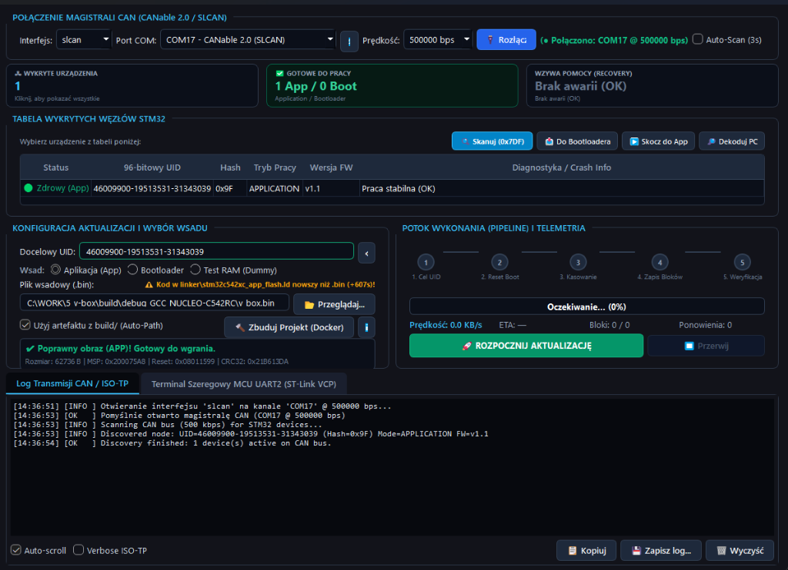

# Instrukcja Obsługi i Dokumentacja Funkcjonalna: V-BOX CAN OTA Updater & Diagnostic Studio (`tools/can_updater_gui.py`)

> **Powiązane dokumenty i narzędzia:**
> * Główny kod aplikacji GUI: [tools/can_updater_gui.py](file:///c:/WORK/5_v-box/tools/can_updater_gui.py)
> * Silnik komunikacyjny CLI / ISO-TP: [tools/can_updater.py](file:///c:/WORK/5_v-box/tools/can_updater.py)
> * Dokumentacja protokołu CAN Bootloader & OTA: [docs/bootloader/can_bootloader_and_ota_guide.md](file:///c:/WORK/5_v-box/docs/bootloader/can_bootloader_and_ota_guide.md)
> * Plan architektoniczny GUI: [docs/bootloader/can_updater_gui_implementation_plan.md](file:///c:/WORK/5_v-box/docs/bootloader/can_updater_gui_implementation_plan.md)

---

## 1. Przegląd Programu

**V-BOX CAN OTA Updater & Diagnostic Studio** (`tools/can_updater_gui.py`) to dedykowana aplikacja desktopowa (oparta na bibliotece **PyQt6** z automatycznym fallbackiem na **PyQt5**), zaprojektowana do bezinwazyjnej aktualizacji oprogramowania układowego (**Over-The-Air / Over-CAN**) oraz zaawansowanej diagnostyki mikrokontrolerów **STM32C542RCT6** przez magistralę **FDCAN1** lub **FDCAN2** (500 kbps, 29-bitowe identyfikatory Extended ID w przestrzeni `0x01F2F3xx` z tokenem autoryzacyjnym `"VBOX"`).



### Główne cechy i założenia projektowe:
* **Dwa tryby pracy (Dual-Persona):**
  1. **Tryb Inżynierski / Deweloperski (wewnątrz repozytorium `5_v-box`):** automatycznie wykrywa drzewo projektu, śledzi wygenerowane pliki `.bin`, ostrzega o nieaktualnej kompilacji (*Stale Build Detector*), umożliwia rekompilację kodu jednym kliknięciem (przez **Docker** lub lokalny **Ninja/GCC**) oraz tłumaczy adresy błędów procesora (`PC`) na dokładny plik `.c` i numer linii kodu (`addr2line`).
  2. **Tryb Serwisowy / Standalone (poza repozytorium lub bez Dockera):** pozwala na pełne skanowanie magistrali CAN, diagnostykę węzłów i wgrywanie gotowych plików `.bin` z dysku na każdym komputerze serwisowym bez konieczności instalowania kompilatorów czy środowiska Docker Desktop.
* **Wielowątkowa architektura czasu rzeczywistego (`QThread`):** operacje na magistrali CAN, strumieniowanie bloków ISO-TP, kompilacja projektu, odczyt UART2 oraz dekodowanie adresów błędów wykonują się w odseparowanych wątkach roboczych. Interfejs użytkownika nigdy się nie zamraża i zachowuje pełną płynność (60 FPS).
* **Stała ochrona geometrii okna:** wymuszony minimalny rozmiar okna (`1180 x 840 px`) oraz zbalansowany układ pionowy zapobiegają ucinaniu krawędzi, zniekształcaniu sekcji i ukrywaniu kontrolek.

---

## 2. Wymagania i Uruchomienie Programu

### 2.1. Instalacja bibliotek Python
Wszystkie wymagane pakiety znajdują się w pliku [tools/requirements_ota.txt](file:///c:/WORK/5_v-box/tools/requirements_ota.txt):
```powershell
pip install -r tools/requirements_ota.txt
```
*(Wymagane pakiety: `python-can`, `python-can-candle`, `candle-api`, `pyusb`, `libusb-package`, `pyserial`, `PyQt6` lub `PyQt5`).*

### 2.2. Sposoby uruchomienia
1. **Z poziomu Visual Studio Code (Zalecane):**
   * Wywołaj paletę poleceń (`Ctrl+Shift+P` $\rightarrow$ `Tasks: Run Task`) i wybierz zadanie:  
     **`[GUI] Launch CAN OTA Updater`**
2. **Z poziomu terminala (PowerShell / CMD):**
   ```powershell
   python tools/can_updater_gui.py
   ```

---

## 3. Szczegółowy Opis Sekcji i Opcji Interfejsu

Okno programu zostało podzielone na **6 logicznych stref funkcjonalnych** ułożonych od góry do dołu zgodnie z przepływem pracy operatora.

---

### Sekcja 1: Połączenie Magistrali CAN (`POŁĄCZENIE MAGISTRALI CAN`)

Górny pasek odpowiada za konfigurację fizycznego adaptera USB-CAN (**candleLight WinUSB** lub **CANable SLCAN**) i nawiązanie połączenia z magistralą **FDCAN1** (`PB8` RX / `PB9` TX) lub **FDCAN2** (`PB5` RX / `PB6` TX).

| Kontrolka / Opcja | Opis działania i przeznaczenie |
| :--- | :--- |
| **`Interfejs`** | Wybór sterownika adaptera CAN: **`candle (candleLight USB)`** (natywny WinUSB dla CANable 2.0 z firmwarem candleLight), **`slcan (CANable COM)`** (wirtualny port COM), **`gs_usb (libusb)`** (backend libusb-1.0) oraz **`socketcan (Linux)`**. Program automatycznie wykrywa podłączony adapter `candleLight` przy starcie! |
| **`Urządzenie USB / Port COM`** | Dynamiczna lista wykrytych kanałów USB `candleLight` (np. `candle:0:0 — Candlelight 2.5 (SN: ...)`) lub portów szeregowych COM (dla trybu `slcan`). |
| **`[🔄]` (Odśwież porty)** | Ponownie skanuje urządzenia USB `candleLight` oraz porty szeregowe COM i automatycznie przypisuje właściwe urządzenia po podłączeniu kabla USB. |
| **`Prędkość`** | Prędkość nominalna magistrali CAN (Bitrate). Domyślnie **`500000 bps` (500 kbps)** – zgodna z konfiguracją sprzętową FDCAN1/FDCAN2 w mikrokontrolerze. |
| **`[🔌 Połącz]` / `[🔌 Rozłącz]`** | Otwiera lub zamyka połączenie z magistralą CAN i uruchamia wątek nasłuchujący `CanBusMonitorWorker`. Tuż po połączeniu automatycznie wykonuje pojedynczy skan magistrali (`0x01F2F3DF`). |
| **Status połączenia** | Wskaźnik tekstowy obok przycisku: zielony `(● Połączono (candle): candle:0:0 @ 500000 bps)` lub czerwony `(● ROZŁĄCZONO)`. |
| **`[ ] Auto-Scan (3s)`** | **Domyślnie odznaczony** w celu utrzymania cichej magistrali CAN. Po zaznaczeniu program wysyła co 3 sekundy rozgłoszeniową ramkę `0x01F2F3DF` z tokenem `"VBOX"`, odświeżając listę urządzeń w czasie rzeczywistym. *(Na czas wgrywania wsadu skanowanie jest automatycznie wstrzymywane).* |

#### 🧠 Jak działa inteligentne rozpoznawanie adaptera (candleLight WinUSB vs CANable SLCAN vs ST-Link VCP)?
1. **Wykrywanie natywnego USB `candleLight` (`candle_api` / `1D50:606F`):** Przy uruchomieniu aplikacja sprawdza obecność adapterów z firmwarem `candleLight` (WinUSB / `gs_usb`). Jeśli taki adapter jest podłączony, lista `Interfejs` automatycznie ustawia się na **`candle (candleLight USB)`**, a na liście urządzeń pojawia się kanał `candle:0:0` wraz z numerem seryjnym.
2. **Klasyfikacja portów szeregowych (`find_serial_ports()`):**
   * **Adapter CANable 2.0 (SLCAN):** rozpoznawany po identyfikatorach `VID:PID` (`16D0:117E`) lub opisie (`CANable`, `SLCAN`). Otrzymuje etykietę **`COMx - CANable 2.0 (SLCAN)`**.
   * **Programator ST-Link VCP (UART2):** rozpoznawany po identyfikatorze STMicroelectronics (`VID = 0x0483`, `PID = 0x374B / 0x374E / 0x3752`). Otrzymuje etykietę **`COMy - ST-Link VCP (UART2)`** i jest **automatycznie przypisywany** do dolnej zakładki terminala szeregowego UART2!

---

### Sekcja 2: Kafelki Podsumowania Floty (Interaktywne Karty KPI)

Trzy kafelki pod paskiem połączenia prezentują stan wszystkich układów na magistrali oraz działają jako **interaktywne filtry tabeli**:

1. **`WYKRYTE URZĄDZENIA` (Niebieski):**
   * Wyświetla łączną liczbę wykrytych węzłów STM32 na magistrali CAN.
   * **Kliknięcie kafelka:** zdejmuje filtry i pokazuje wszystkie urządzenia w tabeli (`Filtr: ALL`).
2. **`GOTOWE DO PRACY` (Zielony):**
   * Wyświetla liczbę sprawnych węzłów w formacie **`X App / Y Boot`** (ile układów wykonuje główną aplikację, a ile czeka w czystym trybie serwisowym Bootloadera).
   * **Kliknięcie kafelka:** filtruje tabelę wyłącznie do sprawnych urządzeń (`Filtr: READY`).
3. **`WZYWA POMOCY (RECOVERY)` (Stonowany / Czerwony podczas awarii):**
   * Podczas normalnej pracy wyświetla stonowany komunikat **`Brak awarii (OK)`**.
   * Gdy którykolwiek mikrokontroler ulegnie awarii (np. 3-krotny `HardFault`, `Watchdog`, błąd `RTOS_ASSERT` lub pusta pamięć Flash) i zacznie nadawać ramkę ratunkową `0xEE` na ID `0x7E9`, kafelek zmienia kolor obramowania i tekstu na czerwony: **`X W TRYBIE SOS`**.
   * **Kliknięcie kafelka:** filtruje tabelę do urządzeń w stanie awarii (`Filtr: ALARM`) oraz automatycznie przepisuje 96-bitowy UID uszkodzonego układu do pola `Docelowy UID`.

---

### Sekcja 3: Tabela Wykrytych Węzłów STM32 i Pasek Akcji Diagnostycznych

Centralna tabela prezentuje szczegółowe informacje o każdym węźle wykrytym na magistrali CAN.

#### Pasek przycisków nad tabelą:
* **`[🔍 Skanuj (0x01F2F3DF)]`:** wysyła rozgłoszeniowe zapytanie `CMD_DISCOVER_NODES` (`0xA0`) wraz z 4-bajtowym tokenem autoryzacyjnym `"VBOX"` na 29-bitowym Extended ID `0x01F2F3DF`. Wszystkie podłączone płytki STM32 odpowiadają na Extended ID `0x01F2F3E9` (z przeciwkolizyjnym opóźnieniem czasowym wyliczanym ze skrótu `uid_hash`), przesyłając swój pełny 96-bitowy UID, aktywny tryb oraz wersję FW (a w trybie Recovery również ramkę diagnostyczną `0xEE` z przyczyną błędu i adresem `PC`).
* **`[📥 Do Bootloadera]`:** wysyła do wybranego węzła komendę `CMD_ENTER_BOOTLOADER` (`0xA2`). Aplikacja główna zapisuje żądanie `BOOT_REQ_ENTER_BOOTLOADER` w `SHARED_RAM` i wykonuje natychmiastowy restart do Bootloadera.
* **`[▶️ Skocz do App]`:** wysyła komendę `CMD_GO_EXECUTE` (`0x21`), nakazując Bootloaderowi zweryfikowanie aplikacji i skok pod adres `0x08008000`.
  > [!WARNING]
  > **Blokada bezpieczeństwa w trybie Recovery:** Gdy wybrane urządzenie znajduje się w stanie awarii (`🔴 SOS (AWARIA APP)` / `BOOTLOADER [RECOVERY]`), przycisk **`[▶️ Skocz do App]` jest automatycznie zablokowany (wyszarzony)**. Chroni to przed próbą uruchomienia uszkodzonego kodu aplikacji, co doprowadziłoby do natychmiastowego błędu procesora. Aby odblokować skok, należy najpierw wgrać sprawny wsad.
* **`[🔎 Dekoduj PC]`:** otwiera okno z pełnym opisem diagnostycznym wybranego wiersza, w tym zdekodowanym adresem instrukcji `PC` (*Program Counter*), pod którym nastąpiła awaria.

#### Kolumny tabeli i logika prezentacji stanu:
* **`Status`:**
  * `🟢 Zdrowy (App)` – układ działa stabilnie w aplikacji głównej FreeRTOS.
  * `🟡 Bootloader` – układ znajduje się w normalnym trybie Bootloadera (oczekuje na rozkazy).
  * `🔴 SOS (AWARIA APP)` – aplikacja główna uległa awarii, natomiast sam Bootloader działa stabilnie w trybie ratunkowym i jest gotowy do przyjęcia nowego wsadu.
* **`96-bitowy UID`:** unikalny, 12-bajtowy identyfikator fabryczny układu STM32 (np. `46009900-19513531-31343039`). Kliknięcie dowolnego wiersza tabeli automatycznie kopiuje ten UID do pola aktualizacji poniżej.
* **`Hash`:** 1-bajtowy skrót XOR wszystkich 12 bajtów UID (np. `0x9F`). Służy do błyskawicznego łączenia ramek ratunkowych `0xEE` z pełnym wpisem urządzenia w jednym wierszu tabeli.
* **`Tryb Pracy`:** `APPLICATION`, `BOOTLOADER` lub `BOOTLOADER [RECOVERY]`.
* **`Wersja FW`:** wersja oprogramowania odczytana z ramki Discovery. Dla aplikacji z nowszym firmware wyświetlana jest pełna wersja aplikacji i zainstalowanego Bootloadera (np. `v2.0.0 | BL v1.2.0`), dla starszego firmware skrócona wersja `vMajor.Minor` (np. `v1.1`).
* **`Diagnostyka / Crash Info`:**
  * Dla sprawnych układów: `Praca stabilna (OK)` lub `Tryb serwisowy / Programowanie Flash (OK)`.
  * Dla układów w trybie SOS: scalona informacja diagnostyczna w jednym wierszu, np.:  
    `Awaria App: HARDFAULT (3/3) @ prvTaskExitError() [port.c:215] | Bootloader stabilny (gotowy do wgrania)`.
  * **Automatyczne wygaszanie SOS:** Po pomyślnym wgraniu programu i rozruchu aplikacji (`APPLICATION`) lub po ustaniu nadawania ramek `0xEE` (czas życia TTL = 3.5 s), status SOS jest automatycznie czyszczony, a wiersz natychmiast zmienia status na `🟢 Zdrowy (App)`.

---

### Sekcja 4: Konfiguracja Aktualizacji, Wybór Wsadu i Strażnik Pre-Flight

Lewy środkowy panel pozwala określić cel aktualizacji, wybrać plik binarny oraz zweryfikować jego integralność przed wysyłką.

| Element | Opis funkcjonalności |
| :--- | :--- |
| **`Docelowy UID`** | Pole z 96-bitowym adresem UID programowanego układu. Wypełnia się automatycznie po kliknięciu wiersza w tabeli (lub automatycznie przy wykryciu 1 węzła na magistrali). **Zielona ramka** potwierdza poprawny format (24 znaki hex / 12 bajtów). Przycisk **`[✖]`** czyści pole. |
| **`Wsad: Aplikacja (App)`** | Tryb aktualizacji głównego programu (`v_box.bin`) w partycji `0x08008000` (do 192 KB). |
| **`Wsad: Bootloader`** | Tryb bezpiecznej, zdalnej aktualizacji samego Bootloadera (`v_box_boot.bin`, do 32 KB) za pośrednictwem bufora pośredniego **Flash Staging Slot (`0x08038000`)**. Wymaga aktywnej Aplikacji Głównej. |
| **`Wsad: Test RAM (Dummy)`** | Tryb testowy (symulacja). Wysyła bloki danych do pamięci RAM mikrokontrolera bez kasowania i zapisywania pamięci Flash – idealny do testowania stabilności i przepustowości łącza CAN. |
| **`Plik wsadowy (.bin)` + `[📁 Przeglądaj...]`** | Ścieżka do pliku binarnego z obrazem firmware oraz przycisk wyboru pliku z dowolnego folderu na dysku. |
| **Ostrzeżenie o nieaktualnym buildzie (*Stale Build*)** | Jeśli program działa wewnątrz repozytorium `5_v-box`, porównuje czas modyfikacji pliku `.bin` ze wszystkimi plikami `.c`, `.h`, `.ld` i `CMakeLists.txt`. Jeśli kod źródłowy jest nowszy niż plik `.bin`, pojawia się pomarańczowy napis: `⚠️ Kod w <plik> nowszy niż .bin (+Xs)!`. |
| **`[✔] Użyj artefaktu z build/ (Auto-Path)`** | Automatycznie ustawia ścieżkę na domyślny plik wyjściowy kompilatora: `build/debug_GCC_NUCLEO-C542RC/v_box.bin` (dla App) lub `v_box_boot.bin` (dla Bootloadera). |
| **`[🔨 Zbuduj Projekt]` + `[ℹ️]`** | Uruchamia kompilację projektu bezpośrednio z GUI. Przycisk automatycznie bada środowisko:<br>• **`Zbuduj Projekt (Docker)`** – gdy działa Docker Desktop z obrazem `vbox-builder`.<br>• **`Zbuduj Projekt (Ninja)`** – gdy w systemie zainstalowano lokalny `ninja` oraz `arm-none-eabi-gcc`.<br>• **`Zbuduj Projekt (Niedostępny)`** – wyszarzony, gdy brak obu narzędzi (wgrywanie gotowych plików `.bin` nadal działa!).<br>Przycisk **`[ℹ️]`** wyświetla szczegółową instrukcję konfiguracji środowiska budowania. |

#### 🛡️ Strażnik Obrazu Binarnego (`Pre-Flight Binary Guard`)
Karta informacyjna na dole sekcji konfiguracji automatycznie bada każdy wybrany plik `.bin` jeszcze przed kliknięciem „Rozpocznij Aktualizację”:
1. **Kontrola rozmiaru partycji:** sprawdza, czy plik mieści się w limitach pamięci Flash (`512 B .. 192 KB` dla App; `512 B .. 32 KB` dla Bootloadera).
2. **Inspekcja tablicy wektorów ARM Cortex-M33 (pierwsze 8 bajtów pliku):**
   * **Wskaźnik stosu (`Initial_MSP`):** musi wskazywać prawidłowy obszar pamięci SRAM mikrokontrolera STM32C5 (`0x20000000 .. 0x20010000`).
   * **Wektor startowy (`Reset_Handler`):** musi mieć ustawiony bit instrukcji **Thumb** (`bit 0 == 1`) oraz wskazywać na właściwą partycję pamięci Flash!
3. **Ochrona przed pomyleniem obrazów (App vs Bootloader):**
   * Jeśli wybierzesz opcję `Aplikacja (App)`, ale omyłkowo wskażesz plik `v_box_boot.bin` (z adresem `Reset_Handler` w przedziale `0x08000000..0x08007FFF`), strażnik wyświetli czerwony błąd:  
     `❌ BŁĄD: Wybrano obraz BOOTLOADERA (Reset=0x0800xxxx) w trybie aktualizacji APLIKACJI!` i **zablokuje uruchomienie aktualizacji**.
4. **Wyrównanie do 16 bajtów (Quad-Word Alignment) i CRC32:**
   * Wyświetla dokładny rozmiar pliku, odczytane adresy `MSP` i `Reset`, wyliczoną sumę kontrolną **CRC32 (IEEE 802.3)** oraz informuje o automatycznym dopełnieniu obrazu bajtami `0xFF` do wielokrotności 16 bajtów (wymagane przez 128-bitowy kontroler Flash w STM32C5).

---

### Sekcja 5: Potok Wykonania (`POTOK WYKONANIA (PIPELINE) I TELEMETRIA`)

Prawy środkowy panel wizualizuje przebieg sesji programowania krok po kroku oraz prezentuje parametry transmisji w czasie rzeczywistym.

#### Wizualny Stepper Krokowy (`PipelineStepperWidget`):
* **Dla aktualizacji Aplikacji Głównej (5 kroków):**
  1. **`1. Cel UID`** – zaadresowanie wybranego węzła po jego 96-bitowym identyfikatorze (`CMD_SELECT_TARGET`).
  2. **`2. Reset Boot`** – automatyczne przełączenie układu z Aplikacji do Bootloadera (`CMD_ENTER_BOOTLOADER`), odczekanie na inicjalizację i ponowne zestawienie sesji.
  3. **`3. Kasowanie`** – wykasowanie sektorów pamięci Flash aplikacji od adresu `0x08008000` (`CMD_ERASE_APP`).
  4. **`4. Zapis Bloków`** – strumieniowe przesyłanie bloków po 1024 bajty przez protokół **ISO-TP** (`CMD_WRITE_MEMORY`), z odstępami między ramkami `CF` dyktowanymi przez urządzenie (`STmin` / `BlockSize` z ramki Flow Control). Każdy blok jest natychmiast weryfikowany własną sumą CRC32.
     > [!IMPORTANT]
     > **Mechanizm Deferred Vector Table Commit:** Pierwszy blok (`Blok 0` zawierający tablicę wektorów startowych pod `0x08008000`) nie jest od razu zapisywany do Flash, lecz buforowany w pamięci RAM Bootloadera. Zostaje fizycznie wgrany do Flash dopiero w Kroku 5 po potwierdzeniu poprawności całego obrazu! Dzięki temu przerwanie zasilania lub odłączenie kabla CAN w trakcie Kroku 4 nigdy nie uszkodzi urządzenia – po resecie Bootloader wykryje brak wektorów i bezpiecznie pozostanie w trybie Recovery.
  5. **`5. Weryfikacja`** – sprawdzenie całościowej sumy kontrolnej CRC32 (`CMD_VERIFY_FIRMWARE`), zatwierdzenie `Bloku 0`, restart do nowej aplikacji (`CMD_GO_EXECUTE`) oraz automatyczny **Post-Flash Health Check** (weryfikacja na magistrali CAN, że układ zgłosił się jako `APPLICATION`).

* **Dla aktualizacji Bootloadera (6 kroków):**
  1. **`1. Cel UID`** – wybór węzła i upewnienie się, że działa w trybie `APPLICATION`.
  2. **`2. Kasuj Staging`** – wykasowanie 32-kilobajtowego bufora **Flash Staging Slot** (`0x08038000`).
  3. **`3. Zapis Staging`** – przesłanie nowego obrazu `v_box_boot.bin` do bufora `0x08038000`.
  4. **`4. Weryfikuj CRC`** – weryfikacja sumy CRC32 całego obrazu w buforze Staging.
  5. **`5. Instaluj Boot`** – wysłanie komendy `CMD_UPDATE_BOOTLOADER` (`0xA4`): mikrokontroler w sekcji krytycznej bada tablicę wektorów w buforze Staging, kasuje strony `0..15` (`0x08000000`), kopiuje nowy Bootloader i weryfikuje zapis.
  6. **`6. Restart`** – skok i uruchomienie nowego Bootloadera oraz Aplikacji.

#### Wskaźniki i przyciski sterujące:
* **Pasek postępu (`QProgressBar`):** pokazuje procentowe zaawansowanie oraz opis aktualnie wykonywanego kroku.
* **Telemetria na żywo:**
  * `Prędkość: X.XX KB/s` – rzeczywista prędkość przesyłania danych po ISO-TP.
  * `ETA: X.X s` – szacowany czas pozostały do końca wgrywania.
  * `Bloki: aktualny / wszystkie` – licznik przesłanych 256-bajtowych bloków (np. `246 / 246`).
  * `Ponowienia: X` – liczba automatycznych retransmisji bloków w przypadku błędów CRC lub zakłóceń na linii CAN.
* **`[🚀 ROZPOCZNIJ AKTUALIZACJĘ]`:** rozpoczyna proces programowania.
* **`[⏹️ Przerwij]`:** aktywny wyłącznie podczas trwającej sesji; pozwala bezpiecznie przerwać wgrywanie po zakończeniu bieżącego bloku.

---

### Sekcja 6: Konsola Logów CAN / ISO-TP oraz Terminal Szeregowy UART2

Dolny panel zawiera dwie niezależne zakładki diagnostyczne:

#### Zakładka 1: `Log Transmisji CAN / ISO-TP`
Rejestruje ze znacznikiem czasu (`[HH:MM:SS]`) wszystkie zdarzenia na magistrali CAN:
* `[INFO]` (niebieski) – etapy operacji, skanowanie, wykryte węzły.
* `[OK]` (zielony) – potwierdzenia wykonania rozkazów, poprawne sumy CRC32, udane aktualizacje.
* `[WARN]` / `[RECOVERY]` (pomarańczowy/czerwony) – ostrzeżenia oraz odebrane sygnały ratunkowe `0xEE` wraz ze zdekodowanym adresem błędu `PC`.
* `[ERROR]` (czerwony) – błędy komunikacji, przekroczenia czasu (`Timeout`) lub odrzucenia ramek (`NACK`).

#### Zakładka 2: `Terminal Szeregowy MCU UART2 (ST-Link VCP)`
Wbudowany monitor portu szeregowego podłączony do wirtualnego portu COM programatora ST-Link:
* Pozwala podglądać logi tekstowe `safe_printf` wysyłane bezpośrednio przez mikrokontroler (`[BOOT]`, `[OTA]`, `[CAN]`) bez potrzeby uruchamiania zewnętrznych programów (PuTTY, TeraTerm).
* Posiada własny wybór portu COM (domyślnie ustawiony na wykryty `ST-Link VCP`), prędkości (`115200` bps) oraz przycisk **`[🔌 Połącz UART2]`**.

#### Dolny pasek narzędziowy konsoli:
* **`[✔] Auto-scroll`:** automatyczne przewijanie okna logów do najnowszego wiersza.
* **`[ ] Verbose ISO-TP`:** włącza szczegółowe logowanie każdej pojedynczej ramki warstwy transportowej ISO 15765-2 (`Single Frame`, `First Frame`, `Consecutive Frame`, `Flow Control`). Przydatne podczas głębokiej analizy protokołu CAN.
* **`[📋 Kopiuj]`:** kopiuje całą zawartość aktywnej konsoli do schowka systemowego.
* **`[💾 Zapisz log...]`:** eksportuje zawartość aktywnej konsoli do pliku `.log` lub `.txt`.
* **`[🗑️ Wyczyść]`:** czyści ekran aktywnej zakładki.

---

## 4. Typowe Scenariusze Użycia (Krok po Kroku)

### Scenariusz A: Standardowa aktualizacja Aplikacji Głównej (`v_box.bin`)
1. Podłącz adapter **CANable 2.0** do komputera oraz do pinów **FDCAN2** (`PB5`/`PB6`) płytki NUCLEO-C542RC.
2. Uruchom program. W sekcji połączenia port `COMx - CANable 2.0 (SLCAN)` zostanie wybrany automatycznie. Kliknij **`[🔌 Połącz]`**.
3. W tabeli pojawi się wykryty układ STM32, a jego `96-bitowy UID` automatycznie wpisze się w pole **`Docelowy UID`**.
4. Upewnij się, że zaznaczono `Wsad: Aplikacja (App)` oraz `[✔] Użyj artefaktu z build/`.
   * *(Jeśli wyświetla się żółte ostrzeżenie o nowszym kodzie źródłowym, kliknij **`[🔨 Zbuduj Projekt]`**, aby przekompilować wsad).*
5. Sprawdź zielony komunikat strażnika: `✔ Poprawny obraz (APP)! Gotowy do wgrania.`
6. Kliknij **`[🚀 ROZPOCZNIJ AKTUALIZACJĘ]`**.
7. Obserwuj postęp 5 kroków w potoku wykonania. Po około 3–4 sekundach pojawi się komunikat o sukcesie, a układ w tabeli zgłosi status **`🟢 Zdrowy (App)`**.

---

### Scenariusz B: Ratowanie płytki po awarii oprogramowania (`Recovery Mode / SOS`)
1. Jeśli wgrana aplikacja zawiera błąd krytyczny (np. dereferencja pustego wskaźnika wywołująca `HardFault`), po 3 nieudanych próbach startu Bootloader zatrzyma wykonywanie aplikacji i przejdzie w tryb **`BOOT_MODE_RECOVERY`**.
2. Po połączeniu w programie GUI:
   * Kafelek **`WZYWA POMOCY (RECOVERY)`** podświetli się na czerwono (`1 W TRYBIE SOS`).
   * W tabeli zobaczysz wiersz ze statusem **`🔴 SOS (AWARIA APP)`**, trybem `BOOTLOADER [RECOVERY]` oraz dokładną lokalizacją błędu w kodzie C (np. `Awaria App: HARDFAULT (3/3) @ main_task() [app_main.c:84]`).
   * Przycisk `[▶️ Skocz do App]` zostanie zablokowany, aby chronić układ przed ponownym wywołaniem błędu.
3. Popraw błąd w kodzie źródłowym C, kliknij **`[🔨 Zbuduj Projekt]`**, a następnie **`[🚀 ROZPOCZNIJ AKTUALIZACJĘ]`**.
4. Po wgraniu poprawionej aplikacji status SOS automatycznie zgaśnie, kafelek alarmowy wróci do stanu **`Brak awarii (OK)`**, a urządzenie uzyska zielony status **`🟢 Zdrowy (App)`**.

---

### Scenariusz C: Zdalna aktualizacja samego Bootloadera (`v_box_boot.bin`)
1. Upewnij się, że docelowe urządzenie działa w trybie **`APPLICATION`** (`🟢 Zdrowy (App)`).
2. W sekcji wyboru wsadu przełącz opcję na **`Bootloader`**.
   * Ścieżka pliku automatycznie zmieni się na `build/debug_GCC_NUCLEO-C542RC/v_box_boot.bin`.
   * Potok wykonania przełączy się na **6-krokowy tryb Staging**.
3. Kliknij **`[🚀 ROZPOCZNIJ AKTUALIZACJĘ]`** i potwierdź operację w oknie dialogowym.
4. Program prześle nowy Bootloader do bezpiecznego bufora `0x08038000`, zweryfikuje jego sumę CRC32 oraz wektory startowe, a następnie zleci mikrokontrolerowi atomową podmianę sektorów `0x08000000` i restart.
