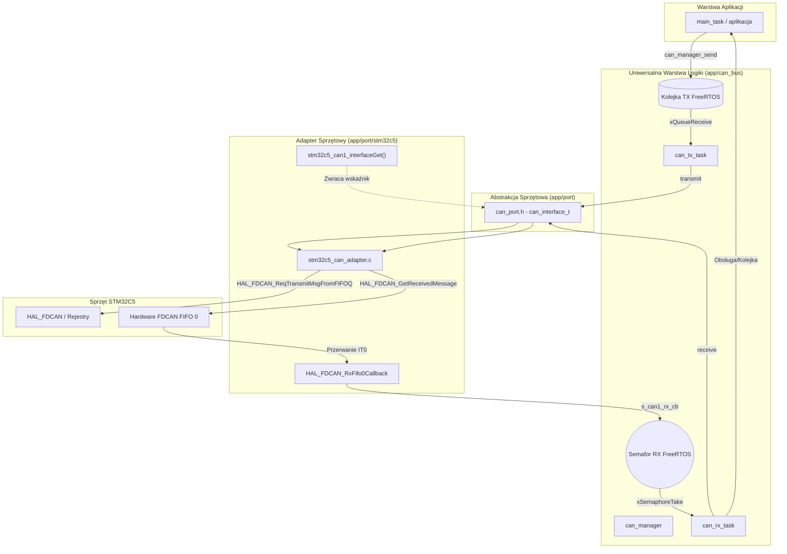

# Przewodnik Implementacji i Portowania Magistrali CAN

Dokument opisuje architekturę warstwową, proces implementacji oraz procedurę portowania modułu magistrali CAN dla mikrokontrolerów z rodziny **STM32C5** (oraz innych układów STM32) w systemie czasu rzeczywistego **FreeRTOS**.

---

## Spis Treści
1. [Wstęp i Architektura Warstwowa](#1-wstęp-i-architektura-warstwowa)
2. [Struktura Katalogów i Plików](#2-struktura-katalogów-i-plików)
3. [Krok 1: Kontrakt Abstrakcji Sprzętowej (`can_port.h`)](#3-krok-1-kontrakt-abstrakcji-sprzętowej-can_porth)
4. [Krok 2: Adapter Sprzętowy (`stm32c5_can_adapter.h` i `.c`)](#4-krok-2-adapter-sprzętowy-stm32c5_can_adapterh-i-c)
5. [Krok 3: Uniwersalny Menedżer CAN (`can_manager.h` i `.c`)](#5-krok-3-uniwersalny-menedżer-can-can_managerh-i-c)
6. [Krok 4: Konfiguracja FreeRTOS i Przerwań NVIC](#6-krok-4-konfiguracja-freertos-i-przerwań-nvic)
7. [Krok 5: Rejestracja w `CMakeLists.txt`](#7-krok-5-rejestracja-w-cmakeliststxt)
8. [Krok 6: Inicjalizacja i Uruchomienie w `main.c`](#8-krok-6-inicjalizacja-i-uruchomienie-w-mainc)
9. [Krok 7: Dodawanie kolejnej szyny (np. CAN2) lub portowanie na inny MCU](#9-krok-7-dodawanie-kolejnej-szyny-np-can2-lub-portowanie-na-inny-mcu)

---

## 1. Wstęp i Architektura Warstwowa

### Dlaczego stosujemy architekturę warstwową?
Zgodnie z zasadami projektu (plik `GEMINI.md`) obowiązuje ścisła separacja:
* **Logika biznesowa i kolejkowanie:** Zależna wyłącznie od FreeRTOS, w 100% niezależna od układu mikrokontrolera.
* **Warstwa sprzętowa:** Dedykowany adapter tłumaczący operacje na wywołania HAL/LL mikrokontrolera.

Dzięki temu zmiana rodziny mikrokontrolera (np. z STM32C5 na STM32H5 lub STM32G4) albo dodanie drugiego kontrolera (CAN2) **nie wymaga dotykania ani jednej linijki kodu w menedżerze CAN i aplikacji**.

### Model Dependency Injection z funkcją Getter
Zamiast eksportować globalną strukturę jako `extern const can_interface_t stm32c5_can1_interface;`, stosujemy hermetyzację poprzez funkcję pobierającą wskaźnik do interfejsu (getter):
```c
const can_interface_t *stm32c5_can1_interfaceGet(void);
```
Sama struktura adaptera w pliku `.c` oznaczona jest jako `static`, co zapobiega zanieczyszczaniu przestrzeni nazw symboli globalnych i uniemożliwia przypadkową modyfikację.

### Architektura Zdarzeniowa (Event-Driven vs Polling)
W systemach czasu rzeczywistego odpytywanie w pętli (polling) marnuje cykle procesora i opóźnia odbiór ramek. Wdrożona architektura wykorzystuje **przerwania i semafor binarny**:
1. Ramka trafia do sprzętowego Rx FIFO 0 kontrolera FDCAN.
2. Kontroler zgłasza przerwanie NVIC -> wywoływany jest callback `HAL_FDCAN_RxFifo0Callback()`.
3. Callback wywołuje zarejestrowaną funkcję powiadomienia, która oddaje semafor binarny (`xSemaphoreGiveFromISR`).
4. Dedykowany task odbiorczy FreeRTOS (`can_rx_task`), który oczekiwał na semaforze (`xSemaphoreTake`), zostaje natychmiast wybudzony, pobiera ramkę ze sprzętowego FIFO i przekazuje do aplikacji.



---

## 2. Struktura Katalogów i Plików

Wszystkie nowe pliki tworzone są w katalogu `app/` zgodnie z regułami projektu:

```text
c:\WORK\5_v-box\
├── app\
│   ├── port\
│   │   ├── can_port.h                 <-- Abstrakcja interfejsu (CZYSTY C, bez HAL/FreeRTOS)
│   │   └── stm32c5\
│   │       ├── stm32c5_can_adapter.h  <-- Nagłówek adaptera (deklaracja stm32c5_can1_interfaceGet)
│   │       └── stm32c5_can_adapter.c  <-- Implementacja adaptera (HAL_FDCAN, przerwania ISR)
│   ├── can_bus\
│   │   ├── can_manager.h              <-- Publiczne API (can_instance_t, can_manager_init, send, read)
│   │   └── can_manager.c              <-- Logika FreeRTOS (taski, kolejki, obsługa semafora)
│   └── tasks_config.h                 <-- Konfiguracja priorytetów i rozmiarów stosów FreeRTOS
├── generated\
│   ├── hal\
│   │   └── mx_fdcan1.c                <-- Konfiguracja sprzętowa CubeMX (priorytet przerwania NVIC!)
│   └── middleware\
│       └── mx_freertos_app.c          <-- Oczyszczone z logiki biznesowej taski startowe
├── main.c                             <-- Punkt wejścia: inicjalizacja i wstrzyknięcie adaptera
└── CMakeLists.txt                     <-- Rejestracja źródeł C i katalogów include
```

---

## 3. Krok 1: Kontrakt Abstrakcji Sprzętowej (`can_port.h`)

Plik: `app/port/can_port.h`

### Zasady:
1. **Całkowity zakaz** dołączania jakichkolwiek nagłówków STM32 (`#include "stm32c5xx_hal.h"` itp.) oraz FreeRTOS.
2. Definiuje wskaźniki na funkcje operujące na standardowych typach (`uint32_t`, `uint8_t*`, `bool`).
3. Definiuje sygnaturę callbacku powiadomienia RX wywoływanego z poziomu przerwania.

### Zawartość pliku:
```c
#ifndef CAN_PORT_H
#define CAN_PORT_H

#include <stdint.h>
#include <stdbool.h>

/**
 * @brief Dozwolone prędkości transmisji magistrali CAN.
 */
typedef enum {
    CAN_BAUDRATE_CUSTOM = 0,       /**< Domyślna konfiguracja sprzętowa (np. z CubeMX) */
    CAN_BAUDRATE_125K   = 125000,  /**< 125 kbps */
    CAN_BAUDRATE_250K   = 250000,  /**< 250 kbps */
    CAN_BAUDRATE_500K   = 500000,  /**< 500 kbps */
    CAN_BAUDRATE_1000K  = 1000000  /**< 1 Mbps */
} can_baudrate_t;

/**
 * @brief Struktura konfiguracyjna parametrów pracy szyny CAN/FDCAN.
 */
typedef struct {
    uint32_t frame_format;          /**< Format ramki: CAN_MSG_FRAME_FORMAT_CAN lub CAN_MSG_FRAME_FORMAT_FD_CAN */
    can_baudrate_t baudrate_normal; /**< Wybrana prędkość transmisji nominalnej */
    can_baudrate_t baudrate_FD;     /**< Wybrana prędkość transmisji danych (dla CAN FD) */
} can_config_t;

/**
 * @brief Typ wskaźnika na funkcję callback powiadamiającą o odebraniu danych w przerwaniu (ISR).
 * @param context Kontekst powiązany z instancją CAN (np. wskaźnik na can_instance_t).
 */
typedef void (*can_rx_notify_fn)(void* context);

/**
 * @brief Generyczna struktura interfejsu sprzętowego magistrali CAN.
 */
typedef struct {
    /** Inicjalizacja kontrolera o parametrach z can_config_t */
    bool (*init)(const can_config_t *config);

    /** Nadanie ramki: id (standard/extended), bufor danych, długość w bajtach */
    bool (*transmit)(uint32_t id, const uint8_t* data, uint8_t len);

    /** Odbiór ramki ze sprzętowego FIFO: wypełnia id, bufor danych oraz odebraną długość */
    bool (*receive)(uint32_t* id, uint8_t* data, uint8_t* len);

    /** Podpięcie callbacku powiadomienia z przerwania ISR */
    void (*attach_rx_callback)(can_rx_notify_fn cb, void* context);
} can_interface_t;

#endif // CAN_PORT_H
```

---

## 4. Krok 2: Adapter Sprzętowy (`stm32c5_can_adapter.h` i `.c`)

Pliki: `app/port/stm32c5/stm32c5_can_adapter.h` oraz `app/port/stm32c5/stm32c5_can_adapter.c`

### Rola adaptera:
* Łączy abstrakcję `can_interface_t` z biblioteką STM32 HAL dla konkretnej rodziny (w tym przypadku STM32C5xx).
* Mapuje bity ID (Standard 11-bit / Extended 29-bit) oraz konwertuje długość w bajtach na kody DLC kontrolera FDCAN.
* Obsługuje sprzętowy callback przerwania `HAL_FDCAN_RxFifo0Callback()` i powiadamia menedżera.
* **Udostępnia interfejs poprzez funkcję getter `stm32c5_can1_interfaceGet()`**.

### 4.1 Plik nagłówkowy `stm32c5_can_adapter.h`:
```c
#ifndef STM32C5_CAN_ADAPTER_H
#define STM32C5_CAN_ADAPTER_H

#include "can_port.h"

/**
 * @brief Pobiera wskaźnik do stałego interfejsu sprzętowego CAN1 dla STM32C5.
 * @return Wskaźnik do struktury can_interface_t.
 */
const can_interface_t *stm32c5_can1_interfaceGet(void);

#endif /* STM32C5_CAN_ADAPTER_H */
```

### 4.2 Plik implementacji `stm32c5_can_adapter.c`:
Kluczowe fragmenty implementacji:

1. **Kontekst callbacku:**
```c
static can_rx_notify_fn s_can1_rx_cb = NULL;
static void* s_can1_rx_context = NULL;
```

2. **Inicjalizacja i konfiguracja trybu (`init`):**
```c
static bool stm32c5_can1_init(const can_config_t *config)
{
    hal_fdcan_handle_t *hfdcan = mx_fdcan1_gethandle();
    if (hfdcan == NULL) return false;

    if (HAL_FDCAN_GetState(hfdcan) == HAL_FDCAN_STATE_ACTIVE)
    {
        HAL_FDCAN_Stop(hfdcan);
    }

    can_config_t cfg = (config != NULL) ? *config : (can_config_t){
        .frame_format = CAN_MSG_FRAME_FORMAT_CAN,
        .baudrate_normal = CAN_BAUDRATE_500K,
        .baudrate_FD = CAN_BAUDRATE_CUSTOM
    };

    /* 1. Ustawienie nominalnego baudrate */
    stm32c5_set_nominal_baudrate(hfdcan, cfg.baudrate_normal);

    /* 2. Ustawienie formatu ramki (Classic CAN vs CAN FD z/bez BRS) */
    if (cfg.frame_format == CAN_MSG_FRAME_FORMAT_FD_CAN)
    {
        bool is_brs = (cfg.baudrate_FD != CAN_BAUDRATE_CUSTOM) && (cfg.baudrate_FD > cfg.baudrate_normal);
        if (is_brs)
        {
            HAL_FDCAN_SetFrameFormat(hfdcan, HAL_FDCAN_FRAME_FORMAT_FD_BRS);
            stm32c5_set_data_baudrate(hfdcan, cfg.baudrate_FD);
        }
        else
        {
            /* CAN FD bez BRS (gdy prędkość danych jest równa nominalnej lub nieokreślona) */
            HAL_FDCAN_SetFrameFormat(hfdcan, HAL_FDCAN_FRAME_FORMAT_FD_NO_BRS);
        }
    }
    else
    {
        HAL_FDCAN_SetFrameFormat(hfdcan, HAL_FDCAN_FRAME_FORMAT_CLASSIC_CAN);
    }

    /* 3. Konfiguracja NVIC, przerwań FIFO 0 i start peryferium */
    HAL_CORTEX_NVIC_SetPriority(FDCAN1_IT0_IRQn, HAL_CORTEX_NVIC_PREEMP_PRIORITY_5, 0);
    HAL_CORTEX_NVIC_EnableIRQ(FDCAN1_IT0_IRQn);
    HAL_FDCAN_SetInterruptGroupsToLine(hfdcan, HAL_FDCAN_IT_GROUP_RX_FIFO_0, HAL_FDCAN_IT_LINE_0);
    HAL_FDCAN_EnableInterruptLines(hfdcan, HAL_FDCAN_IT_LINE_0);
    HAL_FDCAN_EnableInterrupts(hfdcan, HAL_FDCAN_IT_RX_FIFO_0_NEW_MSG);

    return (HAL_FDCAN_Start(hfdcan) == HAL_OK);
}
```

3. **Obsługa nadawania (`transmit`):**
```c
static bool stm32c5_can1_transmit(uint32_t id, const uint8_t* data, uint8_t len)
{
    hal_fdcan_handle_t *hfdcan = mx_fdcan1_gethandle();
    if (hfdcan == NULL || data == NULL) return false;

    hal_fdcan_tx_header_t tx_header = {0};
    uint8_t max_payload = (s_can1_config.frame_format == CAN_MSG_FRAME_FORMAT_FD_CAN) ? 64U : 8U;
    uint8_t payload_len = (len > max_payload) ? max_payload : len;

    tx_header.b.data_length = bytes_to_fdcan_dlc(payload_len);
    tx_header.b.identifier_type = CAN_msg_is_extended_id(id) ? HAL_FDCAN_ID_EXTENDED : HAL_FDCAN_ID_STANDARD;
    tx_header.b.identifier = CAN_msg_get_can_id(id);
    tx_header.b.frame_type = HAL_FDCAN_FRAME_DATA;

    if (s_can1_config.frame_format == CAN_MSG_FRAME_FORMAT_FD_CAN)
    {
        tx_header.b.frame_format = HAL_FDCAN_HEADER_FRAME_FORMAT_FD_CAN;
        tx_header.b.bit_rate_switch = stm32c5_is_brs_enabled(&s_can1_config)
                                      ? HAL_FDCAN_BIT_RATE_SWITCH_ON
                                      : HAL_FDCAN_BIT_RATE_SWITCH_OFF;
    }
    else
    {
        tx_header.b.frame_format = HAL_FDCAN_HEADER_FRAME_FORMAT_CAN;
        tx_header.b.bit_rate_switch = HAL_FDCAN_BIT_RATE_SWITCH_OFF;
    }

    return (HAL_FDCAN_ReqTransmitMsgFromFIFOQ(hfdcan, &tx_header, data) == HAL_OK);
}
```

4. **Obsługa odbioru (`receive`):**
```c
static bool stm32c5_can1_receive(uint32_t* id, uint8_t* data, uint8_t* len)
{
    hal_fdcan_handle_t *hfdcan = mx_fdcan1_gethandle();
    if (hfdcan == NULL || id == NULL || data == NULL || len == NULL) return false;

    uint32_t fill_level = 0;
    HAL_FDCAN_GetRxFifoFillLevel(hfdcan, HAL_FDCAN_RX_FIFO_0, &fill_level);
    if (fill_level == 0) return false;

    hal_fdcan_rx_header_t rx_header = {0};
    if (HAL_FDCAN_GetReceivedMessage(hfdcan, HAL_FDCAN_RX_FIFO_0, &rx_header, data) != HAL_OK)
    {
        return false;
    }

    *len = fdcan_dlc_to_bytes(rx_header.b.data_length);
    *id = (rx_header.b.identifier_type == HAL_FDCAN_ID_EXTENDED) 
            ? CAN_msg_set_extended_id(rx_header.b.identifier) 
            : CAN_msg_set_standard_id(rx_header.b.identifier);

    return true;
}
```

4. **Callback przerwania z obsługą powiadomienia:**
```c
void HAL_FDCAN_RxFifo0Callback(hal_fdcan_handle_t *hfdcan, uint32_t rx_fifo0_interrupts)
{
    if (hfdcan == mx_fdcan1_gethandle())
    {
        if ((rx_fifo0_interrupts & (FDCAN_IR_RF0N | FDCAN_IR_RF0F)) != 0U)
        {
            if (s_can1_rx_cb != NULL)
            {
                s_can1_rx_cb(s_can1_rx_context);
            }
        }
    }
}
```

5. **Hermetyzacja struktury i funkcja getter:**
```c
// Struktura statyczna, niewidoczna poza tym plikiem jednostki kompilacji
static const can_interface_t s_stm32c5_can1_interface = {
    .init = stm32c5_can1_init,
    .transmit = stm32c5_can1_transmit,
    .receive = stm32c5_can1_receive,
    .attach_rx_callback = stm32c5_can1_attach_rx_callback
};

// Publiczna funkcja getter
const can_interface_t *stm32c5_can1_interfaceGet(void)
{
    return &s_stm32c5_can1_interface;
}
```

---

## 5. Krok 3: Uniwersalny Menedżer CAN (`can_manager.h` i `.c`)

Pliki: `app/can_bus/can_manager.h` oraz `app/can_bus/can_manager.c`

### Rola menedżera:
* Zarządza zadaniami FreeRTOS: zadanie nadawcze (`can_tx_task`) i zdarzeniowe zadanie odbiorcze (`can_rx_task`).
* Zarządza kolejką TX (`tx_queue`) oraz semaforem binarnym RX (`rx_sem`).
* Nie zawiera żadnych odwołań do STM32 HAL! Cała komunikacja ze sprzętem odbywa się przez przekazany wskaźnik `const can_interface_t*`.

### 5.1 Struktura instancji (`can_manager.h`):
```c
typedef struct {
    QueueHandle_t tx_queue;             /**< Kolejka ramek do wysłania */
    SemaphoreHandle_t rx_sem;           /**< Semafor binarny wyzwalany z przerwania */
    TaskHandle_t tx_task_handle;        /**< Uchwyt zadania TX */
    TaskHandle_t rx_task_handle;        /**< Uchwyt zadania RX */
    const can_interface_t *hw_interface;/**< Wstrzyknięty interfejs sprzętowy */
    char name[16];                      /**< Czytelna nazwa szyny, np. "CAN1" */
    can_baudrate_t baudrate;            /**< Wybrana prędkość transmisji */
} can_instance_t;
```

### 5.2 Callback z przerwania ISR:
```c
static void on_rx_isr(void *context)
{
    can_instance_t *inst = (can_instance_t *)context;
    if (inst != NULL && inst->rx_sem != NULL)
    {
        BaseType_t higher_priority_task_woken = pdFALSE;
        xSemaphoreGiveFromISR(inst->rx_sem, &higher_priority_task_woken);
        portYIELD_FROM_ISR(higher_priority_task_woken);
    }
}
```

### 5.3 Zdarzeniowe zadanie odbiorcze (`can_rx_task`):
Task nie zużywa czasu CPU, dopóki przerwanie sprzętowe nie odda semafora:
```c
static void can_rx_task(void *arg)
{
    can_instance_t *inst = (can_instance_t *)arg;

    while (1)
    {
        // Oczekiwanie na semafor odblokowywany przez przerwanie sprzętowe
        if (xSemaphoreTake(inst->rx_sem, portMAX_DELAY) == pdTRUE)
        {
            can_msg_t rx_msg;
            // Opróżniamy wszystkie oczekujące ramki z FIFO
            while (inst->iface->receive(&rx_msg.id, rx_msg.data, &rx_msg.len))
            {
                // Przekazanie ramki do kolejki aplikacji lub dispatchera
                if (inst->rx_queue != NULL)
                {
                    (void)xQueueSend(inst->rx_queue, &rx_msg, 0);
                }
            }
        }
    }
}
```

---

## 6. Krok 4: Konfiguracja FreeRTOS i Przerwań NVIC

> [!CRITICAL]
> **Priorytety Przerwań NVIC w FreeRTOS (Cortex-M):**
> Wszystkie przerwania peryferyjne, które wywołują jakiekolwiek funkcje API FreeRTOS (np. `xSemaphoreGiveFromISR`, `xQueueSendFromISR`), **MUSZĄ mieć priorytet numerycznie większy lub równy `configLIBRARY_MAX_SYSCALL_INTERRUPT_PRIORITY`**!
>
> W naszym projekcie w `FreeRTOSConfig.h`:
> `configLIBRARY_MAX_SYSCALL_INTERRUPT_PRIORITY` wynosi **5**.

Jeżeli przerwanie ma priorytet 0 (najwyższy priorytet sprzętowy), próba wywołania `xSemaphoreGiveFromISR()` spowoduje natychmiastowe zablokowanie programu w `configASSERT`!

### Konfiguracja w `generated/hal/mx_fdcan1.c`:
Upewnij się, że przerwanie `FDCAN1_IT0_IRQn` ma ustawiony właściwy priorytet:
```c
HAL_CORTEX_NVIC_SetPriority(FDCAN1_IT0_IRQn, HAL_CORTEX_NVIC_PREEMP_PRIORITY_5, 0);
HAL_CORTEX_NVIC_EnableIRQ(FDCAN1_IT0_IRQn);
```

### Oczyszczenie `mx_freertos_app.c`:
Z wygenerowanych przez CubeMX funkcji zadań `can1_tx_task` i `can1_rx_task` w pliku `generated/middleware/mx_freertos_app.c` usuwamy całą dawną logikę testową/biznesową. Zadania są teraz tworzone i zarządzane dynamicznie przez `can_manager_init()`.

---

## 7. Krok 5: Rejestracja w `CMakeLists.txt`

Dodając nowy moduł portu lub managera do projektu, należy zaktualizować główny plik `CMakeLists.txt`:

1. **Rejestracja plików źródłowych `.c`:**
```cmake
target_sources(${CMAKE_PROJECT_NAME} PRIVATE
    # ...
    app/can_bus/can_manager.c
    app/port/stm32c5/stm32c5_can_adapter.c
)
```

2. **Rejestracja ścieżek include:**
```cmake
target_include_directories(${CMAKE_PROJECT_NAME} PRIVATE
    # ...
    app/can_bus
    app/port
    app/port/stm32c5
)
```

---

## 8. Krok 6: Inicjalizacja i Uruchomienie w `main.c`

W pliku `main.c`:
1. Dołączamy nagłówek menedżera `can_manager.h` oraz nagłówek adaptera `stm32c5_can_adapter.h`.
2. Alokujemy globalną instancję `can_instance_t can1_inst;`.
3. Przed uruchomieniem schedulera FreeRTOS (`vTaskStartScheduler()`) wywołujemy `can_manager_init()`, przekazując wynik wywołania gettera `stm32c5_can1_interfaceGet()`.

```c
#include "main.h"
#include "FreeRTOS.h"
#include "task.h"

#include "can_manager.h"
#include "stm32c5_can_adapter.h"

/* Alokacja instancji dla magistrali CAN1 */
can_instance_t can1_inst;

int main(void)
{
    /* 1. Inicjalizacja sprzętowa HAL i zegarów */
    if (mx_system_init() != SYSTEM_OK)
    {
        return (-1);
    }

    /* 2. Inicjalizacja instancji CAN1 ze wstrzyknięciem adaptera (domyślnie 500k lub z can1_inst.can_config) */
    if (!can_manager_init(&can1_inst, stm32c5_can1_interfaceGet(), "CAN1"))
    {
        return (-1);
    }

    /* 3. Inicjalizacja pozostałych zadań FreeRTOS */
    if (app_synctasks_init() != 0)
    {
        return (-1);
    }

    /* 4. Start planisty FreeRTOS */
    vTaskStartScheduler();

    while (1) {
    }
}
```

### Wysyłanie i odbieranie ramek w aplikacji:
W dowolnym wątku FreeRTOS (np. w `main_task`):
```c
// Przygotowanie ramki
can_msg_t msg = {
    .id = CAN_msg_set_standard_id(0x123),
    .len = 8,
    .data = {0x01, 0x02, 0x03, 0x04, 0x05, 0x06, 0x07, 0x08}
};

// Wysłanie do kolejki z timeoutem
if (can_manager_send(&can1_inst, &msg, pdMS_TO_TICKS(100)))
{
    // Ramka zakolejkowana pomyślnie
}

// Odbiór ramki z kolejki RX z timeoutem
can_msg_t rx_msg;
if (can_manager_read(&can1_inst, &rx_msg, pdMS_TO_TICKS(500)))
{
    // Odebrano nową ramkę
}
```

---

## 9. Krok 7: Dodawanie kolejnej szyny (np. CAN2) lub portowanie na inny MCU

Dzięki zastosowanej architekturze rozszerzenie systemu o drugą szynę CAN jest proste i powtarzalne:

### Przykład: Dodanie szyny CAN2 (dla STM32C5 lub STM32H5)
1. **Utwórz plik adaptera:** `app/port/stm32c5/stm32c5_can2_adapter.c` oraz `.h`.
2. Zaimplementuj funkcje `stm32c5_can2_transmit()`, `stm32c5_can2_receive()` oraz powiąż je z uchwytem `hfdcan2`.
3. Udostępnij getter:
   ```c
   const can_interface_t *stm32c5_can2_interfaceGet(void);
   ```
4. W pliku `main.c`:
   ```c
   can_instance_t can2_inst;
   can_manager_init(&can2_inst, stm32c5_can2_interfaceGet(), "CAN2");
   ```
5. **Żadna linijka w `can_manager.c` nie ulega zmianie!**

### Przykład: Portowanie na inną rodzinę (np. STM32H5)
1. Tworzysz nowy folder: `app/port/stm32h5/`.
2. Tworzysz `stm32h5_can_adapter.c` implementujący `can_interface_t` przy użyciu HAL dla H5.
3. Eksportujesz `stm32h5_can1_interfaceGet()`.
4. W pliku `main.c` wstrzykujesz ten interfejs do `can_manager_init()`.

